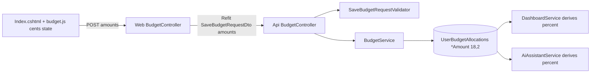

# Spec

> Written with the `to-spec` skill from the grilling session (Q1–Q6). Issue tracker: GitHub Issues on `tngo0508/PersonalFinance`, linked to the GitHub project **PersonalFinance Roadmap** (#7). The spec is published as a parent issue labelled `ready-for-agent`, and `to-tickets` creates the child tickets.

### Problem Statement
In the **Budget Planner**, a user types a category amount such as $700 against their Monthly Income, saves, and the page comes back showing about $699.67. The planner only stores a rounded percentage of income, not the amount the user typed, so the figure the user set is silently changed. Users can't trust that what they enter is what gets recorded. The page also breaks with large figures: long amounts get clipped or push past their cards, the summary list and the input boxes, especially on narrow screens.

### Solution
The Budget Planner records each category's **Allocation Amount** in dollars and cents, exactly as entered, and calculates percentages from it for display only. The slider and percent box still work as shortcuts, but they always land on a whole-cent amount, and the amount is what gets saved. Saving is only allowed when the Allocation Amounts add up to Monthly Income exactly, to the cent, and the page shows the Remaining amount in dollars and percent. Existing saved budgets are converted to amounts once. The layout adapts so any value up to $10,000,000.00 is shown in full, at any screen width from 320px up.

### User Stories
1. As a budgeting user, I want an amount I type (e.g. $700) to be saved as exactly $700.00, so that I can trust my budget.
2. As a budgeting user, I want amounts with cents (e.g. $123.45) kept to the cent, so that my plan matches my real bills.
3. As a budgeting user, I want the amount to look the same after I save and reload, so that I know nothing was changed behind the scenes.
4. As a budgeting user, I want to drag a category slider and get a whole-cent amount, so that the slider stays a quick way to plan.
5. As a budgeting user, I want to type a percentage and have it turned into a whole-cent amount, so that I can plan by share of income.
6. As a budgeting user, I want the percentage next to each category to be calculated from its amount, so that the two never disagree.
7. As a budgeting user, I want my category amounts to stay the same when I change Monthly Income, so that my fixed bills don't shift.
8. As a budgeting user, I want percentages, Remaining and the chart to update right away when I change income, so that I can see the new balance.
9. As a budgeting user, I want to see Remaining in both dollars and percent, so that I know exactly how much is left to allocate.
10. As a budgeting user, I want the status badge to say the budget is fully allocated only when Remaining is exactly $0.00, so that it never hides a leftover cent.
11. As a budgeting user, I want Save blocked with a clear message when my amounts don't add up to income exactly, so that I fix the gap before saving.
12. As a budgeting user, I want Save blocked when Monthly Income is zero, so that I don't save an empty plan.
13. As a budgeting user, I want negative amounts, amounts over $10,000,000 or more than two decimals rejected with a clear message, so that bad input never gets saved.
14. As a budgeting user, I want my entries kept on the page when Save is rejected, so that I don't have to type them again.
15. As a budgeting user with a budget saved earlier, I want it converted to amounts once, so that it still means what I set up.
16. As a budgeting user whose converted budget is off by a cent, I want Remaining to show that cent, so that I can fix it and save.
17. As a budgeting user, I want the category header, summary list, chart and totals to update together after any edit, so that the page is never out of sync.
18. As a phone user (320–480px), I want long amounts like $1,234,567.89 shown in full and wrapped neatly, so that nothing is clipped.
19. As a tablet user, I want category cards laid out so the inputs never squeeze or overflow, so that I can edit comfortably.
20. As a desktop user, I want large incomes shown in full in the income box and the summary, so that I can read my real figures.
21. As a keyboard or screen-reader user, I want the existing labels and visible focus kept on every input and slider, so that the page stays accessible.
22. As a touch user, I want controls at least 44px tall, so that I can tap them easily.
23. As a Dashboard user, I want my budget breakdown percentages calculated from the saved amounts, so that the Dashboard matches the Budget Planner.
24. As an AI Assistant user, I want the assistant to see my budget amounts and percentages, so that its advice uses correct numbers.
25. As a user of the app in any locale, I want the planner to load correctly whatever the server culture is, so that the page never breaks on decimal formatting.

### Implementation Decisions
- **Source of truth:** `UserBudgetAllocation` stores ten per-category Allocation Amounts as `decimal(18,2)`. The ten percentage columns are removed. Percentages are always derived: `income > 0 ? amount × 100 / income : 0`.
- **Schema change:** one EF Core migration adds the amount columns (non-null, default 0), backfills them as `ROUND(MonthlyIncome × Percent / 100, 2)`, then drops the percentage columns. `Down` reverses this. The migration is generated and inspected but not applied to Azure SQL by the agent.
- **Contract:** the Budget allocations DTO keeps its property names. Their meaning changes from percent to dollar amount and is documented in XML docs. Every consumer is inside this solution and changes together, so the Refit interface signature stays the same.
- **Validation (ApiService):** a new FluentValidation validator for the save-budget request, injected into the API Budget controller the same way the Budget Tracker controller injects its validator. Rules: income from 0 to 10,000,000; each amount from 0 to 10,000,000 with at most 2 decimals; income > 0; sum of amounts == income exactly. A failed check returns 400 with the error list.
- **Validation (Web):** the Budget view model mirrors the exact-equality rule for quick feedback. The Web Budget controller maps API 400 errors into ModelState, re-renders the page with the user's input, and uses an error message that matches the rule.
- **Derived consumers:** the Dashboard budget summary, the AI Assistant budget context and Search derive percentages from amounts. The Dashboard summary DTO shape stays the same.
- **Client state:** the planner script holds income and every Allocation Amount as integer cents. Amount input sets cents directly. Percent box or slider sets `round(incomeCents × pct / 100)`. Changing income only changes income. Values are written back to the form as two-decimal strings on submit. Initial data is rendered with invariant culture.
- **Form binding:** the dollar amount input is the model-bound field. The percent box and slider are unbound helper controls.
- **Rendering safety:** summary rows are built with DOM APIs and `textContent`, not HTML string concatenation.
- **Layout:** fluid wrapping instead of abbreviation. The grid uses shrinkable columns and switches to one column earlier. Card headers, controls and summary rows wrap, and inputs grow from a minimum width instead of using fixed widths. The full value is always visible.
- **Versioning and docs:** a Major version bump (schema migration and change in contract meaning). Glossary entries for **Budget Planner** and **Allocation Amount**. Changelog entries under Fixed and Changed.

### Testing Decisions
- **What makes a good test:** it checks behavior a caller can see (what is saved and returned, which requests are rejected and with which errors, what the Dashboard reports), not private helpers or how mapping is done internally.
- **Seam 1 (main, highest):** the ApiService Budget controller with the real budget service and real validator over the EF Core in-memory database. It covers the exact round-trip (700.00, 0.01, 9,999,999.99), validation failures (off by one cent, zero income, three decimals, negative, over the limit) and the 400 response shape. Prior art: `BudgetTrackerControllerTests`, `BudgetTrackerValidatorTests`.
- **Seam 2 (existing):** the Dashboard service over the in-memory database. It checks that budget breakdown percentages come from stored amounts and that zero income gives 0%. Prior art: `DashboardBudgetBreakdownTests`, `DashboardServiceTests`. Existing tests that seed percentage values are updated to seed amounts, keeping what each test checks.
- **Seam 3 (existing):** the Web Budget controller with a mocked Refit client. It checks that an API 400 becomes ModelState errors and the page re-renders with the user's input. Prior art: `BudgetTrackerWebControllerTests`.
- **UI:** browser automation at 375, 768, 1024 and 1440px with $10,000,000 income and $1,234,567.89 amounts, plus the $700 save-and-reload check, when the app can run locally. `npm run lint` must pass.
- **Migration:** inspect the generated migration and snapshot. Prior art for model/migration consistency: `DatabasePersistenceAndMigrationTests`.

### Out of Scope
- Budget Tracker (monthly sheet) behavior and its data.
- Spreadsheet / Google Drive budget sync.
- Adding, renaming or removing budget categories.
- Multi-currency support or currency-symbol localization.
- Applying the migration to any Azure SQL environment.

### Further Notes
- **Root cause:** only percentages were saved, at `decimal(18,2)`. $700 of $3,700 = 18.9189…% was stored as 18.91%, which comes back as $699.67.
- **Backfill rounding:** converted budgets may total ±$0.01 against income. They still load. The user corrects the cent shown in Remaining before saving again.
- **Dropping the percentage columns** is destructive but covered by the backfill and a reversible `Down`. It needs review before deployment.
- **Seams:** the three seams above reuse existing test patterns, and no new test infrastructure is added. If you'd rather have different seams, say so and I'll update this section.

# Requirements

### Overview & Goals
In the Budget Planner (`/Budget`), typing **$700** comes back as **$699.xx** after you save. The page must store and show exactly what the user types, to the cent. Long numbers must also stop clipping and overflowing at any screen size.

**Root cause (confirmed by reading the code):** only *percentages* are saved. `budget.js` turns `$700` into `700×100/income` (e.g. `18.9189…%`). `AppDbContext` maps each `*Percent` column to `decimal(18,2)`, so the value is cut to `18.91%`. On reload, the amount is recalculated as `3700×18.91/100 = 699.67`.

### Decisions settled during grilling
- **Q1 Source of truth:** store the dollar **Allocation Amount** for each category. The percentage is always calculated from it.
- **Q2 Allocation rule:** the sum of allocation amounts must **equal Monthly Income exactly** (to the cent). Enforced on the server.
- **Q3 Long numbers:** a fluid layout that wraps. The full value is always visible; no abbreviations.
- **Q4 Existing data:** backfill amounts from the old percentages, then **drop** the percent columns.
- **Q5 Income change:** dollar amounts **stay fixed**. Percentages and Remaining recalculate.
- **Q6 Percent editing:** the slider and percent box stay editable. Their result is rounded straight to a cent amount, and the amount is what gets saved.

### Scope
**In scope:** Budget Planner page, its JS/CSS, Web and API budget controllers, `BudgetService`, the `UserBudgetAllocation` entity and migration, read-only consumers (`DashboardService`, `AiAssistantService`, `SearchService` if affected), tests, glossary, version, changelog.

**Out of scope:** Budget Tracker (`/BudgetTracker`), spreadsheet sync, and new categories.

### User Stories
- As a user, I want `$700` to stay `$700.00` after saving and reloading, so I can trust my budget.
- As a user, I want to set a category with the slider or a percentage and still end up with an exact cent amount.
- As a user, I want large incomes like `$1,234,567.89` to show in full and never break the layout on phone, tablet, or desktop.

### Functional Requirements
1. Every amount the user types (0.00 to 10,000,000.00, two decimals) is saved and shown back with no change.
2. Editing a percent or the slider sets amount = `round(income × pct / 100, 2)`. The amount box, header amount, summary, chart and totals all update together.
3. Changing Monthly Income keeps amounts as they are. Percentages, Remaining ($ and %), badge and chart recalculate.
4. Remaining shows **dollars and percent**. The badge turns "exact" only when the remaining amount is $0.00.
5. Save is blocked, with a clear message, unless the sum of amounts equals income exactly and income is greater than 0. The check runs in the ApiService validator and is mirrored in the Web controller.
6. Existing saved budgets keep their meaning: amounts are backfilled as `ROUND(income × pct / 100, 2)`.
7. Category cards, header amounts, inputs and summary rows never clip or overflow from 320px up to wide desktop. Values may wrap onto their own line.

### Non-Functional Requirements
- `decimal` everywhere on the server, with `decimal(18,2)` amount columns. JS works in integer cents so no floating-point drift builds up.
- Initial data is rendered with an invariant culture, so the JS keeps working under any server culture.
- Accessibility: existing labels are kept and focus states stay visible. Touch targets are at least 44px.

# Technical Design

### Current Implementation
- `PersonalFinance.Web/Views/Budget/Index.cshtml`: 10 category cards, each with a slider, a percent input (`asp-for`) and an unbound `$` input. Inline `window.budgetInitialData` uses `@Model.X`, which depends on the server culture.
- `wwwroot/js/budget/budget.js`: `currentData` holds **percentages**. The amount input is converted to a percent, and only percents are posted.
- `wwwroot/css/budget.css`: fixed input widths (`75px`/`100px`, shrinking to `65/85px`), `grid-template-columns: repeat(2, 1fr)` (no `minmax(0,…)`), header `.budget-category__amount` set to `nowrap` with no shrink/wrap, and summary `__name` fixed at 85px.
- `Web/Controllers/BudgetController.cs`: `Save` accepts a total in `(0,100]` but the message says "exactly 100%".
- `ApiService/Controllers/BudgetController.cs` → `BudgetService.SaveBudgetAsync`: no validation.
- `Data/AppDbContext.cs` maps `UserBudgetAllocation.*Percent` as `HasPrecision(18,2)`. This truncation is the bug.
- Consumers of `*Percent`: `DashboardService.GetBudgetSummaryAsync` (fills `BudgetSummaryDto.*Percent`), `AiAssistantService` (budget context dictionary), `SearchService`.

### Key Decisions
- **Amount is the source of truth** (Q1/Q4). Percent is never stored. This follows the guideline "avoid storing derived values".
- **Contract semantics:** `BudgetAllocationsDto` keeps its property names (`Housing`, `Food`, …). Their meaning changes to **dollar amounts**, documented in XML docs. Every caller is in this solution, so the change is coordinated and the Refit contract stays stable.
- **Exact-total rule:** `sum(amounts) == MonthlyIncome`, compared as `decimal` after rounding both to 2 places.
- **Validation:** a new FluentValidation `SaveBudgetRequestValidator` in `ApiService/Validators/`, injected into the API `BudgetController` the same way `BudgetTrackerController` does it. It returns `400` with errors. The Web controller mirrors the rule and maps API `400` errors to `ModelState`.
- **JS cents arithmetic:** the JS state stores `incomeCents` and `amountCents[cat]` as integers. Percent = `amountCents / incomeCents × 100`, used for display only.
- **Version:** **Major** bump. This is a schema migration plus a change in contract meaning, as AGENTS.md requires.

### Proposed Changes
**Data**
- `UserBudgetAllocation`: replace the 10 `*Percent` properties with `*Amount` (`decimal`). Map them `HasPrecision(18,2)` in `AppDbContext`.
- New migration `ConvertBudgetAllocationsToAmounts` (AzureSql):
  1. Add the 10 `*Amount` columns, `decimal(18,2)`, NOT NULL, default 0.
  2. Run `migrationBuilder.Sql("UPDATE UserBudgetAllocations SET HousingAmount = ROUND(MonthlyIncome * HousingPercent / 100, 2), …")`.
  3. Drop the `*Percent` columns.
  4. `Down` reverses this: add the percent columns, backfill `CASE WHEN MonthlyIncome > 0 THEN ROUND(amount*100/MonthlyIncome, 2) ELSE 0 END`, then drop the amount columns.
- The migration is **generated and inspected only**, never applied to Azure SQL by the agent.

**ApiService**
- `BudgetService.Get/SaveBudgetAsync` map `*Amount` ⇄ `BudgetAllocationsDto`.
- `DashboardService`: `BudgetSummaryDto.*Percent` is calculated as `income > 0 ? amount*100/income : 0`, so the Dashboard UI does not change. `AiAssistantService` and `SearchService` follow the same pattern.
- `SaveBudgetRequestValidator`: income from 0 to 10,000,000; each amount ≥ 0 with at most 2 decimals; sum == income; income > 0.

**Web**
- `BudgetViewModel`: category properties become amounts, with `[Range(0, 10_000_000)]`. Add `PercentFor(amount)` and `TotalAllocated` / `RemainingAmount`. The `Save` check becomes `TotalAllocated == MonthlyIncome`.
- `Index.cshtml`: the `$` amount input becomes the `asp-for` bound field (`step="0.01"`). The percent input and slider are unbound UI controls. `budgetInitialData` is rendered with `CultureInfo.InvariantCulture` (e.g. `Model.Housing.ToString(CultureInfo.InvariantCulture)`). Remaining shows `$x.xx (y.y%)`.
- `budget.js` refactor (IIFE, const/let, ESLint rules):
  - The state is in cents.
  - Amount input → `amountCents = Math.round(parseFloat(v) * 100)`. No conversion through percent.
  - Percent input or slider → `amountCents = Math.round(incomeCents * pct / 100)`.
  - Income input → only `incomeCents` changes.
  - On submit, amount inputs are written from the state as `(cents/100).toFixed(2)`.
  - Summary rows are built with DOM APIs and `textContent` instead of `innerHTML` string concatenation.

**CSS (`budget.css`)**
- `.budget-categories` → `repeat(2, minmax(0, 1fr))`. Single column below 992px and also when cards are too narrow (`col-lg-8` at 992–1199px is tight). Switch to one column below 1200px if needed.
- Card header: `flex-wrap: wrap; gap`, `min-width: 0` on `__info`. The amount uses `overflow-wrap: anywhere` and may wrap to its own line.
- Controls: `flex-wrap: wrap`. Slider set to `flex: 1 1 100%` on narrow cards. Input groups use `flex: 1 1 auto; min-width: 5.5rem` (percent) / `min-width: 8rem` (amount) instead of fixed widths.
- Income input: `min-width: 0`, so the wrapper never overflows.
- Summary item: name uses `flex: 1 1 auto; min-width: 0`. Values wrap under the bar when space is short. The total row gets `flex-wrap: wrap`.

### Architecture Diagram

### Risks
- **Backfill rounding:** old budgets may now total $0.01 more or less than income. They still load. Saving them requires the user to fix the $0.01 (shown in Remaining).
- **Dropping columns** is destructive but backed by the backfill. The migration must be reviewed before deployment and is not applied by the agent.
- **Floating-point percent from the slider:** handled by integer cents and rounding at each edit.
- **Breaking Refit meaning:** both ends live in the solution and change together. `PersonalFinanceController` simply passes values through.

# Testing

### Validation Approach
Add xUnit tests in `PersonalFinance/tests/PersonalFinance.Tests/` using the in-memory DB pattern (like `DashboardServiceTests.cs`). Then run `dotnet build` and `dotnet test` on the solution and `npm run lint`. Check the UI with the browser skill (`agent-browser`/`playwright-cli`) at 375px, 768px, 1024px and 1440px if the app can run locally.

### Key Scenarios
- Income $3,700, Housing $700 → save → reload → the input shows `700.00` and the header shows `$700`.
- Housing set via percent 33.3333 at income $1,000 → saved amount is `333.33`.
- Income changed from $3,700 to $4,000 → amounts unchanged; percent and Remaining update.
- Saving with sum ≠ income (off by $0.01) is rejected by both the API validator (400) and the Web controller.
- The Dashboard budget summary still shows correct percentages calculated from amounts.

### Edge Cases
- Income 0 → percent shows 0 with no division by zero; save is rejected.
- Amount with 3 decimals or a negative value → validation error.
- Income $10,000,000.00 with amounts like `$1,234,567.89` → no overflow or clipping at 320px.
- Server culture `de-DE` → `budgetInitialData` is still valid JS.

### Test Changes
- New API `BudgetController` tests (real `BudgetService` and validator, in-memory DB, like `BudgetTrackerControllerTests`): amounts round-trip exactly (including 700, 0.01, 9,999,999.99), and requests that break a rule get a 400.
- New `SaveBudgetRequestValidatorTests`: exact-sum, precision, range and zero-income rules.
- Web `BudgetController` test (mocked Refit, like `BudgetTrackerWebControllerTests`): API 400 → ModelState and the page re-renders with the user's input.
- Update `DashboardBudgetBreakdownTests` / `DashboardServiceTests` / `SpreadsheetAnalysisCharacterizationTests` that seed or save `*Percent` values, keeping what each test checks.

# Delivery Steps

### ✓ Step 1: Publish the spec and tickets to GitHub as ready-for-agent
The spec and its tracer-bullet tickets are GitHub issues in the PersonalFinance Roadmap project, ready to hand to an implementation agent.
- Create the spec as a parent GitHub issue (label `ready-for-agent`, assignee `tngo0508`) and add it to project #7.
- Run `to-tickets`: get the user's approval for the breakdown, then create one issue per ticket in dependency order, as sub-issues of the spec, with blocking edges, and add each one to project #7.
- Result: spec #41. The user approved an expand–contract split, which means two migrations instead of one. Tickets: #42 expand (amount columns + backfill), #43 exact round-trip in the planner (← #42), #44 Dashboard derives % (← #42), #45 AI Assistant/Search derive % (← #42), #46 contract: drop percent columns (← #43, #44, #45), #47 exact-total validation (← #43), #48 responsive long numbers (no blockers), #49 docs/version/changelog (← #46, #47, #48). The tickets are the source of truth for implementation order.

> **Current run: `implement-spec` for ticket #42 only** (expand step). Tickets #43–#49 are NOT touched in this run. Ticket #42 has no blockers, so it is on the frontier together with #48. The later tickets (#43 exact round-trip UI, #44 Dashboard, #45 AI/Search, #46 drop percent columns, #47 exact-total validation, #48 responsive layout, #49 docs) stay as separate runs.

### Ticket #42 scope (from the issue)
Add ten `*Amount` columns (`decimal(18,2)`, NOT NULL, default 0) next to the existing `*Percent` columns on `UserBudgetAllocation`, backfill them from the old percentages, and make `BudgetService.SaveBudgetAsync` write the exact amount plus a derived percent. Nothing the user sees changes. The percent columns, the DTO meaning, the Web/JS code, `DashboardService`, `AiAssistantService` and `SearchService` stay as they are.

**Design notes found during investigation**
- Files touched: `Data/Entities/UserBudgetAllocation.cs`, `Data/AppDbContext.cs` (around line 374, `HasPrecision(18, 2)` per property), a new migration in `Data/Migrations/AzureSql/` plus an updated `AzureSqlAppDbContextModelSnapshot.cs`, and `ApiService/Services/BudgetService.cs`.
- In this ticket the request DTO still carries **percentages** (the Web page posts full-precision percents, e.g. 700×100/3700). So `SaveBudgetAsync` computes `amount = Math.Round(MonthlyIncome × pct / 100, 2, MidpointRounding.AwayFromZero)` from the unrounded request percent. Doing it this way means $700 of $3,700 saves as exactly 700.00 even though the stored percent is still truncated to 18.92. This is the expand-phase bridge until #43 changes the DTO to amounts.
- The stored percent keeps its current behavior (`Percent` = request value, written as before). `GetBudgetAsync` and all readers keep returning percents unchanged, which satisfies "existing read paths return the same percentages as before".
- `BudgetService.CheckBudgetAlertsAsync` does not use allocations, so it is not affected.
- The migration is generated with `dotnet ef migrations add AddBudgetAllocationAmounts` for the AzureSql provider, then hand-edited to add a `migrationBuilder.Sql("UPDATE UserBudgetAllocations SET HousingAmount = ROUND(MonthlyIncome * HousingPercent / 100.0, 2), ...")` backfill after the `AddColumn` calls. `Down` drops the ten amount columns. It is inspected only and is **never applied to Azure SQL**.
- Soft-deleted rows: the backfill runs on all rows, including soft-deleted ones (a plain `UPDATE` bypasses the EF query filter), so restored data stays consistent.

### ✓ Step 2: Set up the integration branch and worktree for the spec
An integration branch for spec #41 exists in a `.worktrees/` worktree, per AGENTS.md, and is ready for the ticket branch.
- Read spec #41 and ticket #42 (`gh issue view 41` / `gh issue view 42`); confirm #42 has no open blockers and the frontier is {#42, #48}.
- Create the integration branch (for example `spec/41-budget-planner-exact-amounts`) from `main` as a worktree under `.worktrees/`. Check that the main repo stays on `main`.
- Create the ticket worktree/branch for #42 based on the integration branch (reset onto it if not).
- Per `implement-spec`, an implementer subagent will build the ticket using the `tdd` skill. Exploration notes are not needed because the investigation above covers it.

### ✓ Step 3: Implement ticket #42 with TDD: amount columns, backfill migration and amount-writing save
Saving a $700 budget against $3,700 income stores `HousingAmount = 700.00`, and existing rows are backfilled.
- Red: add a `BudgetServiceTests` class in `PersonalFinance/tests/PersonalFinance.Tests/` (in-memory DB, same helper pattern as `DashboardServiceTests`, with a stub `INotificationService`/`IBudgetDataProvider`). Tests: (a) saving income 3,700 with Housing percent `700m*100/3700` stores `HousingAmount == 700.00m`; (b) all ten categories store `round(income×pct/100, 2)`; (c) zero income stores amounts of 0 with no division error; (d) `GetBudgetAsync` still returns the same percentages as before; (e) a second save of the same period updates the amounts rather than adding a row.
- Green: add the ten `*Amount` properties (with XML docs: "Dollar amount allocated to X") to `UserBudgetAllocation`; map each `HasPrecision(18, 2)` in `AppDbContext`; update `BudgetService.SaveBudgetAsync` to write the amount with a small private helper, keeping the percent writes.
- Generate the migration with `dotnet ef migrations add AddBudgetAllocationAmounts` (AzureSql project and context, following the existing migration commands), add the backfill SQL after the `AddColumn` operations, and write the `Down`.
- Inspect the migration, its `.Designer.cs` and the snapshot diff: only the ten new columns, defaults of 0, no drops, no unrelated changes.
- Add the changelog/version only in ticket #49, not here.
- Run `dotnet build` on the solution and `dotnet test`; fix failures without weakening tests. Also run the migration/model consistency test (`DatabasePersistenceAndMigrationTests`).

### ✓ Step 4: Merge and review ticket #42 on the integration branch
Ticket #42's work is merged on the integration branch, reviewed and ready for the user to review; nothing is applied to Azure SQL.
- Merge the ticket branch into the integration branch with a merger subagent (merge the integration tip into the ticket branch first).
- Run `dotnet build` and `dotnet test` on the integration branch tip.
- Run the `code-review` skill on the integration diff and fix findings in one pass.
- Resolve the ticket the way the tracker closes work: mark #42's acceptance criteria as done and leave the issue to close via the PR (do not close the parent #41). Open a draft PR only if the user asks.
- Clean up the implementer worktree with `git worktree remove`.
- Report: files changed, migration summary (additive only, manual review before deployment), exact build/test commands and results, and that #43–#49 remain, with #43/#44/#45 now unblocked.
- Done: commit `1d590df` on `spec/41-budget-planner-exact-amounts`. Build/test green (402 passed, 1 skipped). All six acceptance boxes ticked on #42 (criterion 4 carries an inline qualification: percent is still the request value in this expand step, not yet derived from amount — that lands in #43/#46). Ticket worktree removed; `feature/budget-allocation-amounts-expand` fast-forwarded to `1d590df` and is redundant. No PR opened. Frontier is now {#43, #44, #45, #48}.

> **Current run: `implement-spec` continues with the unblocked frontier tickets #43, #44, #45 and #48.** #46, #47 and #49 stay blocked until their dependencies land (see Step 1's blocking graph).

### ✓ Step 5: Implement ticket #44 with TDD: Dashboard derives budget percentages from amounts
The Dashboard budget breakdown shows the same percentages, now computed from the stored `*Amount` columns added in #42, with no behavior change visible to the user.
- Create a ticket worktree/branch for #44 based on the integration branch tip (after #42's merge).
- Red: update/extend `DashboardServiceTests` (and `DashboardBudgetBreakdownTests` if that's a separate seam) so they seed `*Amount` values instead of `*Percent`, and assert `BudgetSummaryDto.*Percent` is calculated as `income > 0 ? amount*100/income : 0` (e.g. $700 of $3,700 → ≈18.92%), plus a zero-income case giving 0% with no division error.
- Green: change `DashboardService.GetBudgetSummaryAsync` to read `*Amount` and derive each percent, keeping the `BudgetSummaryDto` shape unchanged.
- Run `dotnet build` and `dotnet test`; merge the integration tip into the ticket branch before reporting done.

### ✓ Step 6: Implement ticket #45 with TDD: AI Assistant and Search derive budget percentages from amounts
The AI Assistant's budget context and Search both read from `*Amount`, with derived percentages, instead of the stored percentages.
- Create a ticket worktree/branch for #45 based on the integration branch tip.
- Red: update the existing AI Assistant budget-context test(s) and any Search test(s) that seed `*Percent` to seed `*Amount` instead, asserting the context/search result includes both the amount and a percent derived from it (0% at zero income).
- Green: update `AiAssistantService`'s budget context builder and `SearchService`'s budget read path to use `*Amount` and compute percent the same way as #44.
- Run `dotnet build` and `dotnet test`; merge the integration tip into the ticket branch before reporting done.

### ✓ Step 7: Implement ticket #43 with TDD: Budget Planner saves and reloads exact Allocation Amounts
Typing $700 on `/Budget`, saving, and reloading shows exactly $700.00, end to end.
- Create a ticket worktree/branch for #43 based on the integration branch tip (after #42, #44 and #45 have merged, since this ticket changes the DTO meaning that those readers now depend on).
- Red: add API `BudgetController` tests (real `BudgetService`, in-memory DB, pattern like `BudgetTrackerControllerTests`) asserting exact round-trips for 700.00, 0.01 and 9,999,999.99 once the DTO carries amounts.
- Green:
  - `BudgetService.Get/SaveBudgetAsync` map `*Amount` ⇄ `BudgetAllocationsDto` directly (no more percent-to-amount bridging); XML docs on the DTO state the values are dollar amounts.
  - `BudgetViewModel`: category properties become amounts; add `PercentFor(amount)` helper for display.
  - `Index.cshtml`: the `$` amount input becomes the `asp-for` bound field (`step="0.01"`); percent input and slider become unbound UI controls; `budgetInitialData` is rendered with `CultureInfo.InvariantCulture`.
  - `budget.js` refactor to integer-cents state: amount input sets `amountCents` directly; percent/slider sets `amountCents = round(incomeCents * pct / 100)`; income change only changes `incomeCents`; amounts post as two-decimal strings; summary rows built with DOM APIs and `textContent`.
- Manual/browser check: $700 of $3,700 → save → reload shows 700.00; 33.3333% of $1,000 saves as 333.33.
- Run `dotnet build`, `dotnet test` and `npm run lint`; merge the integration tip into the ticket branch before reporting done.

### ✓ Step 8: Implement ticket #48 with TDD: long numbers display in full at every screen width
Category cards, header amounts, inputs, the income box and the summary list show full values without clipping from 320px to desktop (independent of #42–#47; can run in parallel).
- Create a ticket worktree/branch for #48 based on the integration branch tip.
- Update `budget.css`: `.budget-categories` grid uses `repeat(2, minmax(0, 1fr))` with an earlier single-column breakpoint; card header/info/controls get `flex-wrap: wrap` and `min-width: 0`; header amount uses `overflow-wrap: anywhere`; input groups use `flex: 1 1 auto; min-width` instead of fixed widths; slider takes a full row on narrow cards; income input gets `min-width: 0`; summary name column is flexible, values can wrap, and the total row wraps; touch targets stay ≥44px.
- Browser check at 375/768/1024/1440px with $10,000,000 income and $1,234,567.89 amounts: no clipping or horizontal overflow.
- Run `npm run lint`; merge the integration tip into the ticket branch before reporting done.

### ✓ Step 9: Merge #43, #44, #45 and #48 onto the integration branch
All four tickets land together on the integration branch, keeping it green and unblocking #46 and #47.
- Merge each ticket branch into the integration branch with a merger subagent, in dependency order (#44 and #45 before #43, since #43 depends on their readers already using amounts; #48 can merge any time).
- Run `dotnet build`, `dotnet test` and `npm run lint` on the integration tip after each merge.
- Resolve each ticket the way the tracker closes work: tick its acceptance boxes, leave it open for the PR unless asked otherwise.
- Clean up each implementer worktree with `git worktree remove`.
- Report the new frontier: {#46, #47} (both now unblocked).

### ✓ Step 10: Implement and merge ticket #47 with TDD: save only when amounts equal income exactly
Save is blocked, with a clear message, unless Allocation Amounts sum to Monthly Income exactly and income is greater than zero.
- Create a ticket worktree/branch for #47 based on the integration tip (after Step 9).
- Red: add `SaveBudgetRequestValidatorTests` (exact-sum, off-by-one-cent, zero income, three decimals, negative, over-limit) and a Web `BudgetController` test (mocked Refit, like `BudgetTrackerWebControllerTests`) asserting an API 400 becomes `ModelState` errors with the user's input preserved.
- Green: add `SaveBudgetRequestValidator` (FluentValidation) in `ApiService/Validators/`, injected into the API `BudgetController` like `BudgetTrackerController`; mirror the exact-equality rule in `BudgetViewModel`; map API 400 errors to `ModelState` in the Web `BudgetController`; show Remaining as `$x.xx (y.y%)`; the exact badge appears only at $0.00 remaining.
- Run `dotnet build`, `dotnet test` and `npm run lint`; merge into the integration branch; tick #47's acceptance boxes.

### ✓ Step 11: Implement and merge ticket #46 with TDD: drop the stored percentage columns (contract)
The percentage columns and properties are removed; Allocation Amounts become the only source of truth, with no visible behavior change.
- Create a ticket worktree/branch for #46 based on the integration tip (after Step 9, and ideally after #47 to avoid rework).
- Confirm no remaining code reads or writes `*Percent` (grep the integration tip after #43/#44/#45 land).
- Remove the ten `*Percent` properties from `UserBudgetAllocation` and its `AppDbContext` mapping.
- Generate a migration (`dotnet ef migrations add RemoveBudgetAllocationPercentages`) that drops the ten percent columns; write a `Down` that re-adds them and backfills `CASE WHEN MonthlyIncome > 0 THEN ROUND(amount*100/MonthlyIncome, 2) ELSE 0 END`.
- Inspect the migration and snapshot diff; call out the destructive drop for review before deployment. Not applied to Azure SQL.
- Run `dotnet build` and `dotnet test`; merge into the integration branch; tick #46's acceptance boxes.

### ✓ Step 12: Implement ticket #49: document the amount-based Budget Planner and finish the spec
The glossary, version and changelog reflect the amount-based Budget Planner, and the integration branch is ready for final review.
- Create a ticket worktree/branch for #49 based on the integration tip (after #46 and #47 merge; #48 is already in).
- Add **Budget Planner** and **Allocation Amount** entries to `GLOSSARY.md`.
- Bump the Major version in `PersonalFinance.Shared/Constants/AppVersion.cs` (schema migration + contract-meaning change), resetting Minor and Patch to 0.
- Add `CHANGELOG.md` `[Unreleased]` entries: **Fixed** ($700 no longer becomes $699.xx; long numbers no longer clip) and **Changed** (amounts are the source of truth; exact-total validation on save).
- Merge into the integration branch; run `dotnet build` and `dotnet test` once more on the final tip.
- Run the `code-review` skill on the full integration diff (spanning #42–#49) and fix findings in one pass.
- Tick #49's acceptance boxes. Report the final integration branch tip, that no PR was opened unless requested, and that the migrations still need manual review before any Azure SQL deployment.