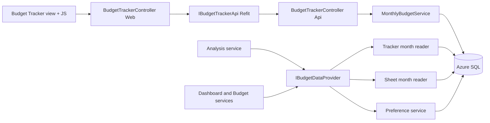

# Spec

### Problem Statement

Users keep their household budget in a Google Drive sheet and the app only reads it back for analysis. To record
spending, income, planned amounts or differences, they must open Google Drive and edit the sheet by hand. There is no
way to enter or maintain a monthly budget inside the application, and the data the app reads is only as current as the
last manual edit and sync.

### Solution

A **Budget Tracker** page inside the application reproduces the layout and behavior of the Google monthly budget sheet:
a Summary tab (planned vs actual per category, expenses and income, differences, totals) and a Transactions tab (dated
expense and income entries). Users enter everything on the site, and it is stored in Azure SQL. The Google sheet is used
only as a reference for layout and rules; nothing is written to Google Drive. Analysis and the Dashboard budget views
can show either the synced Google sheet or the Budget Tracker data, and the user chooses which one.

### User Stories

1. As a budget owner, I want to open a Budget Tracker page for any month, so that I can manage that month's budget
   inside the app.
2. As a budget owner, I want to move to the previous or next month with arrows and pick a month and year directly, so
   that I can review any period quickly.
3. As a budget owner, I want to see Planned, Actual and Diff for every expense category on the Summary tab, so that I
   know where I am over or under budget.
4. As a budget owner, I want to see Planned, Actual and Diff for every income category on the Summary tab, so that I
   know whether my income meets the plan.
5. As a budget owner, I want Expense Diff to show Planned minus Actual, so that a positive number means I am under
   budget.
6. As a budget owner, I want Income Diff to show Actual minus Planned, so that a positive number means I earned more
   than planned.
7. As a budget owner, I want a zero Diff to look neutral, so that balanced categories are not mistaken for problems.
8. As a budget owner, I want totals for Planned, Actual and Diff under each table, so that I see the whole month at a
   glance.
9. As a budget owner, I want horizontal bars comparing Planned and Actual for expenses and for income, so that I can
   compare them visually.
10. As a budget owner, I want to type a Planned amount for each category in the month, so that the plan matches what I
    intend to spend or earn.
11. As a budget owner, I want Planned edits to save immediately and update the totals and bars, so that I do not have to
    reload the page.
12. As a budget owner, I want to add a transaction with a date, amount, description and category, so that spending and
    income are recorded.
13. As a budget owner, I want the transaction's type to follow its category, so that I cannot record an expense in an
    income category by mistake.
14. As a budget owner, I want to edit an existing transaction in place, so that I can correct mistakes quickly.
15. As a budget owner, I want to delete a transaction after confirming, so that accidental deletions are prevented.
16. As a budget owner, I want the Transactions tab to show expenses and income side by side, sorted by date, so that I
    can scan the month like the sheet.
17. As a budget owner, I want a transaction to appear in the month that matches its date, so that I never have to pick a
    month separately.
18. As a budget owner, I want moving a transaction to another date to move it to that month's totals automatically, so
    that the numbers stay correct.
19. As a budget owner, I want Actual for a category to equal the sum of that category's transactions in the month, so
    that I do not have to type totals.
20. As a budget owner, I want to type an Actual amount for a category that has no transactions to record spending
    without itemizing it, so that I can use the tracker as a simple summary.
21. As a budget owner, I want a typed Actual to replace the transaction sum for that category and month, with a visible
    manual badge, so that I always know the number came from a manual entry.
22. As a budget owner, I want to revert a manual Actual back to the transaction sum with one action, so that I can
    return to itemized tracking.
23. As a budget owner, I want to open a month that has no plan yet and choose to copy the planned amounts from the most
    recent earlier month or start blank, so that setting up a new month is quick.
24. As a budget owner, I want the copy option to be offered only when an earlier month exists, so that I am never
    offered an impossible choice.
25. As a budget owner, I want copying a plan to copy only Planned amounts and not transactions or overrides, so that
    actuals are never duplicated.
26. As a budget owner, I want the default expense and income categories created for me the first time I open the
    tracker, so that I can start immediately.
27. As a budget owner, I want to add my own expense category, so that my spending fits the way I track it.
28. As a budget owner, I want to add my own income category, so that every income source has a place.
29. As a budget owner, I want to rename a category, so that names stay accurate.
30. As a budget owner, I want to reorder categories, so that the most important ones appear first.
31. As a budget owner, I want category names to be unique within expenses or income (ignoring letter case), so that
    totals are unambiguous.
32. As a budget owner, I want to delete a category without losing history, so that past months keep their numbers and
    names.
33. As a budget owner, I want a deleted category to disappear from new months and from the transaction category list, so
    that I stop using it.
34. As a budget owner, I want a deleted category to remain visible with its name in past months that used it, so that
    historical totals still make sense.
35. As a budget owner, I want clear messages when I enter an invalid amount, date, description or category name, so that
    I can fix the problem quickly.
36. As a budget owner, I want amounts limited to two decimal places and above zero for transactions, so that the money
    values are precise and meaningful.
37. As a budget owner, I want to see a loading state while data is fetched and a clear message when something fails, so
    that I know what is happening.
38. As a budget owner, I want an empty state for a month with no entries, so that I know the month exists but has
    nothing recorded.
39. As a budget owner, I want to use the tracker with a keyboard and screen reader, so that the page is accessible.
40. As a budget owner, I want the tables to scroll sideways on a phone, so that I can still read every column.
41. As a budget owner, I want my data hidden from other users, so that my finances stay private.
42. As a budget owner, I want to choose whether Analysis uses my Google sheet or my Budget Tracker data, so that I can
    see whichever data I trust.
43. As a budget owner, I want the same choice on the Dashboard budget card, so that the numbers on the dashboard match
    the chosen source.
44. As a budget owner, I want the source switch to keep the same month or period I am viewing, so that I do not lose my
    place.
45. As a budget owner, I want my source choice remembered across visits, so that I do not have to switch every time.
46. As an existing user with synced Google sheet data, I want Analysis and the Dashboard to keep showing the sheet by
    default, so that nothing changes for me until I choose.
47. As a new user without a sheet sync, I want Analysis and the Dashboard to default to the Budget Tracker, so that the
    app is useful immediately.
48. As a budget owner, I want a clear message naming the active source when it has no data for the month, with links to
    add data or to switch source, so that I know why the page is empty.
49. As a budget owner, I want the app never to mix Google sheet numbers with Budget Tracker numbers silently, so that
    the figures I see always come from one source.
50. As a budget owner, I want the page to show which source is active everywhere Analysis or Dashboard budget numbers
    appear, so that I always know the origin of the numbers.
51. As a budget owner, I want the Google sheet sync to keep working exactly as before, so that the existing analysis is
    not disrupted.
52. As a budget owner, I want global search to keep working as before, so that this release does not change search
    results.

### Implementation Decisions

- **Two separate data stores.** Budget Tracker data lives in new, user-owned tables. Synced Google sheet tables are not
  changed or reused, so a sync cannot overwrite manual entries.
- **New concepts stored.** Budget categories (per user, with kind expense or income, a sort position and archive
  status), monthly plans (one per user and month), monthly plan lines (planned amount and optional manual actual per
  category and month), budget transactions (date, amount, description, category), and a per-user source preference.
- **Month is derived from date.** Transactions carry no month reference. A month's transactions are those whose date
  falls in that calendar month, queried as a date range.
- **Actual rule.** The effective Actual for a category and month is the manual override when present, otherwise the sum
  of transactions for that category in that month. This rule is computed in one server-side place and used everywhere.
- **Diff rule.** Diff is never stored. Expense Diff is Planned minus Actual; Income Diff is Actual minus Planned. Totals
  are sums of the rows.
- **Money.** Amounts are exact decimal values with two decimal places. No floating point arithmetic for money.
- **Default categories.** The sheet's default expense and income categories are created for a user the first time the
  tracker is opened. Creation is idempotent.
- **Category lifecycle.** Deleting a category archives it. Archived categories are excluded from new entries and from
  months that have no data for them, and remain visible with their names in months that have plan lines, overrides or
  transactions.
- **Copy from previous month.** Initializing a month can copy Planned amounts from the nearest earlier month that has a
  plan. It never copies transactions or overrides.
- **Entry behavior.** Edits are sent as small server calls. After each successful change the page re-renders from the
  server's totals and bars rather than computing totals on the client.
- **Source selection through a single read path.** Analysis and the Dashboard budget views obtain their month data
  through one provider that returns a common normalized shape. The provider resolves the user's source and reads either
  the synced tables or the Budget Tracker tables. Each month comes from exactly one source; there is no per-month
  fallback.
- **Default source.** If no preference is stored, the source is the Google sheet when the user has synced sheet data,
  otherwise the Budget Tracker. The default is resolved at read time and stored only when the user explicitly switches.
- **Source switch.** One shared endpoint reads and writes the preference. The same segmented control appears on the
  Analysis header and in the Dashboard budget area.
- **Unchanged.** Google Drive sync, the synced data model, global search and the Budget Planner percentage allocator
  keep their current behavior.
- **Authorization.** Every Budget Tracker endpoint requires an authenticated user, and every read and write is
  restricted to that user's data.
- **Naming.** The user-facing name is Budget Tracker (route and nav entry). Internal names carry the MonthlyBudget or
  BudgetTracker prefix as appropriate.
- **No import** of synced sheet data into Budget Tracker in this release.
- **Glossary and decision record.** The domain terms are added to the glossary without implementation detail, and the
  choice of separate data stores with a source-selected provider is recorded as an architecture decision.

### Testing Decisions

- **What makes a good test here.** Tests assert externally visible results of the Budget Tracker service and the source
  provider (totals, diffs, membership by date, default source resolution, ownership, validation outcomes), not internal
  query shapes or the exact order of private helper calls.
- **Seams.** The highest practical seam is the service interface layer of the API service. Tests call the Budget Tracker
  service, the source service and the provider directly against an in-memory database, as the existing Dashboard tests
  do. Controllers and the Web layer are covered by build, lint and an end-to-end smoke check where available.
- **Modules to test.** Sheet calculation (actual, diff, totals, archived visibility), month membership and boundaries,
  month initialization (copy versus blank), category rules (defaults, uniqueness, archive), transaction rules (amount,
  date, category kind), ownership isolation, source default and preference resolution, the provider's no-fallback rule,
  and a characterization of the existing sheet path in Analysis and the Dashboard before and after the refactor.
- **Prior art.** The Dashboard budget breakdown tests that use an in-memory database and seeded users.
- **Not tested.** Pixel layout and chart rendering are verified manually or through the smoke check, not unit tests.

### Out of Scope

- Writing to or importing from Google Drive, including one-time import of synced sheet months.
- Global search over Budget Tracker transactions.
- Recurring transactions, CSV import or export, multi-currency, and attachments.
- Any change to the Budget Planner percentage allocator, Google sync logic, or synced data model.
- Mixing sources within one month or one view.

### Further Notes

- **Issue tracker not published.** This spec is recorded in the plan only. No issue tracker is configured for this
  repository (no `docs/agents/issue-tracker.md` exists), so nothing was published and no triage label was applied. Run
  the setup skill for the matt-pocock workflow to configure one, then publish.
- **Version bump.** AGENTS.md lists database schema changes under Major bumps, while this release adds tables without
  breaking existing ones. The delivery plan assumes a Minor bump; confirm the bump level at release time.
- **Decision record candidates.** Separate data stores and the source-selected provider are hard to reverse and were
  chosen over reusing synced tables, so they warrant an ADR.

# Requirements

### Overview & Goals

Add an in-app **Budget Tracker** that reproduces the layout and behavior of the user's Google "Monthly budget" sheet
(the *Summary* and *Transactions* tabs), so users enter planned amounts, transactions, income, expenses and overrides
directly on the site. Data lives in Azure SQL. Nothing is written to Google Drive; the sheet is only a layout/behavior
reference. Analysis and the Dashboard can read either the synced Google Sheet or the Budget Tracker data, chosen by the
user.

### Settled Decisions (from the design interview)

| #      | Decision                                                                                                                                                                                                                                                                                                                                                            |
|--------|---------------------------------------------------------------------------------------------------------------------------------------------------------------------------------------------------------------------------------------------------------------------------------------------------------------------------------------------------------------------|
| Q1/Q4  | **Actual** = sum of the month's transactions for the category by default. Typing an Actual creates an explicit **Actual Override** for that category and month ("manual" badge, one-click *Revert to transactions*). Overrides never add to or silently conflict with transactions. **Diff** is always calculated, never typed.                                     |
| Q2     | New, separate user-owned entities in Azure SQL. The `Spreadsheet*` (synced) tables are untouched.                                                                                                                                                                                                                                                                   |
| Q3/Q12 | New dedicated page labelled **Budget Tracker** at `/BudgetTracker`, with two tabs: **Summary** and **Transactions**, driven by one month selector. Existing *Budget Planner* and *Spreadsheet Analysis* keep their names.                                                                                                                                           |
| Q5     | Per-user, editable category list seeded from the sheet's defaults (Expenses: Food, Gifts, Health/medical, Home, Transportation, Personal, Pets, Utilities, Travel, Debt, Other; Income: Savings, Paycheck, Bonus, Interest, Other). Users can add custom Expense and Income categories, rename and reorder them. Planned amounts are stored per category per month. |
| Q6     | Opening a month with no plan prompts the user: *Copy planned amounts from <previous month>* (offered only if an earlier month exists) or *Start blank*.                                                                                                                                                                                                             |
| Q7     | A transaction belongs to a month purely by its required **Date**; there is no separate month link. Editing the date moves it.                                                                                                                                                                                                                                       |
| Q8     | Deleting a category soft-deletes it: hidden from new entries and from months with no data for it, still shown (with its name) on months where it has planned amounts, an override or transactions.                                                                                                                                                                  |
| Q9     | Entry is in place via AJAX (modal / inline row editing). After every change the page re-renders from the server's authoritative totals and bars.                                                                                                                                                                                                                    |
| Q10a/b | **User chooses the source** for **Analysis** and the **Dashboard** (budget breakdown and recent transactions). Global search stays on synced data.                                                                                                                                                                                                                  |
| Q11    | No import of synced Google data into Budget Tracker tables.                                                                                                                                                                                                                                                                                                         |
| Q13    | Default source: *Google Sheet* if the user has synced snapshots, otherwise *Budget Tracker*. The default is resolved at read time and persisted only when the user switches.                                                                                                                                                                                        |
| Q14    | A segmented control **Data source: Google Sheet \| Budget Tracker** in the Analysis header and the Dashboard budget card, both posting to one shared endpoint.                                                                                                                                                                                                      |
| Q15    | If the active source has no data for the month, show an empty state naming the source with links to add data or switch. **Never fall back silently to the other source.**                                                                                                                                                                                           |

### Scope

**In scope:** Budget Tracker data model, API, page (Summary + Transactions), category management, source preference,
Analysis and Dashboard reading the active source, glossary and ADR updates, version bump, changelog.

**Out of scope:** writing to Google Drive; importing synced data; global search over tracker data; recurring
transactions, CSV import/export; multi-currency; changes to Budget Planner (percentage allocator).

### User Stories

- As a user, I enter planned amounts per expense and income category for a month so that I see Planned vs Actual vs Diff
  like my sheet.
- As a user, I add, edit and delete transactions (date, amount, description, category) so that Actuals update
  automatically.
- As a user, I override a category's Actual when I do not want to log transactions, and revert it later.
- As a user, I add custom categories so that the tracker fits my budget.
- As a user, I choose whether Analysis and the Dashboard use my Google Sheet or my Budget Tracker data.

### Functional Requirements

- **Summary tab** (mirrors the sheet): two horizontal bar pairs (Planned and Actual for Expenses and for Income), and
  two tables (Expenses, Income) with columns *Category, Planned, Actual, Diff*, a *Totals* row, and an *Add category*
  row. Diff sign convention follows the sheet: **Expenses: Planned − Actual** (positive = under budget, blue; negative =
  over, red). **Income: Actual − Planned**. Zero shows neutral.
- **Transactions tab:** side-by-side Expenses and Income lists (*Date, Amount, Description, Category dropdown*), sorted
  by date then id, with add, inline edit and delete (confirmation on delete). A transaction's type (Expense or Income)
  comes from its category's kind, so it cannot disagree.
- **Validation:** Amount > 0 and at most 2 decimals; Date required; Description max 200 chars; Category must be an
  active category of the user; category name 1–100 chars, unique per user and kind (case-insensitive); planned and
  override amounts are ≥ 0. All checked server-side.
- **Month selector:** previous/next month plus month and year pickers. Empty, loading and error states are handled.
  Currency formatting follows the app's existing `$` convention.
- **Source control:** changing the source reloads Analysis or Dashboard data for the same period and persists the
  preference.
- **Security:** `[Authorize]` on all endpoints; every query scoped by `UserId`; anti-forgery token on state-changing
  AJAX calls.

### Non-Functional Requirements

- Money is `decimal(18,2)`. All calculations are server-side.
- Responsive layout; tables scroll horizontally on mobile; controls are keyboard-accessible with labels.
- No new NuGet packages.

# Technical Design

### Current Implementation

- **Layers:** `PersonalFinance.Web` (MVC + Refit clients) → `PersonalFinance.ApiService` (controllers + services +
  FluentValidation) → `PersonalFinance.Data` (`AppDbContext`, `Migrations/AzureSql/`) with DTOs and Refit contracts in
  `PersonalFinance.Shared`. User identity reaches the API through the `X-User-Id` handler.
- **Synced data:** `SpreadsheetBudgetSnapshot` (per file and month, with `CategoryBreakdownJson`) and
  `SpreadsheetTransactionRecord`. Both are `AuditableEntity` with soft-delete query filters in `AppDbContext`.
- **Consumers of synced data:** `SpreadsheetAnalysisService` (about 11 read queries; also does sync), `BudgetService`
  (Dashboard budget breakdown by `yyyy-MM`), `DashboardService` (recent transactions), `SearchService`. Web side:
  `AnalysisController` calls `IPersonalFinanceApi.GetAnalysisDashboardAsync`; `Views/Analysis/Index.cshtml` renders it
  with Chart.js.
- **Existing pattern to copy:** `AnalysisController` / `BudgetController` (thin Web controllers calling Refit), services
  registered in `ApiService/Program.cs`, Refit clients registered in `Web/Program.cs`, JS under `wwwroot/js/<feature>/`.
- **No tests** exist for `SpreadsheetAnalysisService`; the test project uses `UseInMemoryDatabase` (e.g.
  `DashboardBudgetBreakdownTests`).

### Key Decisions

1. **Separate entities, no reuse of `Spreadsheet*` tables** (ADR candidate: hard to reverse, surprising, real
   trade-off). Sync rewrites snapshot rows, so manual data there would be overwritten.
2. **Actual Override stored on the monthly line** (`ActualOverride` nullable). The effective Actual is
   `ActualOverride ?? SUM(transactions in month for category)`, computed in one place (`MonthlyBudgetService`).
3. **Transactions are month-less:** the month is a date-range predicate `Date >= first AND Date < nextFirst` (sargable).
   Use `DateOnly`.
4. **Archived categories** use `AuditableEntity` soft delete. Because history must still show the name, sheet reads use
   `IgnoreQueryFilters()` on categories and include an archived category in a month only if it has a line with data, an
   override or transactions that month.
5. **Source selection through one provider abstraction.** `SpreadsheetAnalysisService` read paths, `BudgetService` and
   `DashboardService` stop querying `Spreadsheet*` directly and call `IBudgetDataProvider`. It resolves the user's
   preference and delegates to one of two `IBudgetMonthReader` implementations that both return the same normalized
   model. Sync methods in `SpreadsheetAnalysisService` stay untouched.
6. **Preference stored in a new `UserBudgetSourcePreference` entity** (no user-settings entity exists). Absent row means
   the default rule (synced snapshots exist → Google Sheet, else Budget Tracker).
7. **Direct service injection and Refit** per AGENTS.md; no MediatR or AutoMapper; manual mapping extensions.

### Architecture Diagram



### Data Models / Contracts

**Entities** (`PersonalFinance.Data/Entities/`, all `AuditableEntity`, soft-delete filters added in `AppDbContext`;
migration in `Migrations/AzureSql/`):

```csharp
public enum BudgetCategoryKind { Expense = 1, Income = 2 }
public enum BudgetDataSource { GoogleSheet = 1, BudgetTracker = 2 }

public class BudgetCategory : AuditableEntity        // unique (UserId, Kind, Name) filtered on IsDeleted = 0
{ string Name /*100*/; BudgetCategoryKind Kind; int SortOrder; }

public class MonthlyBudgetPlan : AuditableEntity     // unique (UserId, Year, Month) filtered
{ int Year; int Month; ICollection<MonthlyBudgetLine> Lines; }

public class MonthlyBudgetLine : AuditableEntity     // unique (PlanId, CategoryId) filtered
{ int PlanId; int CategoryId; decimal PlannedAmount /*18,2*/; decimal? ActualOverride /*18,2*/; }

public class BudgetTransaction : AuditableEntity     // index (UserId, Date)
{ int CategoryId; DateOnly Date; decimal Amount /*18,2, >0*/; string Description /*200*/; }

public class UserBudgetSourcePreference : AuditableEntity // unique (UserId) filtered
{ BudgetDataSource Source; }
```

Default categories are seeded per user lazily on first Budget Tracker access (idempotent, inside a transaction).

**DTOs** (`PersonalFinance.Shared/DTOs/BudgetTracker/`):

```csharp
MonthlyBudgetSheetDto { int Year; int Month; string MonthName; bool IsInitialized;
  bool CanCopyFromPrevious; string? PreviousMonthLabel;
  SheetSectionDto Expenses; SheetSectionDto Income; List<BudgetTransactionDto> Transactions; }
SheetSectionDto { List<SheetRowDto> Rows; decimal TotalPlanned, TotalActual, TotalDiff; }
SheetRowDto { int CategoryId; string Name; decimal Planned, Actual, Diff; bool ActualIsOverride; bool IsArchived; }
BudgetTransactionDto { int Id; DateOnly Date; decimal Amount; string Description; int CategoryId; string CategoryName; BudgetCategoryKind Kind; }
// requests: InitializeMonthRequest(Year, Month, CopyFromPrevious), SetPlannedRequest, SetActualOverrideRequest(decimal? Amount),
// SaveCategoryRequest(Name, Kind, SortOrder), SaveTransactionRequest(Date, Amount, Description, CategoryId),
// BudgetDataSourceDto(Source, IsDefault)
```

**API** (`ApiService/Controllers/BudgetTrackerController.cs`, route `api/budget-tracker`, contract
`Shared/Contracts/IBudgetTrackerApi.cs`):

- `GET sheet?year&month`; `POST months` (initialize)
- `PUT months/{year}/{month}/lines/{categoryId}/planned`; `PUT .../actual-override` (null reverts)
- `GET/POST categories`; `PUT/DELETE categories/{id}`
- `POST transactions`; `PUT/DELETE transactions/{id}`
- `GET/PUT data-source` (shared by Analysis and Dashboard controls)

Errors map to `BadRequest` (validation), `NotFound` (missing or not owned), `Conflict` (duplicate category name).

**Normalized read model** (`ApiService/Services/`, internal to ApiService):

```csharp
public interface IBudgetMonthReader {
  Task<List<BudgetMonthData>> GetMonthsAsync(string userId, int year, CancellationToken ct);
  Task<BudgetMonthData?> GetMonthAsync(string userId, int year, int month, CancellationToken ct);
  Task<List<BudgetTransactionData>> GetTransactionsAsync(string userId, DateOnly from, DateOnly to, int? take, CancellationToken ct);
  Task<List<int>> GetAvailableYearsAsync(string userId, CancellationToken ct);
}
// BudgetMonthData: Year, Month, BudgetedIncome/ActualIncome, BudgetedExpenses/ActualExpenses, Categories[Name, Budgeted, Actual]
public interface IBudgetDataProvider : IBudgetMonthReader { Task<BudgetDataSource> GetActiveSourceAsync(string userId, CancellationToken ct); }
```

`SheetBudgetMonthReader` wraps the current snapshot and `CategoryBreakdownJson` logic (behavior-preserving).
`TrackerBudgetMonthReader` builds the same shape from the new tables using the Actual rules above.

### Proposed Changes

- **Data:** new entities, `AppDbContext` DbSets, query filters, precision/length/index configuration, new `AzureSql`
  migration (reviewed for non-destructive SQL).
- **ApiService:** `IMonthlyBudgetService`/`MonthlyBudgetService` (sheet assembly, month initialization,
  planned/override, category and transaction CRUD, default seeding), `IBudgetDataSourceService`, `IBudgetDataProvider`,
  the two readers, `Validators/` FluentValidation validators for each request, `BudgetTrackerController`; DI
  registrations in `Program.cs`. Refactor `SpreadsheetAnalysisService` read methods, `BudgetService` and
  `DashboardService` to use `IBudgetDataProvider`. Update the manual factory registration of
  `SpreadsheetAnalysisService` accordingly.
- **Shared:** DTOs, `IBudgetTrackerApi`, source DTO.
- **Web:** `BudgetTrackerController` (view + JSON actions that forward to Refit; CSRF-protected),
  `Views/BudgetTracker/Index.cshtml` (+ partials for the Summary and Transactions tabs and the new-month prompt),
  `wwwroot/js/budget-tracker/budget-tracker.js` (IIFE module, ESLint-compliant, `textContent` rendering, request
  sequencing to avoid stale responses), CSS in the page's `Styles` section following the `analysis-*` conventions with a
  `bt-*` prefix, nav link, Refit registration in `Web/Program.cs`. Add the segmented source control partial
  (`_DataSourceToggle.cshtml`) to `Views/Analysis/Index.cshtml` and the Dashboard budget card view
  (`Views/Dashboard/_KeyFigureBudget.cshtml` area), plus source-named empty states.
- **Docs/versioning:** GLOSSARY terms (Budget Tracker, Planned, Actual, Actual Override, Diff, Budget Category, Budget
  Transaction, Data Source; glossary kept free of implementation detail); ADR
  `docs/adr/0002-budget-tracker-separate-from-spreadsheet-data.md` (separate entities plus source-selected provider);
  `AppVersion.cs` minor bump; `CHANGELOG.md` entry under `[Unreleased]`.

### Risks

- **Analysis refactor regression** (no existing tests): add characterization tests for the sheet path *before* switching
  `SpreadsheetAnalysisService` to the provider.
- **Soft-deleted category lookups** returning null names: covered by `IgnoreQueryFilters()` in sheet reads and tested.
- **Concurrent first-visit seeding** creating duplicate categories: unique filtered index plus idempotent seeding that
  tolerates a unique-violation retry.
- **Filtered unique indexes** across SQL Server and the SQLite dev provider: use the same bracket-quoted filter that
  both accept, and verify the migration snapshot builds.
- **Mixed numbers confusion:** prevented by no silent fallback and an always-visible active-source label.
- Month-less transactions: a transaction dated in a never-initialized month still counts toward that month's Actual once
  the plan exists, and is shown on the Transactions tab.

# Testing

### Validation Approach

xUnit tests in `tests/PersonalFinance.Tests` using `UseInMemoryDatabase` like the existing Dashboard tests. Run
`dotnet build PersonalFinance.sln` and `dotnet test`, then ESLint on the new JS file. Add or adjust only; no existing
tests weakened.

### Key Scenarios

- **Sheet math:** Actual equals the transaction sum; Diff for Expenses is Planned − Actual and for Income is Actual −
  Planned; totals equal row sums; an override replaces the transaction sum; reverting restores it.
- **Month membership:** transactions on the 1st and last day of a month land in that month; editing the date moves a
  transaction; boundary between December and January is correct.
- **Month initialization:** copy-from-previous copies planned amounts only (never overrides or transactions); blank
  creates zeros; `CanCopyFromPrevious` is false for the first month.
- **Categories:** defaults seeded once and idempotently; duplicate names (case-insensitive) rejected; deleting a
  category hides it from new months but keeps it on months with data.
- **Ownership:** a user cannot read or modify another user's categories, lines or transactions (NotFound).
- **Source provider:** the default is the sheet when snapshots exist, otherwise the tracker; an explicit preference
  wins; switching changes Analysis and Dashboard output; no fallback when the active source is empty.
- **Characterization:** the sheet path of Analysis and Dashboard returns the same results before and after the refactor.

### Edge Cases

Zero and very large amounts, 3-decimal input rejected, negative or zero transaction amount rejected, missing date,
transaction in an archived category rejected, category kind mismatch, double-submit of month initialization
(idempotent), override of 0 versus no override.

### Test Changes

New: `MonthlyBudgetSheetCalculationTests`, `MonthlyBudgetTransactionTests`, `BudgetCategoryTests`,
`MonthlyBudgetInitializationTests`, `BudgetDataProviderTests`, `SpreadsheetAnalysisCharacterizationTests`, validator
tests. Existing Dashboard tests are updated only where constructor signatures change.

# Tickets

Tickets are published as local files under `.scratch/budget-tracker/issues/` (no issue tracker configured).

| #  | Ticket                                                                                                                                     | Blocked by | Status |
|----|--------------------------------------------------------------------------------------------------------------------------------------------|------------|--------|
| 01 | [Monthly Budget service, validators, and API endpoints](.scratch/budget-tracker/issues/01-monthly-budget-api.md)                           | None       | closed |
| 02 | [Budget Tracker page — Summary and Transactions tabs](.scratch/budget-tracker/issues/02-budget-tracker-page.md)                            | 01         | closed |
| 03 | [Data source preference and unified budget data provider](.scratch/budget-tracker/issues/03-data-source-provider.md)                       | None       | closed |
| 04 | [Switch Analysis and Dashboard to active source with source toggle](.scratch/budget-tracker/issues/04-analysis-dashboard-source-toggle.md) | 03         | closed |

**Execution order:** Tickets 01 and 03 can start in parallel. Ticket 02 follows 01. Ticket 04 follows 03.

# Delivery Steps

### ✓ Step 1: Add Budget Tracker data model, migration, glossary and ADR
**COMPLETED** — Azure SQL has the new Budget Tracker tables with soft deletes, and the domain language and decision are
documented.

- Added `BudgetCategoryKind` and `BudgetDataSource` enums and entities `BudgetCategory`, `MonthlyBudgetPlan`,
  `MonthlyBudgetLine`, `BudgetTransaction`, `UserBudgetSourcePreference` in `PersonalFinance.Data/Entities/`, all
  inheriting `AuditableEntity`.
- Registered DbSets, soft-delete query filters, `decimal(18,2)` precision, string lengths, `DateOnly` Date, FKs and
  filtered unique indexes in `AppDbContext`.
- Generated and inspected the new `Migrations/AzureSql` migration for non-destructive SQL and a consistent model
  snapshot.
- Updated `GLOSSARY.md` with Budget Tracker, Planned, Actual, Actual Override, Diff, Budget Category, Budget Transaction
  and Data Source (no implementation details).
- Added `docs/adr/0002-budget-tracker-separate-from-spreadsheet-data.md` (separate entities plus user-selected source).

### ✓ Step 2: Implement Monthly Budget service, validators and API endpoints
Maps to **Ticket 01**. The ApiService exposes a tested `api/budget-tracker` surface that computes the sheet and manages
categories, plans, overrides and transactions.

### ✓ Step 3: Build the Budget Tracker page (Summary and Transactions tabs)
Maps to **Ticket 02**. Signed-in users can open Budget Tracker from the nav and enter and view everything the Google
sheet captures, saved to Azure SQL.

### ✓ Step 4: Introduce the data source preference and unified budget data provider
Maps to **Ticket 03**. Budget reads go through a single provider that returns sheet or tracker data according to the
user's preference, with the sheet path behavior preserved.

### ✓ Step 5: Switch Analysis and Dashboard to the active source with a source toggle
Maps to **Ticket 04**. Analysis and the Dashboard budget views show data from the user's chosen source, with a visible
switch and source-named empty states, and the release is documented.