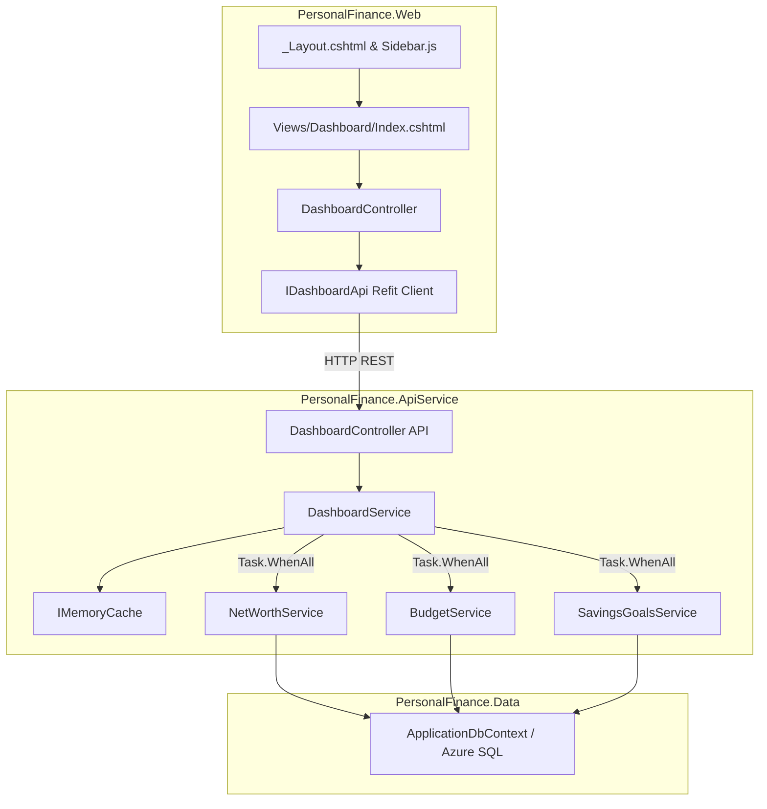

# Requirements

### Problem Statement

The current navigation relies on a flat, horizontal top navbar containing 8 unorganized links. This layout maximizes cognitive load, makes scanning inefficient, and fails to scale as new financial capabilities are introduced. Additionally, the application lacks a centralized landing page or command center—defaulting logo clicks to Google Drive—which degrades onboarding efficiency and prevents users from assessing their comprehensive financial health at a glance.

### Solution

Transition the web application to a modern, hierarchical layout featuring a collapsible left sidebar, an interactive Dashboard home page, and a mobile bottom navigation bar. Authenticated users landing on the root route immediately access aggregated KPI metrics, net worth trends, budget utilization, and savings goal progress powered by ApexCharts. Unauthenticated visitors are presented with a clean overview landing page guiding them toward registration and sign-in. To further enhance utility, the system is complemented by a database-backed notification system and unified global search across transactions, budgets, and savings goals.

### User Stories

1. As an active user, I want a centralized Dashboard home page so that I can evaluate my overall net worth, budget progress, and savings goals in a single glance.
2. As an active user, I want my financial metrics aggregated in parallel so that my dashboard loads with minimal latency and maximal responsiveness.
3. As an active user, I want navigation links grouped into clear functional categories (Overview, My Finances, Resources) so that I can reach target workflows with minimal scanning friction.
4. As a desktop user, I want to collapse the navigation sidebar into an icon-only mode so that I can maximize horizontal screen real estate for complex data tables and charts.
5. As a desktop user, I want my sidebar collapse preference saved in local storage so that subsequent page visits preserve my preferred viewing layout without flicker.
6. As a mobile user, I want a sticky 5-item bottom navigation bar so that I can navigate core features comfortably with single-thumb interaction.
7. As an unauthenticated visitor, I want a clear welcome and feature overview on the root URL (`/`) so that I understand the application's value and can easily register or log in.
8. As an authenticated user, I want the root URL (`/`) and brand logo to direct to the Dashboard so that I can return home instantly from any section.
9. As a new user with no transaction history, I want interactive Quick Setup Cards displayed on the dashboard so that I am guided to create a budget, set a savings goal, or connect Google Drive without facing blank charts.
10. As an active user, I want interactive ApexCharts for my net worth trend and budget breakdown so that I can hover, zoom, and inspect historical data points interactively.
11. As an active user, I want to receive persistent notifications when my budget reaches 80% or 100% capacity so that I can prevent overspending.
12. As an active user, I want to receive milestone notifications when my savings goals reach 50%, 75%, or 100% so that I can celebrate financial milestones.
13. As an active user, I want a notification bell in the top navigation bar showing my unread count so that I can stay informed of critical account alerts without interrupting my workflow.
14. As an active user, I want to mark notifications as read individually or in bulk so that I can maintain an organized notification center.
15. As an active user, I want a unified global search bar in the top navigation bar so that I can query transactions, budget categories, and savings goals from a single input.
16. As an active user, I want search results categorized with distinct source labels so that I can instantly identify whether a match belongs to a transaction, budget, or goal.
17. As an active user, I want debounced search suggestions so that search queries do not generate excessive server requests while I am typing.
18. As a keyboard user, I want full keyboard accessibility (Tab, Enter, Escape) across the sidebar, global search, and notification dropdowns so that I can operate the application efficiently without a pointing device.
19. As an active user, I want the active section highlighted in the sidebar so that I maintain clear spatial awareness of my current position in the application.
20. As an existing user, I want all existing sub-pages (Net Worth, Budget, Savings Goals, Analysis, Finance News, Investment Calculator, Community, Google Drive) to maintain identical URL routes and core capabilities so that my established workflows remain uninterrupted.

# Technical Design

### Implementation Decisions

#### 1. Service Layer & Dependency Injection
- **Direct Service Injection**: Follow the solution standard established in ADR-0001 and project guidelines. API controllers directly inject service interfaces (`IDashboardService`, `INotificationService`, `ISearchService`) using built-in .NET dependency injection within type-based folders (`Controllers/`, `Services/`).
- **Parallel Aggregation with In-Memory Caching**: `DashboardService` fetches Net Worth, Budget, Savings Goals, and Activity summaries concurrently via `Task.WhenAll`. Query results are cached in-memory per user for 60 seconds to maximize throughput and shield Azure SQL Database from repeated concurrent queries.
- **Refit API Client Contracts**: Frontend MVC controllers communicate with the API layer via strongly typed Refit contracts (`IDashboardApi`, `INotificationApi`, `ISearchApi`) with user identity forwarded via the existing `UserIdForwardingHandler`.

#### 2. Presentation & User Experience
- **Contextual Root Routing**: The root route (`/`) dynamically inspects authentication status. Authenticated users are served `/Dashboard`, while unauthenticated visitors receive a dedicated landing page highlighting key features and providing direct login/registration CTAs.
- **Collapsible Sidebar Layout**: The default top navbar in `_Layout.cshtml` is replaced by a three-section sidebar (Overview, My Finances, Resources), a top utility bar (Global Search, Notifications, User Profile), and a mobile 5-item bottom bar.
- **Sidebar State Persistence**: Sidebar expansion state is stored in browser `localStorage` and initialized prior to first render to eliminate layout shift and visual flicker.
- **Interactive Visualizations**: ApexCharts is loaded via CDN in the layout header to provide fluid, interactive charts for dashboard widgets without conflicting with existing Chart.js implementations in other modules.
- **Zero-Data State Handling**: When zero transactions or budgets are recorded, widgets swap chart placeholders with interactive Quick Setup Cards with direct action links.

#### 3. Data Layer & Schemas
- **Auditable Notification Entity**: The `Notification` entity inherits from `AuditableEntity` with mandatory soft-delete filters (`IsDeleted`, `DeletedAt`), tracked via standard Entity Framework Core migrations.
- **DTO Shapes**:
  - `DashboardSummaryDto`: aggregates `NetWorthSummaryDto`, `BudgetSummaryDto`, `List<SavingsGoalSummaryDto>`, and `List<RecentActivityDto>`.
  - `SearchResultsDto`: aggregates categorized `SearchResultDto` records for transactions, budgets, and savings goals.
  - `NotificationDto`: contains `Id`, `Type`, `Title`, `Message`, `IsRead`, `CreatedAt`, and `SourceFeature`.

#### 4. Architecture Diagram

# Testing Decisions

### Testing Decisions

#### Test Quality Principles
Testing focuses on verifying observable external behavior and contract fidelity rather than fragile internal implementation details. The fewest possible testing seams are utilized, adhering to the highest integration boundaries available in the solution.

#### Modules Under Test
1. **DashboardService & IDashboardApi**:
   - Verify parallel aggregation correctly combines data from Net Worth, Budget, Savings Goals, and Activity streams.
   - Verify in-memory cache returns cached data on successive calls within TTL and invalidates properly.
   - Verify zero-data edge cases return structured empty summaries rather than null references or errors.
2. **NotificationService & INotificationApi**:
   - Verify notification creation, unread count computation, and soft-delete / mark-as-read transitions.
   - Verify budget threshold triggers (80% and 100%) and savings goal milestone triggers produce expected notification records.
3. **SearchService & ISearchApi**:
   - Verify multi-entity search queries accurately filter, match, and categorize results across transactions, budgets, and goals.
   - Verify empty queries and special characters return clean empty payloads.
4. **End-to-End & UI Verification**:
   - Verify sidebar collapse/expand transitions, local storage persistence, and mobile bottom navigation responsiveness via Playwright e2e tests.
   - Verify authenticated vs unauthenticated root routing behavior.

#### Prior Art
- Unit and integration tests in `PersonalFinance.Tests/` using xUnit and FluentAssertions (`ApiServiceEndpointTests.cs`, `GoogleDrivePersistenceTests.cs`).
- Automated browser workflows in `e2e-tests/ui-test.js` using Playwright for layout rendering, navigation verification, and responsive viewport checks.

# Out of Scope & Further Notes

### Out of Scope

- Real-time WebSocket or SignalR push transport for notifications (REST polling on navigation/intervals is utilized to prevent infrastructure overhead).
- Search indexing across Community posts and Finance News articles (reserved for a subsequent search expansion phase).
- User-customizable drag-and-drop dashboard widget layouts (fixed responsive grid ensures optimal utility and visual balance).
- Custom icon SVG asset compilation (standardized on Lucide Icons CDN).
- Third-party bank sync or external Open Banking integrations.

### Further Notes

- **ADR-0002 Compliance**: This architectural transition qualifies under ADR-0002 for scalable hierarchical navigation, ensuring future features can be integrated into categorical groups without navigation bloat.
- **Version & Changelog Updates**: In accordance with `AGENTS.md`, application minor version in `AppVersion.cs` will be incremented (`1.10.0` → `1.11.0`) and `CHANGELOG.md` updated under `## [Unreleased]` upon feature delivery.
- **E2E Test Updates**: Existing assertions targeting legacy top `nav.navbar` selectors will be updated to target the new sidebar and top bar hierarchy.

# Delivery Steps

### * Step 1: Implement Navigation Layout and Sidebar State Persistence
The web application provides a responsive left navigation sidebar and mobile bottom navigation bar with persistent layout state to maximize screen utility across devices.

- Update the primary application layout structure to support the three-tier collapsible left navigation sidebar (`Overview`, `My Finances`, `Resources`).
- Add responsive CSS styling supporting 240px expanded desktop width, 60px collapsed icon-only desktop width, and a 5-item mobile bottom navigation bar.
- Add client-side sidebar toggle logic with `localStorage` persistence so user viewport preferences apply immediately on document load without visual flicker.
- Ensure all existing application routes (`/Networth`, `/Budget`, `/SavingsGoals`, `/Analysis`, `/News`, `/InvestmentCalculator`, `/Community`, `/GoogleDrive`) remain fully functional and properly styled within the layout content container.

###   Step 2: Implement Dashboard API and Parallel Service Aggregation with Caching

> **Superseded (2026-10-16):** The Dashboard summary keeps sequential queries on the request-scoped DbContext and adds no response cache. Parallel `Task.WhenAll` would need a separate DbContext per query, and a 60s cache would show stale figures right after a user edits their budget or goals. See `.scratch/homepage/spec.md`.
The backend provides high-throughput, aggregated financial overview metrics with minimal database contention.

- Define shared Dashboard DTOs (`DashboardSummaryDto`, `NetWorthSummaryDto`, `BudgetSummaryDto`, `SavingsGoalSummaryDto`, `RecentActivityDto`) and Refit client interface (`IDashboardApi`).
- Implement `DashboardService` with `IDashboardService` using direct service injection to aggregate net worth trends, budget utilization, savings goal progress, and recent activities in parallel using `Task.WhenAll`.
- Implement per-user short-term in-memory caching to shield database resources and achieve sub-100ms response times for frequent dashboard views.
- Implement `DashboardController` in the API service layer exposing `GET /api/Dashboard/summary` and register dependencies in dependency injection.

###   Step 3: Implement Dashboard MVC Views with ApexCharts and Quick Setup Cards
The frontend provides an interactive personal finance command center with ApexCharts and zero-data onboarding guidance.

- Implement `DashboardController` in the Web layer consuming `IDashboardApi` with contextual root route handling (`/` and `/Dashboard`).
- Include synchronous ApexCharts library loading in layout head for rich interactive chart visualizations (Net Worth Trend, Budget vs Actual).
- Implement Dashboard Razor views (`Views/Dashboard/Index.cshtml`) with responsive metric cards, chart containers, and recent activity feeds.
- Implement interactive Quick Setup Cards (*Set your first budget*, *Add a savings goal*, *Connect Google Drive*) when user accounts lack recorded data to facilitate immediate onboarding.

###   Step 4: Implement Notification Entity, Database Migration, and Polling API
The platform persists actionable financial alerts and delivers them to users via efficient database polling.

- Create `AuditableEntity`-derived `Notification` entity with soft-delete support and generate Entity Framework Core database migration.
- Implement `NotificationService` and API controller with CRUD operations, unread count queries, and mark-as-read endpoints.
- Integrate threshold event triggers across Budget (80%/100% capacity) and Savings Goals (milestone achievements) services.
- Add notification bell UI in the top navigation bar with unread counter badge and periodic REST polling.

###   Step 5: Implement Unified Global Search Backend and Frontend Component
Users can quickly search across all financial entities through a single unified search interface.

- Implement `SearchService` and API controller to execute concurrent searches across transactions, budget line items, and savings goals.
- Define shared search contract `ISearchApi` and response DTOs with entity type classification labels.
- Implement debounced search input component in the top navigation bar with keyboard navigation and labeled result dropdown.