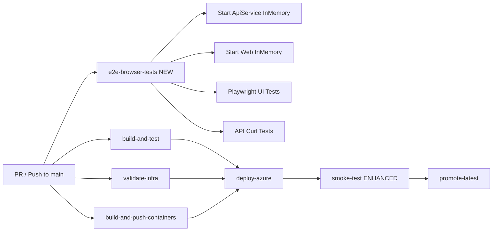

# Requirements

### Overview & Goals

The current CI/CD pipeline (`deploy-azure.yml`) has solid build, unit test, container build, deployment, and post-deployment smoke test stages. However, the **smoke tests only check HTTP status codes** on 4 endpoints (`/health`, `/alive`, `/`, `/Identity/Account/Login`). There is no browser-based E2E testing in CI, and the existing Playwright UI test suite (`networth-ui-test.js`) with 11 test scenarios is **not wired into the pipeline**.

This plan adds comprehensive E2E testing at two stages:
1. **PR validation** — browser-based E2E tests against locally running services (InMemory DB)
2. **Post-deployment** — enhanced smoke tests with more endpoint coverage and content assertions

### Scope

**In Scope:**
- Add a new CI job `e2e-browser-tests` that starts both ApiService and Web locally, runs Playwright browser tests
- Enhance the existing `smoke-test` job with more endpoints and content assertions
- Integrate the existing `networth-ui-test.js` into CI with improvements
- Add API endpoint E2E tests (curl-based) for key ApiService routes
- Update `package.json` with proper test scripts
- Version bump in `AppVersion.cs`

**Out of Scope:**
- Changing the existing unit test suite
- Modifying the Bicep infrastructure
- Adding new application features
- Setting up Playwright as a formal test project (keeping it as a standalone script for simplicity)

# Technical Design

### Current Implementation

**CI Pipeline** (`.github/workflows/deploy-azure.yml`):
- `build-and-test`: dotnet restore, build, test (unit tests only)
- `validate-infra`: Bicep template validation
- `build-and-push-containers`: multi-stage Docker builds (api, web)
- `deploy-azure`: Bicep deployment to Azure Container Apps
- `smoke-test`: HTTP probes on 4 endpoints (status codes only)
- `promote-latest`: tag images as `latest`

**Existing Tests** (`PersonalFinance.Tests/`):
- 13 test files covering API endpoints, DB migrations, container config, workflow validation, Identity, email, etc.
- All unit/integration tests using xUnit, InMemory DB

**Existing E2E Assets**:
- `networth-ui-test.js` — Playwright script with 11 test scenarios (HTTPS redirect, auth redirects, login/register pages, layout, health endpoints, responsive viewport, 404 handling, console errors)
- `infra/smoke-test.ps1` — PowerShell smoke test script (not used in CI)
- Playwright installed in `package.json` but no test script configured

**Architecture**:
- Web app depends on ApiService via Refit clients (`INetWorthApi`, `ICommunityApi`, `IPersonalFinanceApi`, `IAiAssistantApi`, `IGoogleDriveApi`)
- `AppHost.cs` orchestrates both services locally (Aspire pattern)
- `DatabaseProviderType.InMemory` is supported for test scenarios
- Identity requires `RequireConfirmedAccount = true` — needs to be disabled for E2E tests

### Key Decisions

1. **Run both services for E2E** — The Web layer calls ApiService via Refit, so both must be running. The CI job will start ApiService first (with InMemory DB), then Web (with InMemory DB), then run Playwright against the Web URL.

2. **InMemory DB for CI E2E** — Both services will use `Database:Provider=InMemory` via environment variables, avoiding the need for a SQL Server container.

3. **Disable email confirmation for E2E** — Set `RequireConfirmedAccount=false` via configuration so test users can log in without email verification.

4. **Keep Playwright as a standalone script** — Rather than creating a formal Playwright test project, the existing `networth-ui-test.js` pattern will be extended and integrated directly into the CI job.

5. **Two-tier E2E strategy**:
   - **PR stage**: Full browser E2E (Playwright) + API curl tests against local services
   - **Post-deploy stage**: Enhanced HTTP smoke tests (no browser, just curl) against the live Azure environment

### Proposed Changes

#### 1. New CI Job: `e2e-browser-tests` (PR + push to main)

A new job in `deploy-azure.yml` that:
- Restores and builds the solution (reuses `build-and-test` artifacts or does its own restore)
- Installs Node.js and Playwright browsers
- Starts ApiService with InMemory DB on a random port
- Starts Web with InMemory DB on a random port, pointing to the local ApiService
- Waits for both services to be healthy
- Runs the Playwright E2E test suite against the Web URL
- Runs API endpoint tests (curl-based) against the ApiService URL
- Gracefully stops both services

#### 2. Enhanced `smoke-test` Job

Expand the post-deployment smoke tests to include:
- More endpoint coverage: `/Networth`, `/News`, `/Community` (auth redirect checks)
- Content assertions (e.g., login page contains form elements, not just status 200)
- API endpoint checks where accessible

#### 3. Updated E2E Test Script

Move `networth-ui-test.js` to `e2e-tests/ui-test.js` and:
- Parameterize the base URL (from environment variable instead of hardcoded `localhost:7200`)
- Add authenticated feature page tests (register a test user, log in, visit Net Worth, Budget, etc.)
- Add API endpoint tests (curl-based, against the ApiService URL)
- Improve error reporting

#### 4. Package.json Updates

Add proper test scripts:
```json
"scripts": {
  "test:e2e": "node e2e-tests/ui-test.js",
  "test:api": "node e2e-tests/api-test.js"
}
```

### File Structure

```
.github/workflows/
  deploy-azure.yml              ← Modified: add e2e-browser-tests job, enhance smoke-test

e2e-tests/                      ← New directory
  ui-test.js                    ← New: browser E2E tests (migrated from networth-ui-test.js)
  api-test.js                   ← New: API endpoint tests (curl-based)

package.json                    ← Modified: add test scripts
PersonalFinance.Shared/Constants/AppVersion.cs  ← Modified: bump version
```

### Architecture Diagram



### Risks

- **Startup time**: Running both services in CI adds ~30-60s for startup. Mitigated by health-check wait loops.
- **Port conflicts**: Using random ports via `$RANDOM` or Docker's port mapping to avoid conflicts in parallel runs.
- **Identity email confirmation**: `RequireConfirmedAccount=true` blocks login. Mitigated by overriding via environment variable.
- **Playwright browser install**: Adds ~30s. Mitigated by caching the Playwright browser binaries.
- **Flaky tests**: Browser tests can be flaky. Mitigated by retry logic and generous timeouts.

# Testing

### Validation Approach

After implementing the changes:
1. Verify the CI workflow YAML is syntactically valid
2. Run the existing unit tests to ensure no regressions: `dotnet test PersonalFinance.sln`
3. Verify the new E2E test scripts are syntactically valid (Node.js parse check)
4. Build the solution: `dotnet build PersonalFinance.sln --configuration Release`

### Key Scenarios

1. **New `e2e-browser-tests` job** appears in the workflow and runs on PR and push to main
2. **Job starts both services** with InMemory DB and waits for health checks
3. **Playwright tests** connect to the Web URL and validate UI pages
4. **API tests** hit the ApiService endpoints and validate responses
5. **Enhanced smoke-test** covers more endpoints post-deployment
6. **Existing tests** continue to pass (no regressions in unit test suite)
7. **Version bump** is reflected in `AppVersion.cs`

### Edge Cases

- Services fail to start — job should fail with a clear error message
- Health check timeout — job should report which service failed
- Playwright browser install fails — job should fail gracefully
- Post-deployment smoke test URL is empty — existing fallback logic handles this

# Delivery Steps

### ✓ done Step 1: Create E2E test scripts and directory structure
Set up the E2E test infrastructure with browser and API test scripts.
- Create `e2e-tests/` directory
- Migrate `networth-ui-test.js` to `e2e-tests/ui-test.js` with parameterized base URL (from env var `WEB_URL`), improved error reporting, and authenticated feature page tests (register + login flow)
- Create `e2e-tests/api-test.js` — curl-based API endpoint tests against ApiService (NetWorth, Community, Budget endpoints with response payload assertions)
- Update `package.json` with test scripts (`test:e2e`, `test:api`)
- Remove or deprecate the root-level `networth-ui-test.js`

### ✓ done Step 2: Add e2e-browser-tests CI job to deploy-azure.yml
Add a new GitHub Actions job that runs browser E2E tests against locally started services.
- Add `e2e-browser-tests` job after `build-and-test` (runs in parallel with container builds)
- Steps: restore/build solution, install Node.js + cache Playwright browsers, start ApiService with `Database:Provider=InMemory` on a random port, start Web with InMemory DB pointing to local ApiService, wait for health endpoints, run Playwright UI tests, run API curl tests, stop services
- Configure `RequireConfirmedAccount=false` via environment variable for both services
- Add Playwright browser caching to speed up subsequent runs
- Set appropriate timeout (15 minutes) and concurrency handling

### ✓ done Step 3: Enhance post-deployment smoke tests
Expand the existing `smoke-test` job to cover more endpoints and add content assertions.
- Add endpoint checks for `/Networth`, `/News`, `/Community` (verify auth redirect behavior — should redirect to login)
- Add content assertions on `/Identity/Account/Login` (verify form elements are present, not just status 200)
- Add a check for `/Identity/Account/Register`
- Keep the existing health, alive, root, and login probes
- Structure the tests with clear labels and individual pass/fail reporting

### ✓ done Step 4: Update version and finalize
Bump the application version and verify the complete pipeline.
- Update `PersonalFinance.Shared/Constants/AppVersion.cs` — bump Minor version (new CI/CD feature)
- Verify the workflow YAML syntax by running `dotnet test PersonalFinance.sln` to ensure existing tests pass
- Verify Node.js scripts parse without errors (`node -c e2e-tests/ui-test.js` and `node -c e2e-tests/api-test.js`)
- Run `dotnet build PersonalFinance.sln --configuration Release` to confirm no build regressions