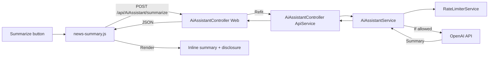

# Technical Design

### Technical Design

### Current Implementation

- **News page**: `NewsController/Index` renders `Views/News/Index.cshtml` which iterates `Model.Articles` (type
  `NewsArticle` from `NewsService.cs`). Each card shows title, description, source, category, and timestamp.
- **AI infrastructure**: The project already has an `AiAssistantService` in `PersonalFinance.ApiService` that calls
  OpenAI via the `OpenAI` SDK. It uses `IAiAssistantService` interface, `AiChatRequestDto`/`AiChatResponseDto` DTOs, and
  a Refit contract `IAiAssistantApi`. The Web layer proxies through `AiAssistantController` (Web) → `IAiAssistantApi`
  (Refit) → `AiAssistantController` (ApiService) → `AiAssistantService`.
- **Frontend pattern**: The AI chat widget (`ai-chat-widget.js`) demonstrates the JS pattern: IIFE module, `fetch()` to
  `/api/AiAssistant/chat`, loading/disabled states, and error handling.

### Key Decisions

1. **New dedicated service method** — Add `SummarizeArticleAsync` to `IAiAssistantService`/`AiAssistantService` rather
   than overloading the chat endpoint. This keeps the summary operation isolated with its own system prompt (no
   financial context).
2. **New API endpoint** — `POST /api/AiAssistant/summarize` in ApiService with a dedicated DTO.
3. **In-memory rate limiter** — `ConcurrentDictionary<string, Queue<DateTime>>` keyed by user ID, 10 requests per 60
   seconds. Registered as `Singleton`.
4. **Session caching in JavaScript** — a `Map` keyed by article URL stores the summary for the lifetime of the page.
5. **No database changes** — summaries are ephemeral.

### Proposed Changes

#### 1. Shared Layer — New DTOs

- **`PersonalFinance.Shared/DTOs/NewsSummaryDto.cs`**:
    - `NewsArticleSummaryRequestDto` — `Title` (string), `Description` (string).
    - `NewsArticleSummaryResponseDto` — `Summary` (string), `Model` (string), `TimestampUtc` (DateTime).

#### 2. Shared Layer — Refit Contract Extension

- Add to `IAiAssistantApi`:
  ```csharp
  [Post("/api/AiAssistant/summarize")]
  Task<NewsArticleSummaryResponseDto> SummarizeArticleAsync([Body] NewsArticleSummaryRequestDto request, CancellationToken cancellationToken = default);
  ```

#### 3. ApiService — Rate Limiter Service

- **`PersonalFinance.ApiService/Services/IRateLimiterService.cs`** / **`RateLimiterService.cs`**:
    - `bool TryAllow(string userId)` — returns `true` if within rate limit.
    - In-memory sliding window: 10 requests per 60 seconds per user.
    - Registered as `Singleton`.

#### 4. ApiService — AI Summary Method

- Extend `IAiAssistantService` with `SummarizeArticleAsync`.
- Implement in `AiAssistantService`:
    - System prompt: concise news summarizer, no financial advice.
    - Rate-limit check before calling OpenAI.
    - Return `NewsArticleSummaryResponseDto`.

#### 5. ApiService — Controller Endpoint

- Add `POST /summarize` to `AiAssistantController` (ApiService).
- Return 429 if rate limited.

#### 6. Web Layer — Proxy Endpoint

- Add `POST /api/AiAssistant/summarize` to `AiAssistantController` (Web).

#### 7. Web Layer — View Changes

- Add "Summarize" button to each article card in `Views/News/Index.cshtml`.
- Add hidden summary container below the description.

#### 8. JavaScript — Summary Module

- **`PersonalFinance.Web/wwwroot/js/news/news-summary.js`** (new):
    - IIFE module, session cache (`Map`), fetch, render inline with disclosure.
    - Loading, error with retry, 429 handling.

#### 9. CSS — Summary Styles

- Add to `wwwroot/css/news.css`: summary container, loading, error, disclosure styles.

#### 10. Version Bump

- `AppVersion.cs`: `1.10.0` → `1.11.0`.

### Data Models / Contracts

**Request DTO**:

```csharp
public class NewsArticleSummaryRequestDto
{
    public string Title { get; set; } = string.Empty;
    public string Description { get; set; } = string.Empty;
}
```

**Response DTO**:

```csharp
public class NewsArticleSummaryResponseDto
{
    public string Summary { get; set; } = string.Empty;
    public string Model { get; set; } = string.Empty;
    public DateTime TimestampUtc { get; set; } = DateTime.UtcNow;
}
```

### Architecture Diagram



### Risks

- **OpenAI API unavailable**: User-friendly error with retry.
- **Rate limiter memory**: Pruned on each call; distributed limiter needed for multi-instance (out of scope).
- **XSS**: Summary rendered via `textContent`, not `innerHTML`.
- **Large descriptions**: Truncated server-side before sending to OpenAI.

# Delivery Steps

### ✓ Step 1: Bump version and final build verification

Update the application version and perform a final build.

- Bump `AppVersion.cs` from `1.10.0` to `1.11.0` (new feature, minor bump).
- Build the full solution (`dotnet build PersonalFinance.sln`) and verify no compilation errors.
- Review all changed files for consistency, security, and accessibility compliance.

### ✓ Step 2: Shared Layer — New DTOs

Create `NewsArticleSummaryRequestDto` and `NewsArticleSummaryResponseDto` in
`PersonalFinance.Shared/DTOs/NewsSummaryDto.cs`.

### ✓ Step 3: Shared Layer — Refit Contract Extension

Add `SummarizeArticleAsync` to `IAiAssistantApi` in `PersonalFinance.Shared/Contracts/IAiAssistantApi.cs`.

### ✓ Step 4: ApiService — Rate Limiter Service

Create `IRateLimiterService` interface and `RateLimiterService` implementation in
`PersonalFinance.ApiService/Services/`.

### ✓ Step 5: ApiService — AI Summary Method

Extend `IAiAssistantService` with `SummarizeArticleAsync` and implement in `AiAssistantService`.

### ✓ Step 6: ApiService — Controller Endpoint

Add `POST /summarize` endpoint to `AiAssistantController` in ApiService.

### ✓ Step 7: Web Layer — Proxy Endpoint

Add `POST /summarize` proxy endpoint to `AiAssistantController` in Web.

### ✓ Step 8: Web Layer — View Changes

Add Summarize button and summary container to article cards in `Views/News/Index.cshtml`.

### ✓ Step 9: JavaScript — Summary Module

Create `news-summary.js` IIFE module in `wwwroot/js/news/`.

### ✓ Step 10: CSS — Summary Styles

Add summary-related styles to `wwwroot/css/news.css`.

### ✓ Step 11: Final Build Verification

Build the full solution and verify no compilation errors.