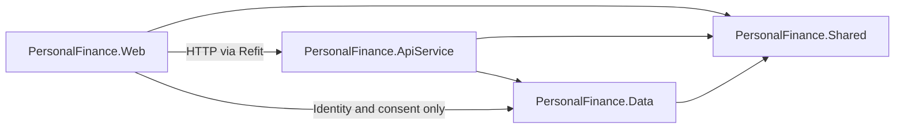
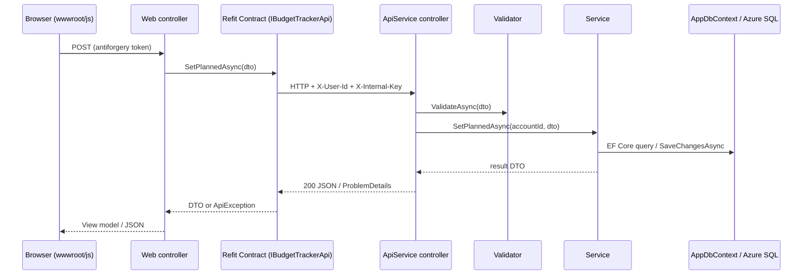

# Architecture Guide

How the Personal Finance App is put together, how a request flows through it, and where to put new code.
Terms (Service, DTO, Entity, Account, Policy, ...) are defined in [`GLOSSARY.md`](../GLOSSARY.md). The reasons behind the
big decisions are in [`docs/adr/`](adr/).

## Projects

All projects live under `PersonalFinance/src/`, tests under `PersonalFinance/tests/`. Open `PersonalFinance.sln` at the
repo root.

| Project | Role |
|---|---|
| `PersonalFinance.AppHost` | .NET Aspire orchestrator for local development: starts Web and ApiService, service discovery, dashboard. |
| `PersonalFinance.ServiceDefaults` | Shared OpenTelemetry, health checks (`/health`, `/alive`) and HTTP resilience. |
| `PersonalFinance.Web` | MVC frontend: controllers, Razor views, ASP.NET Core Identity, JavaScript and CSS. Calls ApiService over HTTP. |
| `PersonalFinance.ApiService` | REST API: controllers, Services (business logic and EF Core access), Validators. |
| `PersonalFinance.Data` | EF Core `AppDbContext`, Entities, Azure SQL migrations. |
| `PersonalFinance.Shared` | DTOs, Refit API Contracts, constants and helpers used by more than one project. |
| `PersonalFinance.Tests` | xUnit tests using the EF Core InMemory provider. |

Shared build settings (target framework, nullable, analyzers) are in `PersonalFinance/Directory.Build.props`;
package versions are in `PersonalFinance/Directory.Packages.props` (central package management); code style is in the
root `.editorconfig`.

## Dependencies between projects

- Web never references ApiService as a project. It talks to it over HTTP through the Refit Contracts in
  `Shared/Contracts/`.
- Web references Data only for ASP.NET Core Identity (`AppDbContext` is an `IdentityDbContext`) and the registration
  consent records (`Web/Services/UserConsentService.cs`). Feature data is always read through ApiService.
- Data references neither Web nor ApiService. ApiService has no MVC or Razor dependency.

## Request flow

A typical feature request, for example saving Budget Tracker planned amounts:

Responsibilities per step:

| Step | Owns | Never does |
|---|---|---|
| Web controller (`Web/Controllers/`) | Builds view models, returns views or JSON, `[ValidateAntiForgeryToken]` on form posts. | Business rules, EF Core access, injecting ApiService Services. |
| Refit Contract (`Shared/Contracts/`) | The HTTP shape between Web and ApiService. | Logic. |
| ApiService controller (`ApiService/Controllers/`) | Binding, calling a Validator, delegating to one Service, mapping results to status codes. | Business rules or queries. |
| Validator (`ApiService/Validators/`) | FluentValidation rules for one request DTO. | Database access. |
| Service (`ApiService/Services/`) | Business rules, EF Core reads and writes, mapping Entities to DTOs by hand. | HTTP concerns. |

There is no mediator: ApiService controllers inject Service interfaces directly
([ADR 0001](adr/0001-standardize-cqrs-feature-organization.md)). MediatR and AutoMapper are banned for licensing reasons.

## Identity: how an Account reaches ApiService

1. The browser signs in to Web with ASP.NET Core Identity (cookie).
2. `Web/Services/UserIdForwardingHandler.cs` is attached to Refit clients in `Web/Program.cs`. It adds the Account id as
   `X-User-Id` and the shared secret as `X-Internal-Key` to every outgoing call.
3. `ApiService/Infrastructure/XUserIdAuthenticationHandler.cs` checks the shared secret, loads the Account's Roles from
   the Identity tables, and builds a `ClaimsPrincipal`.
4. Controllers marked `[Authorize]` read the Account id from `User` (`ClaimTypes.NameIdentifier`). Admin endpoints use
   `[Authorize(Policy = AppPolicies.RequireAdmin)]`, never Role names ([ADR 0004](adr/0004-rbac-roles-from-database-and-policy-checks.md)).

New ApiService controllers must follow step 4 (see `BudgetTrackerController` for the pattern). Some older controllers
still read the `X-User-Id` header directly; those are being moved onto the claims-based path.

## Data rules

- Azure SQL through EF Core Code-First. Migrations live in `PersonalFinance.Data/Migrations/AzureSql`.
- User-owned Entities inherit `AuditableEntity` and are soft-deleted (`IsDeleted`, `DeletedAt`); global query filters
  hide deleted rows.
- Money is `decimal` with explicit precision.
- Reads use `AsNoTracking()`, async methods and deterministic ordering.
- Budget data has two sources (Google Sheet and Budget Tracker), always read through `IBudgetDataProvider`
  ([ADR 0002](adr/0002-budget-tracker-separate-from-spreadsheet-data.md)).

## Adding a feature: checklist

Follow the existing Budget Tracker feature as the reference implementation.

1. **Entity** in `PersonalFinance.Data/Entities/` (inherit `AuditableEntity` if user-owned), `DbSet` and configuration in
   `AppDbContext`, then a migration. Inspect the generated migration before committing.
2. **DTOs** in `PersonalFinance.Shared/DTOs/<Feature>/`.
3. **Service** interface and implementation in `PersonalFinance.ApiService/Services/`; register it in
   `ApiService/Program.cs`.
4. **Validators** in `PersonalFinance.ApiService/Validators/` (picked up automatically by
   `AddValidatorsFromAssemblyContaining<Program>()`).
5. **ApiService controller** in `PersonalFinance.ApiService/Controllers/`, with `[Authorize]`, reading the Account id from
   claims.
6. **Refit Contract** in `PersonalFinance.Shared/Contracts/I<Feature>Api.cs`; register it in `Web/Program.cs` with
   `.AddHttpMessageHandler<UserIdForwardingHandler>()`.
7. **Web controller, view model and Razor view** in `PersonalFinance.Web/`; JavaScript in `wwwroot/js/<feature>/`.
8. **Tests** in `PersonalFinance/tests/PersonalFinance.Tests/<Feature>/`.
9. Bump `AppVersion` and add a `CHANGELOG.md` entry (see [`CONTRIBUTING.md`](../CONTRIBUTING.md)).

Coding rules for each of these steps are in [`CODING_STANDARDS.md`](CODING_STANDARDS.md).
