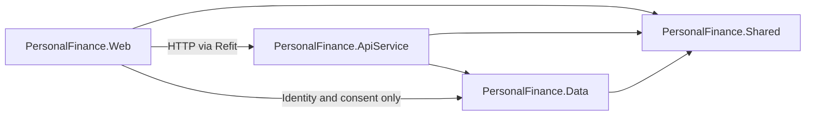
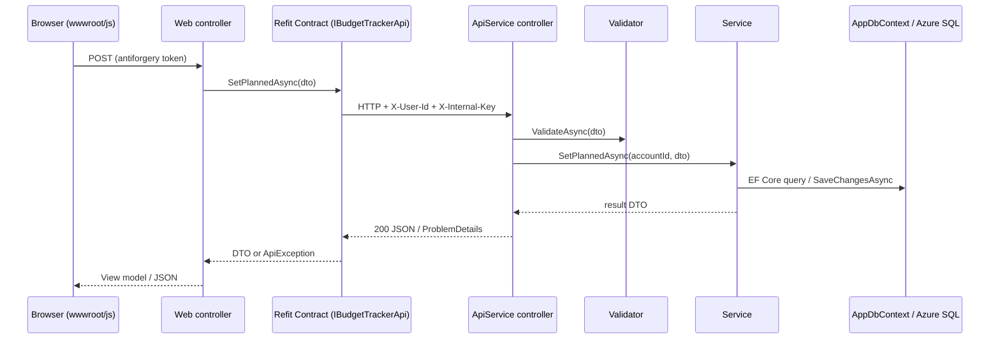

# Architecture Guide

How the Personal Finance App is put together, how a request flows through it, and where to put new code.
Terms (Service, DTO, Entity, Account, Policy, ...) are defined in [`GLOSSARY.md`](../GLOSSARY.md). The reasons behind the
big decisions are in [`docs/adr/`](adr/).

## Projects

All projects live under `PersonalFinance/src/`, tests under `PersonalFinance/tests/`. Open `PersonalFinance.sln` at the
repo root.

| Project | Role |
|---|---|
| `PersonalFinance.AppHost` | .NET Aspire orchestrator for local development: starts Web and ApiService, service discovery, dashboard. |
| `PersonalFinance.ServiceDefaults` | Shared OpenTelemetry, health checks (`/health`, `/alive`) and HTTP resilience. |
| `PersonalFinance.Web` | MVC frontend: controllers, Razor views, ASP.NET Core Identity, JavaScript and CSS. Calls ApiService over HTTP. |
| `PersonalFinance.ApiService` | REST API: controllers, Services (business logic and EF Core access), Validators. |
| `PersonalFinance.Data` | EF Core `AppDbContext`, Entities, Azure SQL migrations. |
| `PersonalFinance.Shared` | DTOs, Refit API Contracts, constants and helpers used by more than one project. |
| `PersonalFinance.Tests` | xUnit tests using the EF Core InMemory provider. |

`Program.cs` in Web and ApiService is a short, commented list of what each app uses; the details live in extension
methods (`ServiceDefaults/LoggingExtensions.cs`, `ApiService/Infrastructure/InfrastructureServiceExtensions.cs`,
each Feature's `ApiService/Features/<Feature>/<Feature>Feature.cs`, `Web/Infrastructure/`, and `MigrateAndRunAsync` in
`Data/DatabaseMigrationExtensions.cs`, which also handles `--migrate-only`).

Shared build settings (target framework, nullable, analyzers) are in `PersonalFinance/Directory.Build.props`;
package versions are in `PersonalFinance/Directory.Packages.props` (central package management); code style is in the
root `.editorconfig`.

## Dependencies between projects



- Web never references ApiService as a project. It talks to it over HTTP through the Refit Contracts in
  `Shared/Contracts/`.
- Web references Data only for ASP.NET Core Identity (`AppDbContext` is an `IdentityDbContext`) and the registration
  consent records (`Web/Features/Legal/UserConsentService.cs`). Feature data is always read through ApiService.
- Data references neither Web nor ApiService. ApiService has no MVC or Razor dependency.

## Request flow

A typical feature request, for example saving Budget Tracker planned amounts:



Responsibilities per step:

| Step | Owns | Never does |
|---|---|---|
| Web controller (`Web/Controllers/`) | Builds view models, returns views or JSON, `[ValidateAntiForgeryToken]` on form posts. JSON actions carry `[JsonApiErrors]` instead of try/catch; view actions show their own error message. | Business rules, EF Core access, injecting ApiService Services, showing raw ApiService responses or exception messages. |
| Refit Contract (`Shared/Contracts/`) | The HTTP shape between Web and ApiService. | Logic. |
| ApiService controller (`ApiService/Controllers/`) | Binding, calling a Validator, delegating to one Service, mapping results to status codes. | Business rules or queries. |
| Validator (`ApiService/Validators/`) | FluentValidation rules for one request DTO. | Database access. |
| Service (`ApiService/Services/`) | Business rules, EF Core reads and writes, mapping Entities to DTOs by hand. | HTTP concerns. |

There is no mediator: ApiService controllers inject Service interfaces directly
([ADR 0001](adr/0001-standardize-cqrs-feature-organization.md)). MediatR and AutoMapper are banned for licensing reasons.

## Identity: how an Account reaches ApiService

1. The browser signs in to Web with ASP.NET Core Identity (cookie).
2. `Web/Infrastructure/UserIdForwardingHandler.cs` is attached to every Refit client by
   `Web/Infrastructure/InternalApiClientExtensions.cs`. It adds the signed-in
   Account id as `X-User-Id` (nothing for signed-out visitors) and the shared secret as `X-Internal-Key`.
3. `ApiService/Infrastructure/XUserIdAuthenticationHandler.cs` checks the shared secret, loads the Account's Roles from
   the Identity tables, and builds a `ClaimsPrincipal`.
4. Every ApiService controller is marked `[Authorize]` and reads the Account id with `User.GetUserId()`
   (`PersonalFinance.Shared/Helpers/ClaimsPrincipalExtensions.cs`). Admin endpoints use
   `[Authorize(Policy = AppPolicies.RequireAdmin)]`, never Role names ([ADR 0004](adr/0004-rbac-roles-from-database-and-policy-checks.md)).

Rules for new code:

- Never read the `X-User-Id` header in a controller, and never accept a user id from the query string or request body.
  The Account always comes from `User.GetUserId()`.
- Every ApiService controller needs `[Authorize]` (or a deliberate `[AllowAnonymous]`);
  `Security/AccountIsolationTests` fails the build otherwise.
- Pass the Account id into Services and filter every query by it, including lookups by id.

## Data rules

- Azure SQL through EF Core Code-First. Migrations live in `PersonalFinance.Data/Migrations/AzureSql`.
- User-owned Entities inherit `AuditableEntity` and are soft-deleted (`IsDeleted`, `DeletedAt`); global query filters
  hide deleted rows.
- Money is `decimal` with explicit precision.
- Reads use `AsNoTracking()`, async methods and deterministic ordering.
- Budget data has two sources (Google Sheet and Budget Tracker), always read through `IBudgetDataProvider`
  ([ADR 0002](adr/0002-budget-tracker-separate-from-spreadsheet-data.md)).

## Adding a feature: checklist

Mirror the **Feedback** Feature: `ApiService/Features/Feedback/`, `Web/Features/Feedback/`, `Shared/DTOs/Feedback/` and
`tests/Feedback/`. It is the smallest complete one, and it has the anatomy every Feature follows
([ADR 0007](adr/0007-feature-folders-with-interface-only-dependencies.md)):

```text
ApiService/Features/<Feature>/
  <Feature>Controller.cs        public: the HTTP seam
  I<Feature>Service.cs          public: the seam other Features and tests use
  <Feature>Service.cs           internal sealed, beside its interface
  <Feature>Feature.cs           Add<Feature>Feature(): the Feature's DI registrations, called from Program.cs
  Validators/                   internal sealed, only when the Feature has request validation
  Domain/                       pure logic with no EF Core or HTTP dependency, only when there is some
  Adapters/                     clients for external systems (Google Drive, OpenAI), only when there are some
Web/Features/<Feature>/
  <Feature>Controller.cs, view models, UI services   (views stay in Views/<Controller>/)
```

Everything in a Feature is `internal sealed` except its interface, its controller, its DTOs and its view models. A
Feature depends on another Feature only through that Feature's interface or `AppDbContext`; the Architecture tests
(`tests/Architecture/`) fail the build otherwise. Features not yet moved to this layout still sit in the type-based
folders below, which ADR 0007 is retiring.

1. **Entity** in `PersonalFinance.Data/Entities/` (inherit `AuditableEntity` if user-owned), `DbSet` and configuration in
   `AppDbContext`, then a migration. Inspect the generated migration before committing.
2. **DTOs** in `PersonalFinance.Shared/DTOs/<Feature>/`.
3. **Service** interface and implementation in `PersonalFinance.ApiService/Features/<Feature>/`; register it in that
   Feature's `Add<Feature>Feature()` (a new Feature gets a new `<Feature>Feature.cs`, called from
   `ApiService/Program.cs`). `tests/Architecture/ApiServiceCompositionTests` fails if the interface is not registered.
4. **Validators** in `PersonalFinance.ApiService/Features/<Feature>/Validators/` (picked up automatically by
   `AddValidatorsFromAssemblyContaining<Program>(includeInternalTypes: true)`).
5. **ApiService controller** in `PersonalFinance.ApiService/Features/<Feature>/`, with `[Authorize]`, reading the
   Account id from claims.
6. **Refit Contract** in `PersonalFinance.Shared/Contracts/I<Feature>Api.cs`; add one line to `AddInternalApiClients` in
   `Web/Infrastructure/InternalApiClientExtensions.cs` (`Web/InternalApiClientRegistrationTests` fails if you forget).
7. **Web controller and view model** in `PersonalFinance.Web/Features/<Feature>/`, the **Razor view** in
   `Views/<Controller>/`; JavaScript in `wwwroot/js/<feature>/`.
   JavaScript only calls Web: a `fetch('/api/X...')` needs a Web controller routed at `api/X` with `[Authorize]` and
   `[JsonApiErrors]` (`Web/WebApiRouteTests` checks this), and state-changing calls send the
   `RequestVerificationToken` header from the layout's `__RequestVerificationToken` meta tag.
8. **Tests** in `PersonalFinance/tests/PersonalFinance.Tests/<Feature>/`. Services are tested with the EF Core InMemory
   provider, which runs any query in memory: guard queries that use string, date or collation-dependent operations
   with `TestSupport/AzureSqlTranslation` (see `Search/SearchServiceTests`). Endpoint authorization can be tested over
   HTTP against the real pipeline with `WebApplicationFactory` (see `Security/ApiServiceInternalKeyHttpTests`).
9. Bump `AppVersion` and add its `## [x.y.z] - YYYY-MM-DD` section to `CHANGELOG.md` (see
   [`CONTRIBUTING.md`](../CONTRIBUTING.md)). The merge becomes a GitHub Release of its own
   ([ADR 0006](adr/0006-one-release-per-merged-pr.md)).

Coding rules for each of these steps are in [`CODING_STANDARDS.md`](CODING_STANDARDS.md).
