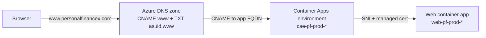

# Custom Domain Setup (Azure App Service Domain + Container Apps)

This runbook puts the production Web app behind your own domain name, e.g. `https://www.personalfinancex.com`, instead of the generated `web-pf-prod-<suffix>.<region>.azurecontainerapps.io` address. Everything stays in Azure: the domain is bought as an **App Service Domain**, its DNS lives in **Azure DNS**, and the TLS certificate is a free **Container Apps managed certificate**.

The old `azurecontainerapps.io` URL keeps working after the switch.

**Subdomain or apex.** The app is served on a **subdomain** such as `www.<domain>` or `app.<domain>`. A subdomain points at the app with a CNAME record and validates its certificate by CNAME, so it does not depend on the environment's IP address. The bare **apex** (`<domain>` with no prefix) is also possible; the differences are marked **Apex alternative** in each step. The Bicep binds **one** hostname, so pick one.

---

## 0. Plan at a glance

Do the phases in order. Each phase ends in a state that is safe to leave overnight, so the work can be spread over several sittings. Total hands-on time is about 1 hour, plus waiting for DNS and the certificate.

| Phase | Steps | Hands-on | Waiting | Safe stopping point? |
|---|---|---|---|---|
| A. Prepare | Prerequisites, Step 1 | 10 min | – | Yes: nothing bought yet |
| B. Buy | Step 2 | 10 min | ~5 min provisioning | Yes: domain owned, not used yet |
| C. DNS | Step 3 | 10 min | minutes, up to an hour | Yes: records do nothing until the hostname is added |
| D. Bind | Step 4 | 10 min | 5–20 min certificate | **Only after Phase E is done**, see below |
| E. Lock in CI | Step 5 | 15 min | one CI run | Yes |
| F. External services | Step 6 | 10 min | a few minutes | Yes |
| G. Verify | Section 4 | 10 min | – | Done |

> **Do Phases D and E in the same sitting.** After Step 4 the custom domain works, but any CI deploy that runs before Step 5 is in place rebinds the domain without TLS. Finish Step 5 straight after Step 4.

### Progress checklist

- [ ] **A.** Subscription is pay-as-you-go; `az login` works; name and subdomain chosen
- [ ] **B.** Domain bought; DNS zone `<domain>` exists in `rg-personalfinance-prod`
- [ ] **C.** CNAME `<sub>` and TXT `asuid.<sub>` records added and resolving
- [ ] **D.** Hostname added; managed certificate issued; `https://<host>` loads
- [ ] **E.** Both GitHub variables set; CI deploy kept the binding
- [ ] **F.** Google OAuth origins and redirect URI added; (optional) Brevo domain verified
- [ ] **G.** Verification checklist passes

### Values worksheet

Fill these in as you go; later steps need them. None of them are secrets, but keep this filled-in copy out of the repository anyway.

| Value | From | Your value |
|---|---|---|
| Domain `<domain>` | Step 1 | |
| Subdomain label `<sub>` | Step 1 | |
| Full hostname `<host>` | Step 1 | |
| Environment name `<env>` | Resource names table | |
| Web app name `<web>` | Resource names table | |
| Web app FQDN `<web-fqdn>` | Step 3.1 | |
| Verification ID `<verifyId>` | Step 3.1 | |
| Managed certificate name | Step 4.3 | |
| Managed certificate `id` | Step 4.3 | |

---

## 1. Overview



| Piece | Where it lives | Who creates it |
|---|---|---|
| Domain registration | App Service Domain in `rg-personalfinance-prod` | You, once (Step 2) |
| DNS records (CNAME, TXT) | Azure DNS zone created with the domain | You, once (Step 3) |
| Hostname + managed certificate | Container Apps environment and Web app | You, once (Step 4) |
| Keeping the binding on every deploy | `infra/modules/web-service.bicep` via `customDomainName` + `certificateId` | CI, every deploy (Step 5) |

### Cost

| Item | Approximate cost |
|---|---|
| App Service Domain (`.com`) | ~$12 / year |
| Azure DNS zone | $0.50 / month (~$6 / year) |
| Azure DNS queries | $0.40 per million; effectively $0 for this app |
| Container Apps custom domain + managed certificate | Free |
| **Total** | **~$18 / year** |

Prices are indicative. The portal shows the exact domain price before you buy.

### Resource names used below

| Placeholder | Production value |
|---|---|
| `<rg>` | `rg-personalfinance-prod` |
| `<env>` | `cae-pf-prod-<suffix>` (find it with `az containerapp env list -g rg-personalfinance-prod -o table`) |
| `<web>` | `web-pf-prod-<suffix>` (find it with `az containerapp list -g rg-personalfinance-prod -o table`). This is the resource **name**, not the URL: no `https://` and nothing after the first dot. |
| `<domain>` | the domain you buy, e.g. `personalfinancex.com` |
| `<sub>` | the subdomain label, e.g. `www` or `app` |
| `<host>` | the full hostname the app is served on, `<sub>.<domain>`, e.g. `www.personalfinancex.com` |

> **PowerShell users:** the commands below fit on one line, so they run in PowerShell as written. Bash line continuations (`\`) do not work in PowerShell. Quote `@` when you use it as a record name (`-n "@"`): PowerShell reads a bare `@` as the splatting operator and fails with `Unrecognized token in source text`.

---

## 2. Prerequisites

- [ ] An Azure subscription with **pay-as-you-go billing and a payment card**. Free-trial and credit-only subscriptions (Azure for Students, Visual Studio credits) cannot buy App Service Domains.
- [ ] **Owner** or **Contributor** on `rg-personalfinance-prod`.
- [ ] Azure CLI signed in to the production subscription:

  ```bash
  az login
  az account set --subscription "<subscription name or id>"
  az extension add --name containerapp --upgrade
  ```

- [ ] Admin access to the GitHub repository (to set Actions variables) and to the Google Cloud OAuth client (Step 6).

---

## 3. Step-by-step

### Step 1: Pick and check the name

1. In the Azure portal, search **App Service Domains** and select **+ Create**.
2. Choose the subscription and resource group `rg-personalfinance-prod`.
3. Type the name you want (e.g. `personalfinancex`) and check the availability list. `.com`, `.net`, `.org` and a few others are offered; `.dev` is not.
4. Choose the subdomain label the app will live on, e.g. `www` or `app`. That gives you `<host>`.

### Step 2: Buy the domain

1. Fill in the **Contact information**. It is required by ICANN; **Privacy protection** (on by default) hides it from public WHOIS.
2. On **Advanced**, keep **Auto renew** on. Leave **DNS zone** set to create a new Azure DNS zone.
3. Review the price and select **Create**.

Provisioning takes a few minutes. Afterwards the resource group contains the App Service Domain and an Azure DNS zone named `<domain>`.

> If the purchase fails with a billing or eligibility error, the subscription type is the usual cause (see Prerequisites).

### Step 3: Point DNS at the Web app

1. Get the Web app's FQDN and the environment's domain verification ID:

   ```bash
   az containerapp show -n <web> -g <rg> --query "properties.configuration.ingress.fqdn" -o tsv
   az containerapp env show -n <env> -g <rg> --query "properties.customDomainConfiguration.customDomainVerificationId" -o tsv
   ```

   The FQDN looks like `web-pf-prod-<suffix>.<unique-name>.<region>.azurecontainerapps.io`.

2. Add two record sets to the DNS zone (portal: **DNS zones** → `<domain>` → **+ Record set**, or the CLI below):

   | Type | Name | Value | TTL |
   |---|---|---|---|
   | CNAME | `<sub>` | `<web-fqdn>` from step 1 | 3600 |
   | TXT | `asuid.<sub>` | `<verifyId>` from step 1 | 3600 |

   ```bash
   az network dns record-set cname set-record -g <rg> -z <domain> -n <sub> --cname <web-fqdn>
   az network dns record-set txt add-record -g <rg> -z <domain> -n asuid.<sub> --value <verifyId>
   ```

3. Wait until the records resolve (usually minutes for a new App Service Domain):

   ```bash
   nslookup <host>
   nslookup -type=TXT asuid.<host>
   ```

> **Apex alternative.** The apex cannot be a CNAME. Get the environment's IP with `az containerapp env show -n <env> -g <rg> --query "properties.staticIp" -o tsv`, then add an **A** record `@` pointing at it and a **TXT** record `asuid` holding `<verifyId>`:
>
> ```bash
> az network dns record-set a add-record -g <rg> -z <domain> -n "@" --ipv4-address <ip>
> az network dns record-set txt add-record -g <rg> -z <domain> -n asuid --value <verifyId>
> ```

### Step 4: Add the hostname and the managed certificate

1. Add the hostname to the Web app:

   ```bash
   az containerapp hostname add -n <web> -g <rg> --hostname <host>
   ```

2. Create a free managed certificate and bind it. A subdomain uses **CNAME** validation:

   ```bash
   az containerapp hostname bind -n <web> -g <rg> --hostname <host> --environment <env> --validation-method CNAME
   ```

   This is the step that turns on HTTPS for `<host>`. Azure checks the DNS records, issues the certificate, stores it in the environment and binds it to the hostname with SNI. Issuance takes about 5–20 minutes. The command waits; if it times out, re-check with Step 3.

   > **Apex alternative.** Use `--hostname <domain>` in both commands and `--validation-method HTTP` in the bind. An apex cannot use CNAME validation.

3. Confirm the binding and copy the certificate's resource ID:

   ```bash
   az containerapp hostname list -n <web> -g <rg> -o table
   az containerapp env certificate list -n <env> -g <rg> --managed-certificates-only --query "[].{name:name, subject:properties.subjectName, id:id}" -o table
   ```

   The hostname's `bindingType` should be `SniEnabled`. The certificate `id` looks like `/subscriptions/.../managedEnvironments/<env>/managedCertificates/<name>`; pick the one whose `subject` is `<host>`.

4. Open `https://<host>` in a browser. You should see the app with a valid certificate.

### Step 5: Make CI keep the binding

The next CI deploy re-applies `infra/main.bicep`. `infra/modules/web-service.bicep` adds the custom domain when `customDomainName` is set and binds it with TLS (`SniEnabled`) only when `certificateId` is also set. **If the workflow does not pass `certificateId`, the deploy rebinds the domain with `bindingType: Disabled` and HTTPS on the custom domain stops working.**

The Bicep declares the app's whole custom-domain list, so a deploy keeps **only** the hostname in `CUSTOM_DOMAIN_NAME`. Any other hostname you bound by hand, for example an apex you tried first, is removed on the next deploy.

1. Add two repository variables: **Settings** → **Secrets and variables** → **Actions** → **Variables** → **New repository variable**:

   | Variable | Value |
   |---|---|
   | `CUSTOM_DOMAIN_NAME` | `<host>`, e.g. `www.personalfinancex.com` |
   | `CUSTOM_DOMAIN_CERTIFICATE_ID` | the certificate `id` from Step 4.3 |

   The two must match: the certificate's subject has to be the same hostname as `CUSTOM_DOMAIN_NAME`.

2. No workflow change is needed. Both `.github/workflows/deploy-azure.yml` and `.github/workflows/rollback.yml` pass the two variables to the shared action `.github/actions/deploy-azure/action.yml`, which hands them to the Bicep as `customDomainName` and `certificateId`. Set both variables before the next deploy runs, or set neither.

3. Merge a change to `main` (or run the workflow with **workflow_dispatch**) and confirm afterwards that the binding is still `SniEnabled`:

   ```bash
   az containerapp hostname list -n <web> -g <rg> -o table
   ```

### Step 6: Update external services

1. **Google sign-in.** In Google Cloud Console → **APIs & Services** → **Credentials** → the OAuth 2.0 Web client:
   - **Authorized JavaScript origins:** add `https://<host>`
   - **Authorized redirect URIs:** add `https://<host>/signin-google`

   Keep the existing `azurecontainerapps.io` entries so both URLs keep working. Changes can take a few minutes to apply.
2. **Brevo (optional).** Emails keep working with the current verified sender. To send from `@<domain>`, add the domain in Brevo → **Senders, Domains & Dedicated IPs** → **Domains**, then add the SPF/DKIM/DMARC records it shows to the Azure DNS zone, and update the `BREVO_SENDER_EMAIL` variable. Sender addresses use the bare `<domain>`, not `<host>`.

No application code changes are needed: the Web app already honours forwarded headers and `AllowedHosts` is `*`. Links in emails (confirmation, password reset) use the host of the incoming request, so they point at whichever domain the user used.

---

## 4. Verification checklist

- [ ] `https://<host>` loads with a valid certificate (padlock, issuer DigiCert/GeoTrust managed by Microsoft).
- [ ] `http://<host>` redirects to HTTPS or is refused (ingress has `allowInsecure: false`).
- [ ] `https://<host>/health` returns `Healthy`.
- [ ] Sign in with Google works on `https://<host>`.
- [ ] A registration or password-reset email links to `https://<host>/...`.
- [ ] After the next CI deploy, `az containerapp hostname list` still shows the certificate bound.

When the app is on a subdomain, the bare `https://<domain>` does **not** load. Redirecting the apex to `<host>` needs a second hostname, which the Bicep does not support yet.

---

## 5. Troubleshooting

| Symptom | Likely cause | Fix |
|---|---|---|
| PowerShell: `Unrecognized token in source text` at `@` | A bare `@` is PowerShell's splatting operator | Quote it: `-n "@"`. |
| `hostname add` fails with a not-found error | `-n` was given the URL instead of the app name | Use `<web>` only, e.g. `web-pf-prod-<suffix>`, without `https://` or anything after the first dot. |
| `hostname add` fails with a validation error | TXT `asuid.<sub>` missing or not yet propagated, or wrong value | Re-check Step 3 with `nslookup -type=TXT asuid.<host>`; the value must equal the environment's `customDomainVerificationId`. |
| Certificate stuck in `Pending` / bind times out | CNAME wrong or not propagated, so validation cannot reach the app | Confirm `nslookup <host>` shows `<web-fqdn>` as an alias, then rerun the `hostname bind` command. For the apex, `nslookup <domain>` must return the environment `staticIp`. |
| Site worked, then HTTPS broke after a deploy | CI deployed without `certificateId`, or with a certificate for a different hostname | Set `CUSTOM_DOMAIN_CERTIFICATE_ID` to the certificate whose subject is `<host>` (Step 5), then redeploy. |
| A hostname added by hand disappeared after a deploy | The Bicep keeps only `CUSTOM_DOMAIN_NAME` | Expected. Set `CUSTOM_DOMAIN_NAME` to the hostname you want to keep. |
| CI deploy fails on the Web app with a custom-domain error | `CUSTOM_DOMAIN_NAME` set but DNS records missing or deleted | Restore the CNAME and TXT records, or clear `CUSTOM_DOMAIN_NAME` to deploy without the domain. |
| Google login: `redirect_uri_mismatch` | New URIs not added to the OAuth client | Step 6.1. |
| First request is slow | Scale-to-zero outside business hours (ADR 0011) | Expected; unrelated to the domain. |

### Renewal

- The **domain** auto-renews yearly against the subscription's payment method. Keep the card valid; an expired domain takes the site offline.
- The **managed certificate** renews automatically as long as the CNAME and TXT records (A and TXT for the apex) stay in place.

### Switching hostnames (e.g. apex to `www`)

1. Do Steps 3 and 4 for the new hostname. Both hostnames work side by side until the next deploy.
2. Update both GitHub variables (Step 5.1) to the new hostname and its certificate, then redeploy. The deploy removes the old hostname from the app.
3. Add the new URLs to Google OAuth (Step 6.1).
4. Delete the old certificate and DNS records once nothing uses them (see below).

### Removing the custom domain

1. Clear the `CUSTOM_DOMAIN_NAME` and `CUSTOM_DOMAIN_CERTIFICATE_ID` variables and redeploy.
2. `az containerapp hostname delete -n <web> -g <rg> --hostname <host>`
3. Delete the managed certificate: `az containerapp env certificate delete -n <env> -g <rg> --certificate <name>`
4. Delete the DNS records you added in Step 3 if you no longer need them.
5. Turn off auto-renew on the App Service Domain if you no longer want it.

---

## 6. Production setup log: `www.personalfinancex.com`

The commands used to set up production, with the real names filled in. Every command is one line and runs in PowerShell as written. The verification ID and certificate ID are read from Azure inside the commands, so they are not copied here.

| Value | Production |
|---|---|
| Resource group | `rg-personalfinance-prod` |
| DNS zone | `personalfinancex.com` |
| Environment | `cae-pf-prod-cdknljx37hrso` |
| Web app | `web-pf-prod-cdknljx37hrso` |
| Web app FQDN | `web-pf-prod-cdknljx37hrso.blueisland-19317010.westus2.azurecontainerapps.io` |
| Hostname | `www.personalfinancex.com` |

### Apex first attempt (superseded)

Production was first pointed at the bare apex, then moved to `www`. These records and bindings are not needed for `www`. The next CI deploy removes the apex hostname from the app, because the Bicep keeps only `CUSTOM_DOMAIN_NAME`.

```powershell
az network dns record-set a add-record -g rg-personalfinance-prod -z personalfinancex.com -n "@" --ipv4-address 20.64.184.211
az containerapp hostname add -n web-pf-prod-cdknljx37hrso -g rg-personalfinance-prod --hostname personalfinancex.com
az containerapp hostname bind -n web-pf-prod-cdknljx37hrso -g rg-personalfinance-prod --hostname personalfinancex.com --environment cae-pf-prod-cdknljx37hrso --validation-method HTTP
```

The `@` must be quoted in PowerShell. Unquoted, it fails with `Unrecognized token in source text`.

### 1. Look up names

```powershell
az containerapp list -g rg-personalfinance-prod --query "[].name" -o table
az containerapp env list -g rg-personalfinance-prod --query "[].name" -o table
az containerapp show -n web-pf-prod-cdknljx37hrso -g rg-personalfinance-prod --query "properties.configuration.ingress.fqdn" -o tsv
```

### 2. DNS records

```powershell
$verifyId = az containerapp env show -n cae-pf-prod-cdknljx37hrso -g rg-personalfinance-prod --query "properties.customDomainConfiguration.customDomainVerificationId" -o tsv
az network dns record-set cname set-record -g rg-personalfinance-prod -z personalfinancex.com -n www --cname web-pf-prod-cdknljx37hrso.blueisland-19317010.westus2.azurecontainerapps.io
az network dns record-set txt add-record -g rg-personalfinance-prod -z personalfinancex.com -n asuid.www --value $verifyId
```

Wait until both resolve:

```powershell
nslookup www.personalfinancex.com
nslookup -type=TXT asuid.www.personalfinancex.com
```

### 3. Hostname and managed certificate

```powershell
az containerapp hostname add -n web-pf-prod-cdknljx37hrso -g rg-personalfinance-prod --hostname www.personalfinancex.com
az containerapp hostname bind -n web-pf-prod-cdknljx37hrso -g rg-personalfinance-prod --hostname www.personalfinancex.com --environment cae-pf-prod-cdknljx37hrso --validation-method CNAME
```

Confirm `bindingType` is `SniEnabled`:

```powershell
az containerapp hostname list -n web-pf-prod-cdknljx37hrso -g rg-personalfinance-prod -o table
```

### 4. GitHub variables

Set both before the next deploy runs. The certificate ID is the one whose subject is `www.personalfinancex.com`.

```powershell
$certId = az containerapp env certificate list -n cae-pf-prod-cdknljx37hrso -g rg-personalfinance-prod --managed-certificates-only --query "[?properties.subjectName=='www.personalfinancex.com'].id | [0]" -o tsv
gh variable set CUSTOM_DOMAIN_NAME --repo tngo0508/PersonalFinance --body "www.personalfinancex.com"
gh variable set CUSTOM_DOMAIN_CERTIFICATE_ID --repo tngo0508/PersonalFinance --body $certId
```

### 5. Google sign-in

In Google Cloud Console, add to the OAuth 2.0 Web client:

- Authorized JavaScript origin: `https://www.personalfinancex.com`
- Authorized redirect URI: `https://www.personalfinancex.com/signin-google`

### 6. Verify after the next deploy

```powershell
az containerapp hostname list -n web-pf-prod-cdknljx37hrso -g rg-personalfinance-prod -o table
curl.exe -sI https://www.personalfinancex.com/health
```

### Optional: clean up the apex

Once the deploy has removed the apex hostname, delete its certificate and records if you no longer want them. Look up the certificate name first:

```powershell
az containerapp env certificate list -n cae-pf-prod-cdknljx37hrso -g rg-personalfinance-prod --managed-certificates-only --query "[?properties.subjectName=='personalfinancex.com'].name" -o tsv
az containerapp env certificate delete -n cae-pf-prod-cdknljx37hrso -g rg-personalfinance-prod --certificate <name>
az network dns record-set a delete -g rg-personalfinance-prod -z personalfinancex.com -n "@" --yes
az network dns record-set txt delete -g rg-personalfinance-prod -z personalfinancex.com -n asuid --yes
```

Keep the apex records instead if you plan to redirect `personalfinancex.com` to `www` later.
