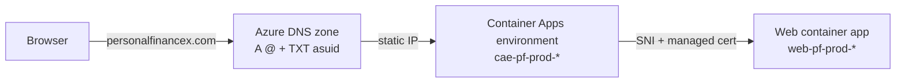

# Custom Domain Setup (Azure App Service Domain + Container Apps)

This runbook puts the production Web app behind your own domain name, e.g. `https://personalfinancex.com`, instead of the generated `web-pf-prod-<suffix>.<region>.azurecontainerapps.io` address. Everything stays in Azure: the domain is bought as an **App Service Domain**, its DNS lives in **Azure DNS**, and the TLS certificate is a free **Container Apps managed certificate**.

The old `azurecontainerapps.io` URL keeps working after the switch.

---

## 0. Plan at a glance

Do the phases in order. Each phase ends in a state that is safe to leave overnight, so the work can be spread over several sittings. Total hands-on time is about 1 hour, plus waiting for DNS and the certificate.

| Phase | Steps | Hands-on | Waiting | Safe stopping point? |
|---|---|---|---|---|
| A. Prepare | Prerequisites, Step 1 | 10 min | – | Yes: nothing bought yet |
| B. Buy | Step 2 | 10 min | ~5 min provisioning | Yes: domain owned, not used yet |
| C. DNS | Step 3 | 10 min | minutes, up to an hour | Yes: records do nothing until the hostname is added |
| D. Bind | Step 4 | 10 min | 5–20 min certificate | **Only after Phase E is done**, see below |
| E. Lock in CI | Step 5 | 15 min | one CI run | Yes |
| F. External services | Step 6 | 10 min | a few minutes | Yes |
| G. Verify | Section 4 | 10 min | – | Done |

> **Do Phases D and E in the same sitting.** After Step 4 the custom domain works, but any CI deploy that runs before Step 5 is in place rebinds the domain without TLS. Either finish Step 5 straight after Step 4, or make the workflow change (Step 5.2) first, before Phase D.

### Progress checklist

- [ ] **A.** Subscription is pay-as-you-go; `az login` works; name chosen and available
- [ ] **B.** Domain bought; DNS zone `<domain>` exists in `rg-personalfinance-prod`
- [ ] **C.** A `@` and TXT `asuid` records added and resolving
- [ ] **D.** Hostname added; managed certificate issued; `https://<domain>` loads
- [ ] **E.** Workflow passes `certificateId`; both GitHub variables set; CI deploy kept the binding
- [ ] **F.** Google OAuth origins and redirect URI added; (optional) Brevo domain verified
- [ ] **G.** Verification checklist passes

### Values worksheet

Fill these in as you go; later steps need them. None of them are secrets, but keep this filled-in copy out of the repository anyway.

| Value | From | Your value |
|---|---|---|
| Domain `<domain>` | Step 1 | |
| Environment name `<env>` | Resource names table | |
| Web app name `<web>` | Resource names table | |
| Static IP `<ip>` | Step 3.1 | |
| Verification ID `<verifyId>` | Step 3.1 | |
| Managed certificate name | Step 4.3 | |
| Managed certificate `id` | Step 4.3 | |

---

## 1. Overview



| Piece | Where it lives | Who creates it |
|---|---|---|
| Domain registration | App Service Domain in `rg-personalfinance-prod` | You, once (Step 2) |
| DNS records (A, TXT) | Azure DNS zone created with the domain | You, once (Step 3) |
| Hostname + managed certificate | Container Apps environment and Web app | You, once (Step 4) |
| Keeping the binding on every deploy | `infra/modules/web-service.bicep` via `customDomainName` + `certificateId` | CI, every deploy (Step 5) |

### Cost

| Item | Approximate cost |
|---|---|
| App Service Domain (`.com`) | ~$12 / year |
| Azure DNS zone | $0.50 / month (~$6 / year) |
| Azure DNS queries | $0.40 per million; effectively $0 for this app |
| Container Apps custom domain + managed certificate | Free |
| **Total** | **~$18 / year** |

Prices are indicative. The portal shows the exact domain price before you buy.

### Resource names used below

| Placeholder | Production value |
|---|---|
| `<rg>` | `rg-personalfinance-prod` |
| `<env>` | `cae-pf-prod-<suffix>` (find it with `az containerapp env list -g rg-personalfinance-prod -o table`) |
| `<web>` | `web-pf-prod-<suffix>` (find it with `az containerapp list -g rg-personalfinance-prod -o table`) |
| `<domain>` | the domain you buy, e.g. `personalfinancex.com` |

---

## 2. Prerequisites

- [ ] An Azure subscription with **pay-as-you-go billing and a payment card**. Free-trial and credit-only subscriptions (Azure for Students, Visual Studio credits) cannot buy App Service Domains.
- [ ] **Owner** or **Contributor** on `rg-personalfinance-prod`.
- [ ] Azure CLI signed in to the production subscription:

  ```bash
  az login
  az account set --subscription "<subscription name or id>"
  az extension add --name containerapp --upgrade
  ```

- [ ] Admin access to the GitHub repository (to set Actions variables) and to the Google Cloud OAuth client (Step 6).

---

## 3. Step-by-step

### Step 1: Pick and check the name

1. In the Azure portal, search **App Service Domains** and select **+ Create**.
2. Choose the subscription and resource group `rg-personalfinance-prod`.
3. Type the name you want (e.g. `personalfinancex`) and check the availability list. `.com`, `.net`, `.org` and a few others are offered; `.dev` is not.

### Step 2: Buy the domain

1. Fill in the **Contact information**. It is required by ICANN; **Privacy protection** (on by default) hides it from public WHOIS.
2. On **Advanced**, keep **Auto renew** on. Leave **DNS zone** set to create a new Azure DNS zone.
3. Review the price and select **Create**.

Provisioning takes a few minutes. Afterwards the resource group contains the App Service Domain and an Azure DNS zone named `<domain>`.

> If the purchase fails with a billing or eligibility error, the subscription type is the usual cause (see Prerequisites).

### Step 3: Point DNS at the Container Apps environment

1. Get the environment's static IP and domain verification ID:

   ```bash
   az containerapp env show -n <env> -g <rg> \
     --query "{ip:properties.staticIp, verifyId:properties.customDomainConfiguration.customDomainVerificationId}" -o table
   ```

2. Add two record sets to the DNS zone (portal: **DNS zones** → `<domain>` → **+ Record set**, or the CLI below):

   | Type | Name | Value | TTL |
   |---|---|---|---|
   | A | `@` | `ip` from step 1 | 3600 |
   | TXT | `asuid` | `verifyId` from step 1 | 3600 |

   ```bash
   az network dns record-set a add-record   -g <rg> -z <domain> -n @     --ipv4-address <ip>
   az network dns record-set txt add-record -g <rg> -z <domain> -n asuid --value <verifyId>
   ```

3. Wait until the records resolve (usually minutes for a new App Service Domain):

   ```bash
   nslookup <domain>
   nslookup -type=TXT asuid.<domain>
   ```

> **Optional `www`:** to serve `www.<domain>` too, add a CNAME `www` → `<web>.<region>.azurecontainerapps.io` and a TXT `asuid.www` with the same `verifyId`, then repeat Step 4 for `www.<domain>`. The Bicep below binds one hostname only, so a second hostname also needs a Bicep change.

### Step 4: Add the hostname and the managed certificate

1. Add the hostname to the Web app:

   ```bash
   az containerapp hostname add -n <web> -g <rg> --hostname <domain>
   ```

2. Create a free managed certificate and bind it. An apex domain (no subdomain) must use **HTTP** validation:

   ```bash
   az containerapp hostname bind -n <web> -g <rg> --hostname <domain> \
     --environment <env> --validation-method HTTP
   ```

   Issuance takes about 5–20 minutes. The command waits; if it times out, re-check with step 3.

3. Confirm the binding and copy the certificate's resource ID:

   ```bash
   az containerapp hostname list -n <web> -g <rg> -o table
   az containerapp env certificate list -n <env> -g <rg> --managed-certificates-only --query "[].{name:name, subject:properties.subjectName, id:id}" -o table
   ```

   The `id` looks like `/subscriptions/.../managedEnvironments/<env>/managedCertificates/<name>`.

4. Open `https://<domain>` in a browser. You should see the app with a valid certificate.

### Step 5: Make CI keep the binding

The next CI deploy re-applies `infra/main.bicep`. `infra/modules/web-service.bicep` adds the custom domain when `customDomainName` is set and binds it with TLS (`SniEnabled`) only when `certificateId` is also set. **If the workflow does not pass `certificateId`, the deploy rebinds the domain with `bindingType: Disabled` and HTTPS on the custom domain stops working.**

1. Add two repository variables: **Settings** → **Secrets and variables** → **Actions** → **Variables** → **New repository variable**:

   | Variable | Value |
   |---|---|
   | `CUSTOM_DOMAIN_NAME` | `<domain>` |
   | `CUSTOM_DOMAIN_CERTIFICATE_ID` | the certificate `id` from Step 4.3 |

2. Make sure the Bicep deploy step in `.github/workflows/deploy-azure.yml` passes both, next to the other `parameters:` lines:

   ```yaml
               customDomainName=${{ vars.CUSTOM_DOMAIN_NAME || '' }}
               certificateId=${{ vars.CUSTOM_DOMAIN_CERTIFICATE_ID || '' }}
   ```

3. Merge a change to `main` (or run the workflow with **workflow_dispatch**) and confirm afterwards that the binding is still `SniEnabled`:

   ```bash
   az containerapp hostname list -n <web> -g <rg> -o table
   ```

### Step 6: Update external services

1. **Google sign-in.** In Google Cloud Console → **APIs & Services** → **Credentials** → the OAuth 2.0 Web client:
   - **Authorized JavaScript origins:** add `https://<domain>`
   - **Authorized redirect URIs:** add `https://<domain>/signin-google`

   Keep the existing `azurecontainerapps.io` entries so both URLs keep working. Changes can take a few minutes to apply.
2. **Brevo (optional).** Emails keep working with the current verified sender. To send from `@<domain>`, add the domain in Brevo → **Senders, Domains & Dedicated IPs** → **Domains**, then add the SPF/DKIM/DMARC records it shows to the Azure DNS zone, and update the `BREVO_SENDER_EMAIL` variable.

No application code changes are needed: the Web app already honours forwarded headers and `AllowedHosts` is `*`. Links in emails (confirmation, password reset) use the host of the incoming request, so they point at whichever domain the user used.

---

## 4. Verification checklist

- [ ] `https://<domain>` loads with a valid certificate (padlock, issuer DigiCert/GeoTrust managed by Microsoft).
- [ ] `http://<domain>` redirects to HTTPS or is refused (ingress has `allowInsecure: false`).
- [ ] `https://<domain>/health` returns `Healthy`.
- [ ] Sign in with Google works on `https://<domain>`.
- [ ] A registration or password-reset email links to `https://<domain>/...`.
- [ ] After the next CI deploy, `az containerapp hostname list` still shows the certificate bound.

---

## 5. Troubleshooting

| Symptom | Likely cause | Fix |
|---|---|---|
| `hostname add` fails with a validation error | TXT `asuid` missing or not yet propagated, or wrong value | Re-check Step 3 with `nslookup -type=TXT asuid.<domain>`; the value must equal the environment's `customDomainVerificationId`. |
| Certificate stuck in `Pending` / bind times out | A record wrong or not propagated, so HTTP validation cannot reach the app | Confirm `nslookup <domain>` returns the environment `staticIp`, then rerun the `hostname bind` command. |
| Site worked, then HTTPS broke after a deploy | CI deployed without `certificateId` | Set `CUSTOM_DOMAIN_CERTIFICATE_ID` and the workflow parameter (Step 5), then redeploy. |
| CI deploy fails on the Web app with a custom-domain error | `CUSTOM_DOMAIN_NAME` set but DNS records missing or deleted | Restore the A and TXT records, or clear `CUSTOM_DOMAIN_NAME` to deploy without the domain. |
| Google login: `redirect_uri_mismatch` | New URIs not added to the OAuth client | Step 6.1. |
| First request is slow | Scale-to-zero outside business hours (ADR 0011) | Expected; unrelated to the domain. |

### Renewal

- The **domain** auto-renews yearly against the subscription's payment method. Keep the card valid; an expired domain takes the site offline.
- The **managed certificate** renews automatically as long as the A and TXT records stay in place.

### Removing the custom domain

1. Clear the `CUSTOM_DOMAIN_NAME` and `CUSTOM_DOMAIN_CERTIFICATE_ID` variables and redeploy.
2. `az containerapp hostname delete -n <web> -g <rg> --hostname <domain>`
3. Delete the managed certificate: `az containerapp env certificate delete -n <env> -g <rg> --certificate <name>`
4. Turn off auto-renew on the App Service Domain if you no longer want it.
