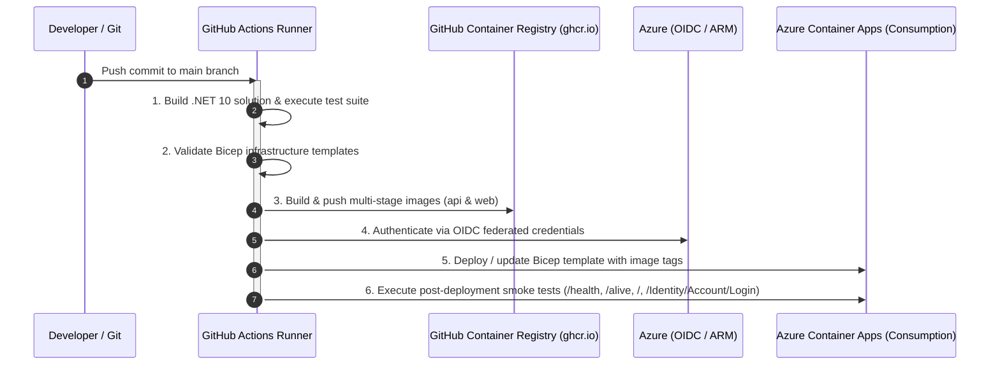

# Personal Finance App - Development Notes & Developer Guide

This document provides developer guidelines, architectural details, configuration instructions, secrets management workflows, and troubleshooting solutions for developing and maintaining the **Personal Finance App**.

---

## 1. Prerequisites & Environment Setup

### Required SDKs and Tools
- **.NET 10 SDK** (v10.0.100 preview or higher)
- **Entity Framework Core CLI Tools (`dotnet-ef`)**:
  ```bash
  dotnet tool install --global dotnet-ef
  # Or update if already installed
  dotnet tool update --global dotnet-ef
  ```
- **ASP.NET Core Code Generator (`dotnet-aspnet-codegenerator`)** *(for scaffolding Identity pages)*:
  ```bash
  dotnet tool install --global dotnet-aspnet-codegenerator
  # Or update if already installed
  dotnet tool update --global dotnet-aspnet-codegenerator
  ```
- **IDE**: JetBrains Rider (recommended), Visual Studio 2022+ / 2026+, or VS Code with C# Dev Kit.
- **Git**

---

## 2. Solution Structure & Project Architecture

The solution uses a Clean Architecture pattern integrated with **.NET Aspire**:

```
PersonalFinanceApp/
├── PersonalFinance.sln                      # Solution configuration
├── PersonalFinance.db                       # Shared SQLite database (git-ignored)
├── CHANGELOG.md                             # Release changelog
├── README.md                                # General project documentation
├── docs/
│   ├── DEVELOPMENT.md                       # Developer guidelines (this document)
│   ├── deployment.md                        # Deployment guide
│   └── IDENTITY_SCHEMA.md                   # Identity schema documentation
└── PersonalFinance/
    ├── src/
    │   ├── PersonalFinance.AppHost/         # .NET Aspire orchestrator & dashboard
    │   ├── PersonalFinance.ServiceDefaults/ # Aspire telemetry, health checks & resilience
    │   ├── PersonalFinance.Web/             # ASP.NET Core MVC, Razor Pages, Identity UI
    │   ├── PersonalFinance.ApiService/      # REST API backend, Google Drive service & Scalar
    │   ├── PersonalFinance.Data/            # EF Core AppDbContext, entities & migrations
    │   └── PersonalFinance.Shared/          # Contracts, DTOs, helpers & cryptographic utilities
    └── tests/
        └── PersonalFinance.Tests/           # xUnit unit and integration tests
```

### Architectural Roles

| Project | Responsibility | Key Technologies |
|---|---|---|
| `PersonalFinance.AppHost` | Orchestrates multi-project startup, service discovery, and Aspire dashboard. | .NET Aspire 13.x |
| `PersonalFinance.ServiceDefaults` | Shared OpenTelemetry metrics, distributed tracing, health endpoints (`/health`, `/alive`), and HTTP resilience. | OpenTelemetry, Polly |
| `PersonalFinance.Web` | Frontend web UI, Identity, file explorer, budget reports, transactions viewer, net worth projections. | MVC, Razor Pages, Identity, Bootstrap 5, Chart.js, Refit |
| `PersonalFinance.ApiService` | Backend REST API: Google Drive integration, budget reports, transactions, net worth projections, OpenAPI & Scalar docs (`/scalar/v1`). | ASP.NET Core Controllers, Scalar |
| `PersonalFinance.Data` | EF Core persistence with provider-specific migrations (SQLite + SQL Server/Azure SQL), Identity stores, Data Protection keys. | EF Core 10, SQLite, SQL Server |
| `PersonalFinance.Shared` | Shared DTOs, API interfaces (`IGoogleDriveApi`, `INetWorthApi`), parsing algorithms (`GoogleDriveHelper`), AES-256 helpers. | Refit, System.Security.Cryptography |
| `PersonalFinance.Tests` | Automated unit and integration test suite (104+ tests). | xUnit, Moq, FluentAssertions |

---

## 3. Configuration & Secrets Management

### Security Principle
**Never commit plain-text API keys, passwords, or private tokens to Git repositories or `appsettings.json`.**

The project separates configuration into:
1. `appsettings.json` / `appsettings.Development.json`: Safe, non-sensitive defaults, URLs, and logging levels.
2. **.NET User Secrets** (`secrets.json`): Sensitive credentials on developer machines (Brevo API keys, Google API keys).
3. **Environment Variables**: Production secrets injected via container orchestrators or CI/CD pipelines.

---

### Setting Up User Secrets on a New Machine

When cloning this repository on a new machine, run the following commands to configure development user secrets. Replace each placeholder value with your actual credential.

#### PersonalFinance.Web Project

```bash
# Azure SQL Database connection string
dotnet user-secrets set "ConnectionStrings:DefaultConnection" "Server=tcp:<server>.database.windows.net,1433;Initial Catalog=PersonalFinance;Persist Security Info=False;User ID=<user>;Password=<password>;MultipleActiveResultSets=False;Encrypt=True;TrustServerCertificate=False;Connection Timeout=30;" --project PersonalFinance/src/PersonalFinance.Web

# Brevo transactional email API key
dotnet user-secrets set "Brevo:ApiKey" "<YOUR_BREVO_API_KEY>" --project PersonalFinance/src/PersonalFinance.Web

# Google OAuth 2.0 credentials
dotnet user-secrets set "Authentication:Google:ClientId" "<YOUR_GOOGLE_CLIENT_ID>.apps.googleusercontent.com" --project PersonalFinance/src/PersonalFinance.Web
dotnet user-secrets set "Authentication:Google:ClientSecret" "<YOUR_GOOGLE_CLIENT_SECRET>" --project PersonalFinance/src/PersonalFinance.Web
```

#### PersonalFinance.ApiService Project

```bash
# Azure SQL Database connection string
dotnet user-secrets set "ConnectionStrings:DefaultConnection" "Server=tcp:<server>.database.windows.net,1433;Initial Catalog=PersonalFinance;Persist Security Info=False;User ID=<user>;Password=<password>;MultipleActiveResultSets=False;Encrypt=True;TrustServerCertificate=False;Connection Timeout=30;" --project PersonalFinance/src/PersonalFinance.ApiService

# Google Drive API key (default; users can also enter their own key via /GoogleDrive)
dotnet user-secrets set "GoogleDrive:ApiKey" "<YOUR_GOOGLE_DRIVE_API_KEY>" --project PersonalFinance/src/PersonalFinance.ApiService

# OpenAI API key (for AI Assistant feature)
dotnet user-secrets set "OpenAI:ApiKey" "<YOUR_OPENAI_API_KEY>" --project PersonalFinance/src/PersonalFinance.ApiService
```

#### Verify Configured Secrets

```bash
# List Web project secrets
dotnet user-secrets list --project PersonalFinance/src/PersonalFinance.Web

# List ApiService project secrets
dotnet user-secrets list --project PersonalFinance/src/PersonalFinance.ApiService
```

#### Resetting User Secrets

If you need to clear all secrets and start fresh:

```bash
# Clear all secrets for Web project
dotnet user-secrets clear --project PersonalFinance/src/PersonalFinance.Web

# Clear all secrets for ApiService project
dotnet user-secrets clear --project PersonalFinance/src/PersonalFinance.ApiService
```

#### Remove a Single Secret

To remove an individual secret without clearing all others:

```bash
# Example: Remove the Brevo API key
dotnet user-secrets remove "Brevo:ApiKey" --project PersonalFinance/src/PersonalFinance.Web
```

---

### Viewing and Locating User Secrets

#### Viewing Configured Secrets

To see all currently configured secrets for a project, run:

```bash
# List Web project secrets
dotnet user-secrets list --project PersonalFinance/src/PersonalFinance.Web

# List ApiService project secrets
dotnet user-secrets list --project PersonalFinance/src/PersonalFinance.ApiService
```

#### Where Are User Secrets Stored?

User secrets are stored in a JSON file in your user profile's AppData folder:

```
%APPDATA%\Microsoft\UserSecrets\<SecretId>\secrets.json
```

The `SecretId` is unique to each project and can be found in the project's `.csproj` file. Look for the `<UserSecretsId>` element:

```xml
<PropertyGroup>
  <UserSecretsId>aspnet-PersonalFinance.Web-abc123</UserSecretsId>
</PropertyGroup>
```

You can open the `secrets.json` file directly in a text editor to view the raw key-value pairs, but using `dotnet user-secrets list` is the recommended approach.

**Important:** User secrets are for **development only**. They are loaded only when the environment is set to `Development` and should never be relied upon in production deployments.

---

### Brevo Transactional Email Configuration

Account registration requires email confirmation (`options.SignIn.RequireConfirmedAccount = true`). Verification emails are sent via the **Brevo REST API** (`https://api.brevo.com/v3/smtp/email`).

#### Setting Brevo API Key via User Secrets
Configure the API key in the `PersonalFinance.Web` project secret store:

```bash
# Set Brevo API Key
dotnet user-secrets set "Brevo:ApiKey" "<YOUR_BREVO_API_KEY>" --project PersonalFinance/src/PersonalFinance.Web

# Optional: Override sender email or name
dotnet user-secrets set "Brevo:SenderEmail" "your-email@domain.com" --project PersonalFinance/src/PersonalFinance.Web
dotnet user-secrets set "Brevo:SenderName" "PersonalFinance" --project PersonalFinance/src/PersonalFinance.Web
```

#### Inspecting Configured Secrets
```bash
dotnet user-secrets list --project PersonalFinance/src/PersonalFinance.Web
```

#### Configuration Schema (`appsettings.json`)
`PersonalFinance.Web/appsettings.json` defines placeholder properties:
```json
"Brevo": {
  "ApiKey": "",
  "SenderEmail": "tngo0508@gmail.com",
  "SenderName": "PersonalFinance"
}
```
During execution, the User Secrets store automatically overrides `Brevo:ApiKey` in `Development` mode.

---

### Google Drive API Configuration

To interact with Google Drive folders without entering a key in the web interface on each session:

```bash
# Set default Google Drive API Key for ApiService
dotnet user-secrets set "GoogleDrive:ApiKey" "<YOUR_GOOGLE_API_KEY>" --project PersonalFinance/src/PersonalFinance.ApiService
```

*Note: Individual users can also supply and save their own API key via `/GoogleDrive`, where it is AES-256 encrypted before being persisted into SQLite.*

---

### Google OAuth 2.0 & External Authentication Setup

The application supports seamless third-party external authentication via ASP.NET Core Identity and OAuth 2.0 / OpenID Connect.

#### How It Works Architecturally
1. **Conditional Registration (`PersonalFinance.Web/Program.cs`)**:
   Google authentication is conditionally registered during startup when `Authentication:Google:ClientId` and `Authentication:Google:ClientSecret` are populated in configuration. If credentials are empty, the application runs smoothly without external login buttons.
2. **Dynamic UI Discovery (`Login.cshtml.cs` & `Register.cshtml.cs`)**:
   Pages query `SignInManager.GetExternalAuthenticationSchemesAsync()`. Branded buttons are dynamically rendered only for active schemes.
3. **Automated User Provisioning & Secure Account Linking (`ExternalLogin.cshtml.cs`)**:
   - **New Users**: When a user logs in with Google for the first time, a new `IdentityUser` is created with `EmailConfirmed = true` (verified by Google) and linked to `AspNetUserLogins`.
   - **Existing Confirmed Accounts**: If a local user with the matching email already exists and is confirmed (`EmailConfirmed == true`), the external provider is linked via `UserManager.AddLoginAsync` and the user is signed in immediately.
   - **Unconfirmed Accounts**: If a local account exists but has not verified their email, linking is rejected until the email is confirmed to prevent unauthorized account takeover.
4. **Custom Claims Synchronization**:
   Google user metadata is extracted during sign-in and synchronized into user identity claims:
   - `urn:google:picture`: User profile avatar (rendered in `_LoginPartial.cshtml`).
   - `ClaimTypes.GivenName`: First name or display name.
   - `urn:google:locale`: Language and regional preference.
5. **API-Aware Cookie Redirection**:
   Unauthenticated requests to API endpoints (`/api/...`) or requests with `Accept: application/json` / `X-Requested-With: XMLHttpRequest` receive HTTP `401 Unauthorized` or `403 Forbidden` instead of HTML 302 redirects to `/Account/Login`.

---

#### Step 1: Create OAuth 2.0 Credentials in Google Cloud Console

1. **Access Google Cloud Console**:
   - Navigate to [Google Cloud Console](https://console.cloud.google.com/) and sign in with your Google account.
2. **Create / Select Project**:
   - In the top navigation bar, open the project dropdown and click **"New Project"**.
   - Set the Project Name (e.g., `PersonalFinance`) and click **"Create"**. Ensure the new project is selected.
3. **Configure the OAuth Consent Screen**:
   - In the left sidebar, navigate to **APIs & Services** &rarr; **OAuth consent screen** (or [Consent Screen](https://console.cloud.google.com/apis/credentials/consent)).
   - Select **External** user type and click **Create**.
   - Enter required application information:
     - **App name**: `Personal Finance`
     - **User support email**: Your email address
     - **Developer contact information**: Your email address
   - Click **Save and Continue**.
   - **Scopes**: Click **Add or Remove Scopes**, select `openid`, `.../auth/userinfo.email`, and `.../auth/userinfo.profile`, then click **Update** and **Save and Continue**.
   - **Test Users**: While in "Testing" mode, add your Gmail account (and any test accounts) under **Test users**, then click **Save and Continue**.
4. **Create OAuth Client ID**:
   - In the left sidebar, navigate to **APIs & Services** &rarr; **Credentials**.
   - Click **+ CREATE CREDENTIALS** &rarr; **OAuth client ID**.
   - Set **Application type** to **Web application**.
   - Set **Name** to `PersonalFinance Web App`.
5. **Configure Origins and Redirect URIs**:

   | Configuration Field in Google Console | Format Rules | Development Example |
   |---|---|---|
   | **Authorized JavaScript origins** | Base origin only (`scheme://host:port`). **No path, no trailing slash.** | `https://localhost:7200`<br/>`http://localhost:5200` |
   | **Authorized redirect URIs** | Full callback endpoint URL with `/signin-google` path. | `https://localhost:7200/signin-google`<br/>`http://localhost:5200/signin-google` |

   > ⚠️ **Common Mistake**: Entering `https://localhost:7200/signin-google` into *Authorized JavaScript origins* will result in `Invalid Origin: URIs must not contain a path or end with "/"`. Ensure `/signin-google` is placed only in *Authorized redirect URIs*.

6. Click **CREATE**. Copy the generated **Client ID** (e.g., `485689840313-...apps.googleusercontent.com`) and **Client Secret**.

---

#### Step 2: Configure Local Credentials via .NET User Secrets

Store your Google credentials in the `PersonalFinance.Web` secret store:

```bash
# Set Google OAuth Client ID
dotnet user-secrets set "Authentication:Google:ClientId" "<YOUR_GOOGLE_CLIENT_ID>.apps.googleusercontent.com" --project PersonalFinance/src/PersonalFinance.Web

# Set Google OAuth Client Secret
dotnet user-secrets set "Authentication:Google:ClientSecret" "<YOUR_GOOGLE_CLIENT_SECRET>" --project PersonalFinance/src/PersonalFinance.Web
```

Verify configured secrets:
```bash
dotnet user-secrets list --project PersonalFinance/src/PersonalFinance.Web
```

#### Production & Container Configuration
In production or staging environments, supply these values via environment variables:
- `Authentication__Google__ClientId`
- `Authentication__Google__ClientSecret`

#### Configuration Schema (`appsettings.json`)
`PersonalFinance.Web/appsettings.json` provides empty baseline placeholders:
```json
"Authentication": {
  "Google": {
    "ClientId": "",
    "ClientSecret": ""
  }
}
```

---

#### Step 3: Extending to Other OAuth Providers (GitHub, Microsoft, Facebook, etc.)

The authentication architecture is designed to support additional external providers with minimal effort:

1. **Add Package Reference**:
   Add the provider package (e.g., `AspNet.Security.OAuth.GitHub` or `Microsoft.AspNetCore.Authentication.MicrosoftAccount`) to `Directory.Packages.props` and `PersonalFinance.Web.csproj`.
2. **Register in `PersonalFinance.Web/Program.cs`**:
   ```csharp
   var githubClientId = builder.Configuration["Authentication:GitHub:ClientId"];
   var githubClientSecret = builder.Configuration["Authentication:GitHub:ClientSecret"];
   if (!string.IsNullOrEmpty(githubClientId) && !string.IsNullOrEmpty(githubClientSecret))
   {
       builder.Services.AddAuthentication()
           .AddGitHub(options =>
           {
               options.ClientId = githubClientId;
               options.ClientSecret = githubClientSecret;
               options.CallbackPath = "/signin-github";
           });
   }
   ```
3. **Automatic UI & Handler Integration**:
   Because `Login.cshtml`, `Register.cshtml`, and `ExternalLogin.cshtml.cs` leverage generic ASP.NET Core Identity scheme discovery (`SignInManager.GetExternalAuthenticationSchemesAsync()` and `SignInManager.GetExternalLoginInfoAsync()`), the newly registered provider button will automatically appear on the UI and route through the existing account provisioning and linking pipeline.

---

#### Step 4: Identity Scaffolding CLI Commands & Custom ExternalLogin Architecture

ASP.NET Core Identity uses Razor Pages located under `Areas/Identity/Pages/Account/`. Developers can scaffold new pages using the official .NET code generation tool and apply custom business logic.

##### 1. CLI Scaffolding Workflow
To generate default Identity Razor Pages from the command line:

```bash
# 1. Install or update the ASP.NET Core Code Generator global tool
dotnet tool install --global dotnet-aspnet-codegenerator
# Or update if already installed
dotnet tool update --global dotnet-aspnet-codegenerator

# 2. Ensure Microsoft.VisualStudio.Web.CodeGeneration.Design is referenced in the Web project
dotnet add PersonalFinance/src/PersonalFinance.Web/PersonalFinance.Web.csproj package Microsoft.VisualStudio.Web.CodeGeneration.Design

# 3. Scaffold specific Identity pages (e.g., ExternalLogin, Login, Register)
dotnet aspnet-codegenerator identity \
  --project PersonalFinance/src/PersonalFinance.Web/PersonalFinance.Web.csproj \
  --dbContext PersonalFinance.Data.AppDbContext \
  --files "Account.ExternalLogin;Account.Login;Account.Register"
```

##### 2. Custom Enhancements in `ExternalLogin.cshtml.cs`
Rather than relying on default boilerplate scaffolding, the `ExternalLogin` flow in this application has been customized with essential security and user experience enhancements:

- **Automated User Provisioning**:
  When a user signs in via an external OAuth provider for the first time, a new `IdentityUser` is provisioned with `EmailConfirmed = true` (since third-party providers like Google have already verified email ownership).
- **Pre-Account Takeover Defense**:
  When an existing local account matches the provider email address:
  - **Confirmed Accounts (`EmailConfirmed == true`)**: The external login is automatically linked using `_userManager.AddLoginAsync(existingUser, info)` and the user is signed in.
  - **Unconfirmed Accounts (`EmailConfirmed == false`)**: The external login association is rejected with an explicit error to prevent malicious pre-registration account takeover attacks.
- **Dynamic Claims Synchronization (`SynchronizeCustomClaimsAsync`)**:
  On every successful external authentication callback, user claims are refreshed:
  - `urn:google:picture`: Synchronizes user avatar URL for display in `_LoginPartial.cshtml`.
  - `ClaimTypes.GivenName`: Synchronizes user display name / given name.
  - `urn:google:locale`: Synchronizes user language and locale preferences.
- **Bootstrap 5 Card UI Layout**:
  `ExternalLogin.cshtml` provides clean, centralized card styling matching the application design system with clear feedback notifications.

##### 3. Key Files Reference
- `PersonalFinance/src/PersonalFinance.Web/Areas/Identity/Pages/Account/ExternalLogin.cshtml`: Razor Page view.
- `PersonalFinance/src/PersonalFinance.Web/Areas/Identity/Pages/Account/ExternalLogin.cshtml.cs`: Page model and authentication handlers.
- `PersonalFinance/src/PersonalFinance.Web/Program.cs`: External authentication provider configuration and API redirect handling.
- `PersonalFinance/tests/PersonalFinance.Tests/ExternalAuthenticationTests.cs`: Unit test coverage for claims mapping and provisioning logic.

---

### Database Connection String & Secrets Management

To protect credentials and prevent sensitive database connection strings from being committed to source control or exposed in deployment logs, connection strings are managed securely across development, design-time tooling, and production.

#### 1. Local Development via .NET User Secrets
For local development against cloud databases or private instances (such as Azure SQL or custom SQL Server), never add passwords to `appsettings.json`. Instead, store the connection string in the .NET User Secrets store for both the Web and ApiService projects:

```bash
# Set connection string for Web Frontend
dotnet user-secrets set "ConnectionStrings:DefaultConnection" "Server=tcp:<server-name>.database.windows.net,1433;Initial Catalog=PersonalFinance;Persist Security Info=False;User ID=<user>;Password=<password>;MultipleActiveResultSets=False;Encrypt=True;TrustServerCertificate=False;Connection Timeout=30;" --project PersonalFinance/src/PersonalFinance.Web

# Set connection string for ApiService Backend
dotnet user-secrets set "ConnectionStrings:DefaultConnection" "Server=tcp:<server-name>.database.windows.net,1433;Initial Catalog=PersonalFinance;Persist Security Info=False;User ID=<user>;Password=<password>;MultipleActiveResultSets=False;Encrypt=True;TrustServerCertificate=False;Connection Timeout=30;" --project PersonalFinance/src/PersonalFinance.ApiService
```

*Note: For standard local SQLite development, no User Secrets are needed; `DatabasePathHelper` automatically resolves `"Data Source=PersonalFinance.db"` dynamically to the root repository folder.*

#### 2. Design-Time EF Core CLI Tooling (`AppDbContextFactory`)
Design-time tools (like `dotnet ef migrations add` and `dotnet ef database update`) resolve the database connection string using `DesignTimeDbContextFactoryHelper.ResolveConnectionString()`:
1. `--connection-string "<value>"` command-line argument passed to `dotnet ef database update`
2. `ConnectionStrings__DefaultConnection` or `DefaultConnection` environment variable
3. Fallback default (`Data Source=PersonalFinance.db`)

Example running EF Core migrations against Azure SQL securely:
```bash
dotnet ef database update --context SqlServerAppDbContext --project PersonalFinance/src/PersonalFinance.Data -- --connection-string "Server=tcp:...;Database=...;User ID=...;Password=...;"
```

#### 3. Production & CI/CD Pipeline Injection
In Azure Container Apps, credentials are never written to plain-text configuration files or container image layers:
- **Bicep `@secure()` Parameters**: `sqlAdministratorLoginPassword` and `customConnectionString` in `infra/main.bicep` are decorated with `@secure()`, ensuring values are masked in Azure Resource Manager deployment logs and ARM outputs.
- **Container Apps Secret Store**: In `infra/modules/web-service.bicep` and `infra/modules/api-service.bicep`, the connection string is registered in the Container App environment's native secret store (`db-connection-string`).
- **Container Environment Binding**: Bound securely via `secretRef: 'db-connection-string'` to environment variable `ConnectionStrings__DefaultConnection`.
- **Runtime Resolution**: At startup, ASP.NET Core reads `builder.Configuration.GetConnectionString("DefaultConnection")`, automatically injecting the secret into EF Core `AppDbContext`.

---

## 4. Running the Application

### Option A: Via .NET Aspire AppHost (Recommended)
Launches all services, wires up Aspire service discovery, and starts the Aspire telemetry dashboard:

```bash
dotnet run --project PersonalFinance/src/PersonalFinance.AppHost
```

- **Aspire Dashboard**: URL displayed in console output (e.g., `https://localhost:17227`)
- **Web App**: `https://localhost:7200`
- **API Service**: `https://localhost:7100`
- **Scalar API UI**: `https://localhost:7100/scalar/v1`

#### Aspire Dashboard Launch Settings
`PersonalFinance.AppHost/Properties/launchSettings.json` configures standard Aspire environment variables:
```json
"environmentVariables": {
  "ASPNETCORE_ENVIRONMENT": "Development",
  "DOTNET_ENVIRONMENT": "Development",
  "DOTNET_DASHBOARD_OTLP_ENDPOINT_URL": "https://localhost:21224",
  "DOTNET_RESOURCE_SERVICE_ENDPOINT_URL": "https://localhost:22257"
}
```

---

### Option B: Standalone Project Execution
You can run services individually when debugging a specific component:

```bash
# 1. Run ApiService
dotnet run --project PersonalFinance/src/PersonalFinance.ApiService

# 2. Run Web Frontend (in a separate terminal)
dotnet run --project PersonalFinance/src/PersonalFinance.Web
```

---

## 5. Database & Entity Framework Core Workflows

### ASP.NET Core Identity Schema Documentation
For a complete breakdown of all 7 ASP.NET Core Identity database tables (`AspNetUsers`, `AspNetRoles`, `AspNetUserRoles`, `AspNetUserClaims`, `AspNetRoleClaims`, `AspNetUserLogins`, `AspNetUserTokens`), foreign key relationships, and integration with application tables (`GoogleDriveConnections`, `GoogleDriveCachedFiles`, `DataProtectionKeys`), see [IDENTITY_SCHEMA.md](IDENTITY_SCHEMA.md).

### Environment-Driven Database Provider Switching
The application supports both **Microsoft Azure SQL Database (Basic tier, ~$5/month)** (primary production path) and **SQLite** (local dev or Azure Files mounted volume fallback):
- **Automatic Detection**: If the connection string contains SQL Server indicators (`Server=`, `database.windows.net`, `Data Source=tcp:`, `Initial Catalog=`, etc.), `DatabaseProviderHelper` automatically selects the `SqlServer` provider with exponential backoff connection resilience (`EnableRetryOnFailure`). Otherwise, it defaults to `Sqlite`.
- **Explicit Override**: Specify `"Database:Provider": "SqlServer"` or `"Database:Provider": "Sqlite"` in configuration or set the `DATABASE_PROVIDER` environment variable.
- **DI wiring**: `AddAppDbContext` registers `AppDbContext` with a provider-specific implementation (`SqlServerAppDbContext` or `SqliteAppDbContext`) so EF Core discovers the matching migration set at runtime.

### Provider-Specific EF Core Migrations (required for Azure SQL)
A single shared migration history is **not** used. SQLite-scaffolded migrations bake store types like `TEXT`/`INTEGER` into designers and omit `maxLength` on Identity keys; replaying them on SQL Server yields invalid `nvarchar(max)` primary keys/indexes.

Instead, each provider has its own migration set and model snapshot:

| Provider | Context type | Migrations folder |
|---|---|---|
| SQLite | `SqliteAppDbContext` | `PersonalFinance.Data/Migrations/Sqlite` |
| SQL Server / Azure SQL | `SqlServerAppDbContext` | `PersonalFinance.Data/Migrations/SqlServer` |

Identity string keys/FKs are explicitly bounded in `AppDbContext.OnModelCreating` (`Id`/`UserId`/`RoleId` = 450, login/token providers = 128) so SQL Server scaffolding emits `nvarchar(450)` / `nvarchar(128)`.

**Note:** After switching to provider-specific migrations, delete any local `PersonalFinance.db` once and let startup recreate it (migration IDs changed).

### Data Protection Keyring Persistence
To ensure authentication cookies and antiforgery tokens remain valid across container restarts and scale-to-zero cycles in Azure Container Apps, Data Protection keys are stored directly in `AppDbContext` via `Microsoft.AspNetCore.DataProtection.EntityFrameworkCore` (`DataProtectionKeys` table).

### SQLite Solution-Level Path Resolution
To avoid separate SQLite database files being created in each project subfolder during development, `DatabasePathHelper.ResolveConnectionString()` dynamically resolves `"Data Source=PersonalFinance.db"` to the root repository folder (`C:\workdir\repos\PersonalFinanceApp\PersonalFinance.db`).

### Automated Migrations & Cold-Start Resilience
- Pending migrations and starter sample data are automatically applied on startup via `app.MigrateAndSeedDatabaseAsync()` using the active provider's migration set.
- Built-in retry logic (5 retries with exponential backoff) handles Azure SQL Serverless auto-pause wake-up latencies (~10-30s cold starts) without crashing container startup.
- Dedicated migration execution: Run `dotnet run --project PersonalFinance/src/PersonalFinance.ApiService -- --migrate-only` or set `MIGRATE_ONLY=true` for ACA Jobs or initialization containers.

### EF Core CLI Commands
Run all EF Core commands from the solution root. **Always pass `--context`** so the correct provider migration set is updated:

```bash
# Add a SQLite migration
dotnet ef migrations add <MigrationName> --context SqliteAppDbContext --output-dir Migrations/Sqlite --project PersonalFinance/src/PersonalFinance.Data

# Add a SQL Server / Azure SQL migration (keep both sets in sync for schema changes)
dotnet ef migrations add <MigrationName> --context SqlServerAppDbContext --output-dir Migrations/SqlServer --project PersonalFinance/src/PersonalFinance.Data

# Apply SQLite migrations
dotnet ef database update --context SqliteAppDbContext --project PersonalFinance/src/PersonalFinance.Data

# Apply SQL Server migrations
dotnet ef database update --context SqlServerAppDbContext --project PersonalFinance/src/PersonalFinance.Data -- --connection-string "Server=...;Database=...;..."

# Generate idempotent SQL Server script (validates nvarchar(450) keys without a live server)
dotnet ef migrations script --idempotent --context SqlServerAppDbContext --project PersonalFinance/src/PersonalFinance.Data -o sqlserver.sql

# List migrations per provider
dotnet ef migrations list --context SqliteAppDbContext --project PersonalFinance/src/PersonalFinance.Data
dotnet ef migrations list --context SqlServerAppDbContext --project PersonalFinance/src/PersonalFinance.Data
```

---

## 6. Testing & Quality Assurance

The solution contains a comprehensive test suite in `PersonalFinance.Tests` validating domain models, helpers, parsers, services, and controllers.

```bash
# Run all tests
dotnet test PersonalFinance.sln

# Run tests with detailed output
dotnet test PersonalFinance.sln --logger "console;verbosity=normal"
```

### Key Test Suites
- `IdentityConfigurationTests`: Validates `RequireConfirmedAccount` sign-in policies and registration flows.
- `ExternalAuthenticationTests`: Tests Google OAuth scheme registration, option configuration, custom claim extraction (`urn:google:picture`, `urn:google:locale`), API-aware 401/403 status code redirects, user auto-provisioning with confirmed emails, and secure account linking.
- `BrevoEmailSenderTests`: Tests Brevo REST API dispatch, payload serialization, error responses, and HTML email assembly.
- `EmailTemplateHelperTests`: Tests custom HTML email templates, parameter escaping, CTA button styling, and fallback URL rendering.
- `GoogleDriveHelperTests`: Tests URL parsing, multi-sheet OpenXML budget parsing, balance extraction, category categorization, transaction parsing (`ParseXlsxTransactions`, `ParseCsvTransactions`), side-by-side table detection, Excel serial date conversion, and total row filtering.
- `GoogleDrivePersistenceTests`: Tests SQLite connection storage, file caching, incremental sync, and AES encryption.
- `GoogleDriveWebControllerTests`: Tests controller actions for budget reports, transactions, error handling, and spreadsheet source resolution.
- `DatabasePersistenceAndMigrationTests`: Provider switching, provider-specific migration sets, SQLite migrate/seed pipeline, SQL Server migration script inspection (`nvarchar(450)` keys), and Data Protection key persistence.
- `ServiceDefaultsTests`: Validates OpenTelemetry providers, health check registration, and Aspire defaults.
- `GitHubActionsDeploymentWorkflowTests`: Validates CI/CD workflow configuration including job timeouts, concurrency settings, `paths-ignore`, per-image cache scopes, deploy gating, and `promote-latest` behavior.

---

## 7. Common Troubleshooting & FAQs

### 1. Aspire Dashboard Startup Error: Missing OTLP Endpoints
**Symptom:**
```
System.AggregateException: Failed to configure dashboard resource because DOTNET_DASHBOARD_OTLP_ENDPOINT_URL and DOTNET_DASHBOARD_OTLP_HTTP_ENDPOINT_URL environment variables are not set.
```
**Cause:**
`launchSettings.json` in `PersonalFinance.AppHost` used legacy or incorrect variable names (e.g. `ASPIRE_DASHBOARD_OTLP_ENDPOINT_URL`).
**Resolution:**
Ensure `PersonalFinance.AppHost/Properties/launchSettings.json` specifies `DOTNET_DASHBOARD_OTLP_ENDPOINT_URL` and `DOTNET_RESOURCE_SERVICE_ENDPOINT_URL`.

---

### 2. ASP.NET Core Identity: `Unable to load user with ID '...'`
**Symptom:**
Navigating to account pages or confirming email results in an error message: `Unable to load user with ID 'ac88844f-...'`.
**Cause:**
The browser contains an existing authentication cookie (`.AspNetCore.Identity.Application`) referencing a user ID from a previous or recreated SQLite database file (`PersonalFinance.db`).
**Resolution:**
1. Clear browser cookies for `localhost:7200` (or open an Incognito / Private window).
2. Register a new user account at `/Identity/Account/Register`.
3. If an unconfirmed user needs a new email verification link, navigate to `/Identity/Account/ResendEmailConfirmation`.

---

### 3. Brevo Email Delivery: Emails Not Received / 401 Unauthorized
**Symptom:**
Registration succeeds but no confirmation email arrives, or logs show `Brevo API returned error status Unauthorized`.
**Cause:**
Missing or invalid Brevo API key in the User Secrets store.
**Resolution:**
1. Verify the secret is set:
   ```bash
   dotnet user-secrets list --project PersonalFinance/src/PersonalFinance.Web
   ```
2. If missing or expired, update the secret:
   ```bash
   dotnet user-secrets set "Brevo:ApiKey" "<VALID_KEY>" --project PersonalFinance/src/PersonalFinance.Web
   ```
3. Ensure the sender email configured in `appsettings.json` (`Brevo:SenderEmail`) is a verified sender in your Brevo account dashboard.

---

### 4. Google Drive Explorer: 404 Not Found or 403 Forbidden
**Symptom:**
Google Drive folder returns 404 or 403 error in the explorer UI.
**Cause:**
- **404 Not Found**: Google masks non-public folders as 404. The folder is set to "Restricted".
- **403 Forbidden**: Google Drive API is not enabled on your Google Cloud Console project, or the API key has referrer/IP restrictions.
**Resolution:**
1. In Google Drive, right-click the folder &rarr; **Share** &rarr; change General access to **"Anyone with the link"** (Viewer).
2. Ensure the Google Drive API v3 is enabled in Google Cloud Console under *APIs & Services > Library*.

---

### 5. SQLite Database Locked or Schema Out of Sync
**Symptom:**
`Microsoft.Data.Sqlite.SqliteException: SQLite Error 5: 'database is locked'.`
**Cause:**
Multiple processes holding write locks or active connections during intensive migrations.
**Resolution:**
1. Stop running instances of `PersonalFinance.AppHost`, `PersonalFinance.Web`, and `PersonalFinance.ApiService`.
2. Apply pending migrations directly using the CLI:
   ```bash
   dotnet ef database update --project PersonalFinance/src/PersonalFinance.Data
   ```
3. Restart via `PersonalFinance.AppHost`.

---

### 6. Google OAuth: `Error 400: redirect_uri_mismatch`
**Symptom:**
Clicking "Continue with Google" opens a Google error page displaying:
```
Access blocked: This app's request is invalid
Error 400: redirect_uri_mismatch
```
**Cause:**
The redirect URI sent by the application (e.g., `https://localhost:7200/signin-google`) does not exactly match any of the entries in **Authorized redirect URIs** in Google Cloud Console.
**Resolution:**
1. Click **error details** on the Google error page to view the exact `redirect_uri` requested by your browser.
2. Open [Google Cloud Console Credentials](https://console.cloud.google.com/apis/credentials) &rarr; edit your OAuth 2.0 Web Client.
3. Under **Authorized redirect URIs**, add the exact URI:
   - `https://localhost:7200/signin-google`
   - `http://localhost:5200/signin-google`
4. Click **Save** and retry after a few seconds.

---

### 7. Google Cloud Console: `Invalid Origin: URIs must not contain a path or end with "/"`
**Symptom:**
Google Cloud Console rejects entering a URL into the **Authorized JavaScript origins** field.
**Cause:**
A full callback path (e.g., `/signin-google`) or a trailing slash was entered into *Authorized JavaScript origins*.
**Resolution:**
- **Authorized JavaScript origins** requires the origin scheme, domain, and port **only** (e.g., `https://localhost:7200` or `http://localhost:5200`).
- Place callback URLs with `/signin-google` strictly inside **Authorized redirect URIs**.

---

### 8. External Login Button Not Appearing on Login / Register Pages
**Symptom:**
The "or continue with" divider and Google sign-in buttons are missing from `/Identity/Account/Login` and `/Identity/Account/Register`.
**Cause:**
The application conditionally hides external login options when `Authentication:Google:ClientId` or `Authentication:Google:ClientSecret` are empty or missing.
**Resolution:**
1. Check configured secrets:
   ```bash
   dotnet user-secrets list --project PersonalFinance/src/PersonalFinance.Web
   ```
2. If missing, configure credentials:
   ```bash
   dotnet user-secrets set "Authentication:Google:ClientId" "<YOUR_CLIENT_ID>" --project PersonalFinance/src/PersonalFinance.Web
   dotnet user-secrets set "Authentication:Google:ClientSecret" "<YOUR_CLIENT_SECRET>" --project PersonalFinance/src/PersonalFinance.Web
   ```
3. Restart `PersonalFinance.Web` or `PersonalFinance.AppHost`.

---

### 9. Google Sign-In Error: `Account with this email already exists but has not been confirmed`
**Symptom:**
Signing in with Google fails with the validation error: *"An account with this email address already exists but has not been confirmed. Please confirm your email address first."*
**Cause:**
A local account was previously registered with the same email address via password, but the email confirmation link was not verified. For security, external logins are not linked to unconfirmed accounts to protect against pre-account-takeover attacks.
**Resolution:**
1. Navigate to `/Identity/Account/ResendEmailConfirmation` and confirm the local account via the confirmation email.
2. Once the local email is confirmed, signing in with Google will automatically link the provider to the account.

---

## 7. Containerization & Docker Builds

The application provides multi-stage, production-ready `Dockerfile` configurations for both `PersonalFinance.ApiService` and `PersonalFinance.Web` targeting **.NET 10** with Ubuntu Noble chiseled runtime images (`mcr.microsoft.com/dotnet/aspnet:10.0-noble-chiseled-extra`) and non-root security (`USER $APP_UID`).

### Building Container Images Locally

Run Docker build commands from the repository root:

```bash
# Build ApiService container image
docker build -t personalfinance-apiservice:latest -f PersonalFinance/src/PersonalFinance.ApiService/Dockerfile .

# Build Web container image
docker build -t personalfinance-web:latest -f PersonalFinance/src/PersonalFinance.Web/Dockerfile .
```

### Running Containers Locally

```bash
# Run ApiService
docker run -d --name personalfinance-api -p 8081:8080 personalfinance-apiservice:latest

# Run Web Frontend
docker run -d --name personalfinance-web -p 8080:8080 personalfinance-web:latest
```

Health check endpoints `/health` and `/alive` are available on port 8080 for both container instances.

---

## 8. Azure Deployment & Infrastructure as Code (Bicep)

The application provides Azure Infrastructure as Code (IaC) using modular Bicep templates targeting **Azure Container Apps (ACA) Consumption Profiles** with scale-to-zero autoscaling (0 to 1 replica), Log Analytics 5 GB/mo free grant, and Azure SQL Database Basic tier (~$5/month).

### Infrastructure Structure

```
infra/
├── main.bicep                  # Orchestrates ACA Environment, Log Analytics, Database, and Container Apps
├── main.parameters.json        # Parameter mapping for environment
├── local-dev.bicep             # Standalone template for local dev Azure SQL provisioning
├── deploy-local-sql.ps1        # Script to provision local dev Azure SQL and store connection string
├── modules/
│   ├── log-analytics.bicep     # Free 5GB/mo workspace (PerGB2018 SKU, 30 days retention)
│   ├── container-env.bicep     # Container Apps Managed Environment (Consumption profile)
│   ├── sql-database.bicep      # Azure SQL Database Basic tier (~$5/month, 2 GB, 5 DTUs)
│   ├── api-service.bicep       # ApiService Container App (Internal ingress, scale-to-zero)
│   └── web-service.bicep       # Web App Container App (External HTTPS ingress, scale-to-zero)
└── deploy.ps1                  # Single-command local deployment and validation script
```

### Validating & Deploying Infrastructure Locally

#### 1. Dry-Run Template Validation
Validate Bicep syntax and ARM schema against Azure Resource Manager without deploying resources:
```powershell
.\infra\deploy.ps1 -ResourceGroupName "rg-personalfinance-prod" -Location "eastus" -ValidateOnly
```

#### 2. What-If Deployment Preview
Generate a What-If diff of planned cloud resource changes:
```powershell
.\infra\deploy.ps1 -ResourceGroupName "rg-personalfinance-prod" -Location "eastus" -WhatIf
```

#### 3. Provisioning & Deployment
Deploy the full stack to Azure Container Apps:
```powershell
.\infra\deploy.ps1 `
  -ResourceGroupName "rg-personalfinance-prod" `
  -Location "eastus" `
  -GoogleClientId "<YOUR_CLIENT_ID>" `
  -GoogleClientSecret "<YOUR_CLIENT_SECRET>" `
  -BrevoApiKey "<YOUR_BREVO_KEY>" `
  -GoogleDriveApiKey "<YOUR_DRIVE_KEY>"
```

### Production Secrets & Environment Variables

| Variable / Secret | Target ACA Secret / Env | Purpose |
|---|---|---|
| `Authentication:Google:ClientId` | `google-client-id` / `Authentication__Google__ClientId` | Google OAuth 2.0 Web Client ID |
| `Authentication:Google:ClientSecret` | `google-client-secret` / `Authentication__Google__ClientSecret` | Google OAuth 2.0 Client Secret |
| `Brevo:ApiKey` | `brevo-api-key` / `Brevo__ApiKey` | Brevo REST API Key for email confirmation |
| `Brevo:SenderEmail` | `Brevo__SenderEmail` | Brevo verified sender email |
| `GoogleDrive:ApiKey` | `google-drive-api-key` / `GoogleDrive__ApiKey` | Google Drive API v3 public folder access |
| `ConnectionStrings:DefaultConnection` | `db-connection-string` / `ConnectionStrings__DefaultConnection` | Azure SQL or SQLite connection string |
| `ASPNETCORE_FORWARDEDHEADERS_ENABLED` | `ASPNETCORE_FORWARDEDHEADERS_ENABLED=true` | Forwarded headers for SSL termination behind ACA ingress |

---

## 9. CI/CD Pipeline (GitHub Actions, GHCR & Azure OIDC)

The repository includes a zero-cost continuous integration and deployment pipeline defined in [`.github/workflows/deploy-azure.yml`](.github/workflows/deploy-azure.yml).

### Zero-Cost CI/CD Architecture
- **GitHub Container Registry (`ghcr.io`)**: Stores multi-stage container images for `PersonalFinance.ApiService` and `PersonalFinance.Web` at **$0.00** cost (eliminating the ~$5/month Azure Container Registry fee).
- **Azure OIDC Passwordless Authentication**: Authenticates GitHub Actions runners using OpenID Connect federated credentials, eliminating long-lived Azure service principal passwords and secrets.
- **Automated Validation & Testing**: Runs compilation, unit tests, Bicep syntax validation, container image builds, Bicep provisioning, and live HTTP smoke tests on every push to `main`.



### GitHub Repository Secrets & Variables

Configure the following secrets in GitHub Repository Settings &rarr; **Secrets and variables** &rarr; **Actions**:

#### Repository Secrets (`secrets.*`)
| Secret Name | Description | Example / Source |
|---|---|---|
| `AZURE_CLIENT_ID` | Application (client) ID of Azure App Registration / Managed Identity | `00000000-0000-0000-0000-000000000000` |
| `AZURE_TENANT_ID` | Azure Active Directory Tenant ID | `00000000-0000-0000-0000-000000000000` |
| `AZURE_SUBSCRIPTION_ID` | Azure Subscription ID | `00000000-0000-0000-0000-000000000000` |
| `GOOGLE_CLIENT_ID` | Google OAuth 2.0 Client ID | `<id>.apps.googleusercontent.com` |
| `GOOGLE_CLIENT_SECRET` | Google OAuth 2.0 Client Secret | `GOCSPX-...` |
| `BREVO_API_KEY` | Brevo REST API Key for email verification | `xkeysib-...` |
| `GOOGLE_DRIVE_API_KEY` | Google Drive API v3 Key | `AIzaSy...` |
| `CUSTOM_CONNECTION_STRING` | *(Optional)* Connection string for external DB / mounted SQLite | `Data Source=tcp:sqlserver...` |
| `SQL_ADMIN_PASSWORD` | *(Optional)* Password for Azure SQL Basic tier | `P@ssw0rd12345!` |

#### Repository Variables (`vars.*`)
| Variable Name | Description | Default Value |
|---|---|---|
| `BREVO_SENDER_EMAIL` | Verified Brevo sender email address | `tngo0508@gmail.com` |
| `BREVO_SENDER_NAME` | Sender display name | `PersonalFinance` |
| `CUSTOM_DOMAIN_NAME` | *(Optional)* Custom domain name for the Web App | *(empty)* |

---

### Step-by-Step: Setting Up Azure OIDC Federated Credentials

Run the following Azure CLI commands to configure passwordless GitHub Actions authentication:

```bash
# 1. Define variables
APP_NAME="personalfinance-github-deployer"
GITHUB_ORG_OR_USER="<YOUR_GITHUB_USERNAME_OR_ORG>"
GITHUB_REPO="PersonalFinanceApp"
SUBSCRIPTION_ID=$(az account show --query id -o tsv)
RESOURCE_GROUP="rg-personalfinance-prod"

# 2. Create Azure AD Application / App Registration
APP_ID=$(az ad app create --display-name $APP_NAME --query appId -o tsv)

# 3. Create Service Principal for the application
az ad sp create --id $APP_ID

# 4. Assign Contributor role to the Resource Group
az role assignment create \
  --role "Contributor" \
  --assignee $APP_ID \
  --scope "/subscriptions/$SUBSCRIPTION_ID/resourceGroups/$RESOURCE_GROUP"

# 5. Add Federated Identity Credential for main branch
az ad app federated-credential create \
  --id $APP_ID \
  --parameters "{
    \"name\": \"github-actions-main\",
    \"issuer\": \"https://token.actions.githubusercontent.com\",
    \"subject\": \"repo:${GITHUB_ORG_OR_USER}/${GITHUB_REPO}:ref:refs/heads/main\",
    \"description\": \"GitHub Actions deployment for main branch\",
    \"audiences\": [\"api://AzureADTokenExchange\"]
  }"

# 6. Add Federated Identity Credential for Pull Requests (optional)
az ad app federated-credential create \
  --id $APP_ID \
  --parameters "{
    \"name\": \"github-actions-pr\",
    \"issuer\": \"https://token.actions.githubusercontent.com\",
    \"subject\": \"repo:${GITHUB_ORG_OR_USER}/${GITHUB_REPO}:pull_request\",
    \"description\": \"GitHub Actions PR validation\",
    \"audiences\": [\"api://AzureADTokenExchange\"]
  }"
```

---

### Post-Deployment Smoke Testing

The deployment pipeline runs automated smoke tests against the public web endpoint. You can also run the smoke test suite locally against any deployed instance:

```powershell
.\infra\smoke-test.ps1 -WebUrl "https://web.yellowmeadow-12345.eastus.azurecontainerapps.io"
```

Endpoints validated:
- `/health`: Readiness probe ensuring database and dependencies are responsive.
- `/alive`: Liveness probe ensuring ASP.NET Core process is running.
- `/`: Home landing page verifying Razor / MVC routing and asset serving.
- `/Identity/Account/Login`: Identity login UI verifying cookie and Data Protection setup.

> **Microservice Network Isolation & `/scalar/v1`:**
> `PersonalFinance.ApiService` is provisioned with internal-only ingress (`external: false`) in Azure Container Apps to prevent unauthorized public exposure of backend endpoints. Consequently, internal endpoints such as `/scalar/v1` and `/openapi/v1.json` are not exposed to public internet smoke tests; they are verified during development and CI pipeline test executions.

---

## Appendix: Content Archived from README

> The following sections were previously in `README.md` and have been moved here for reference. They contain detailed, step-by-step instructions that are more appropriate for a developer guide than a project landing page.

---

### Data Flow & System Interactions

#### 1. Google Drive Folder Exploration & Caching Flow
1. **User Connection**: Authenticated user submits a Google Drive folder link or ID and API key on `/GoogleDrive`.
2. **Security & Persistence**: The connection configuration is encrypted via `CredentialProtector` (AES-256) and saved in SQLite (`GoogleDriveConnection`).
3. **Fetching & Caching**: `PersonalFinance.ApiService` queries Google Drive API v3, normalizes metadata (size, MIME category, timestamps), and persists records to `GoogleDriveCachedFile`.
4. **Subsequent Access**: On repeat visits, metadata is served immediately from the local SQLite cache without triggering external API calls, providing near-instant page loads.
5. **Incremental Sync**: The manual "Sync / Refresh" button detects new, updated, or removed files, updating only changed records.

#### 2. Monthly Budget Report & Analytics Flow
1. **Spreadsheet Discovery**: User clicks "View Budget Report" on any Google Sheet or spreadsheet CSV in their Drive.
2. **Fetch & Conversion**: `ApiService` exports the spreadsheet via Google Drive API (or uses cached CSV data) and passes the raw content to `GoogleDriveHelper`.
3. **Parsing Engine**: `GoogleDriveHelper` automatically detects single-month and full-year multi-month budget formats, parses planned vs. actual income/expenses, extracts category allocations, and computes starting/ending balances.
4. **Analytics Delivery**: A structured `MonthlyBudgetReportDto` is returned through the typed Refit client to the frontend.
5. **Interactive Visualization**: The web client renders KPI summary cards (Total Income, Total Expenses, Net Surplus/Deficit, Savings Rate), Chart.js comparison charts, and category variance progress bars with print support.

#### 3. Spreadsheet Transactions Viewer Flow
1. **Transaction Discovery**: User clicks "Transactions" on any Google Sheet or spreadsheet in their Drive.
2. **Fetch & Export**: `ApiService` exports the spreadsheet as XLSX (all sheets available) via Google Drive API, with CSV fallback.
3. **Parsing Engine**: `GoogleDriveHelper.ParseXlsxTransactions` scans sheets for tables with `Date` and `Amount` headers. It supports side-by-side tables (e.g., Google's Monthly budget template with Expenses and Income), section labels that set transaction type, `Type` columns, signed amounts, Excel serial date conversion, and skips "Total…" rows. Sheets named "Transactions" are prioritized.
4. **Analytics Delivery**: A structured `SpreadsheetTransactionsDto` is returned through the `IGoogleDriveApi.GetSpreadsheetTransactionsAsync` Refit method to the frontend.
5. **Interactive Visualization**: The web client renders a searchable, sortable table with category chips, income marked with green "+", spending-over-time charts (daily or monthly), top category rankings, live filtered totals, and CSV export.

#### 4. Net Worth Projection & Financial Independence Flow
1. **User Input**: User enters current net worth, annual income, savings rate, investment return rate, inflation rate, and FI target on the Net Worth page (`/Networth`). Preset scenarios (Conservative, Moderate, Aggressive) can auto-fill parameters.
2. **Server-Side Calculation**: The `NetWorthProjectionRequestDto` is sent via the `INetWorthApi` Refit client to `PersonalFinance.ApiService/NetWorthController`. The `NetWorthProjectionService` computes year-by-year projections including net worth growth, annual contributions, investment returns, inflation-adjusted values, and cumulative ROI.
3. **Randomization**: Optionally, the randomization feature generates Monte Carlo–style parameter variations to explore different outcomes.
4. **Projection Delivery**: A structured `NetWorthProjectionDto` is returned to the frontend.
5. **Interactive Visualization**: The web client renders a year-by-year projection table (highlighting rows where cumulative ROI surpasses annual income — the FI milestone), interactive Chart.js visualizations with a dark futuristic theme, and slider controls for live parameter adjustments. A 4% rule calculator helps users set realistic FI targets.

---

### Detailed Feature Descriptions

#### Google Drive Folder Explorer & Persistent Caching
Allows users to connect, manage, and cache Google Drive folders with persistent SQLite storage so they only need to connect a folder once and avoid repeated API requests (`/GoogleDrive`).
- **Persistent SQLite Storage**: Google Drive folder connections (`GoogleDriveConnection`) and file metadata (`GoogleDriveCachedFile`) are saved in SQLite.
- **Subsequent Login Auto-Loading**: Saved configurations load automatically upon login, skipping setup flows and serving cached data with zero external API calls.
- **Multiple Drives Support**: Users can connect multiple Google Drive folders simultaneously, switch between them seamlessly, and add new drives without overwriting existing ones.
- **Incremental Synchronization & Manual Refresh**: Smart synchronization updates modified files, inserts new items, and removes deleted files without re-downloading unchanged metadata. Users can trigger manual sync via the "Sync / Refresh" button.
- **Credential Security & Re-authentication**: API credentials and tokens are AES-encrypted in SQLite, masked in UI outputs (`AIza...8xY2`), never logged in plaintext, and isolated by authenticated user. Expired credentials prompt an in-place re-authentication modal.
- **Universal URL Parsing**: Supports standard folder URLs, shortened/view URLs, and raw folder IDs via `GoogleDriveHelper`.
- **Interactive DataTables & Grid Views**: Real-time category filtering (Sheets, Docs, PDFs, Images, Slides, Folders), sorting by name, size (raw byte sorting), creation/modification dates, and pagination.
- **Direct Access**: Clickable links to open files/folders directly in Google Drive, plus quick clipboard copy actions.

#### Google Drive Monthly Budget Report & Financial Analytics
Transforms raw budget spreadsheets stored in Google Drive into structured, actionable financial insights directly from the web interface.
- **Automatic Layout Detection**: Seamlessly identifies and parses both single-month budget sheets and 12-month full-year overview spreadsheets.
- **Income & Expense Analytics**: Computes planned vs. actual totals, net surplus/deficit, net savings rate (%), and budget variance across all categories.
- **Starting & Ending Balances**: Tracks beginning and ending cash balances across months for cash flow visibility.
- **Visual Analytics**: Interactive Chart.js visualizations including income vs. expense bar/line charts and category spending doughnut charts.
- **Category Progress & Variance**: Visual progress bars highlighting under-budget and over-budget category allocations.
- **Export & Print**: Dedicated clean printable report view for physical archiving and financial reviews.
- **Enhanced Features** (v1.1.0+): Summary card with period, status badge, and plain-language takeaway; plan meters on Income and Spending tiles; savings rate measured against a 20% goal; "Where your income went" bar; category sorting (largest, most over budget, A–Z); "Only over budget" filter; CSV export.

#### Spreadsheet Transactions Viewer
View, search, and filter transaction data extracted from Google Sheets spreadsheets (`/GoogleDrive` → Transactions action).
- **Smart Table Detection**: `GoogleDriveHelper.ParseXlsxTransactions` automatically finds tables with `Date` and `Amount` headers across all sheets. Sheets named "Transactions" are read first.
- **Side-by-Side Tables**: Supports Google's Monthly budget template format where Expenses and Income tables appear side by side.
- **Type Resolution**: Uses section labels above tables, `Type` columns, or signed amounts to determine income vs. expense.
- **Excel Date Conversion**: Handles Excel serial dates (e.g., 45292 → 2024-01-15).
- **Total Row Filtering**: Automatically skips "Total…" summary rows.
- **Interactive UI**: Searchable, sortable table with category chips, income marked with green "+", spending-over-time charts (daily or monthly for ranges over two months), top category rankings with "Other" folding, live filtered totals, and CSV export.
- **Transactions Insights**: Highlights largest expense, top category share, and most frequent category.

#### Net Worth Projection & Financial Independence Planning
Interactive tool for planning Financial Independence (FI) goals (`/Networth`).
- **Input Parameters**: Current net worth, annual income, savings rate, investment return rate, inflation rate, and FI target amount.
- **Preset Scenarios**: Conservative, Moderate, and Aggressive presets for quick setup.
- **Year-by-Year Projections**: Table showing net worth growth, annual contributions, investment returns, inflation-adjusted values, and cumulative ROI.
- **FI Milestone Highlighting**: Rows where cumulative ROI surpasses annual income are highlighted, marking a key FI milestone.
- **Monte Carlo Randomization**: Explore parameter variations to understand range of possible outcomes.
- **4% Rule Calculator**: Tooltips and explanations help users set realistic FI targets based on the 4% withdrawal rule.
- **Interactive Controls**: Slider controls for all parameters with live preview updates, input validation, and reset functionality.
- **Server-Side Validation**: Projections computed by `NetWorthProjectionService` in `ApiService` with shared DTOs (`NetWorthProjectionDto`, `NetWorthProjectionRequestDto`).
- **Dark Futuristic Chart Theme**: Enhanced Chart.js visualizations for net worth growth over time.

---

### How to Get a Free Google Cloud API Key (Step-by-Step for Non-Technical Users)

To query live Google Drive folders, you can obtain a free API key from Google in about 2 minutes:

1. **Open Google Cloud Console**:
   - Go to [console.cloud.google.com](https://console.cloud.google.com/) and sign in with any standard Google/Gmail account.
2. **Create a Project**:
   - Click the **Project dropdown** at the top of the page (next to the Google Cloud logo) and click **"New Project"**.
   - Enter a name (e.g., `PersonalFinance-DriveExplorer`) and click **"Create"**.
3. **Enable the Google Drive API**:
   - In the left sidebar navigation, click **APIs & Services** &rarr; **Library** (or search for *"Google Drive API"* in the top search bar).
   - Select **Google Drive API** and click the blue **"Enable"** button.
4. **Generate Your API Key**:
   - In the left sidebar, click **APIs & Services** &rarr; **Credentials**.
   - Click **"+ CREATE CREDENTIALS"** at the top of the page and choose **"API key"**.
5. **Copy and Use Your Key**:
   - A dialog will show your generated API key (starts with `AIzaSy...`).
   - Copy the key and paste it into the **Google API Key** field on the `/GoogleDrive` web page, or configure it securely in local User Secrets:
     ```bash
     dotnet user-secrets set "GoogleDrive:ApiKey" "YOUR_API_KEY_HERE" --project PersonalFinance/src/PersonalFinance.ApiService
     ```

> **Note**:
> - **Cost**: The Google Drive API is **free** for personal use (Google provides thousands of free queries per day).
> - **Folder Sharing Requirement**: The Google Drive folder's General access must be set to **"Anyone with the link"** (Role: Viewer). API keys operate without user login credentials and can only query public/link-shared folders. If left as *"Restricted"*, Google Drive returns an HTTP 404 (Not Found) or HTTP 403 (Forbidden) access error.

#### Troubleshooting File Listing Issues
1. **HTTP 404 / Cannot See Files**: Google masks private folders with HTTP 404. In Google Drive, right-click the folder &rarr; click **Share** &rarr; **Share** &rarr; change General access to **"Anyone with the link"** (Viewer).
2. **HTTP 403 Forbidden**: Ensure the **Google Drive API** is enabled in your Google Cloud Console under *APIs & Services > Library*, and that your API key has no restricting IP/HTTP referrers preventing requests.
3. **0 Files Returned**: If files exist in the folder but are not listed, confirm both the folder and nested items are accessible to "Anyone with the link".

---

### Configuration & User Secrets Management (Brevo)

To prevent accidental credential leaks into public Git repositories, private keys are managed via [.NET User Secrets](https://learn.microsoft.com/en-us/aspnet/core/security/app-secrets) during local development.

#### Brevo Transactional Email Sender
ASP.NET Core Identity is configured with `RequireConfirmedAccount = true`, requiring user verification upon registration. Transactional emails are dispatched via the **Brevo REST API** (`https://api.brevo.com/v3/smtp/email`) with responsive HTML templates.

Configure the Brevo API key in your local secret store:

```bash
# Set Brevo API Key for Web Frontend
dotnet user-secrets set "Brevo:ApiKey" "<YOUR_BREVO_API_KEY>" --project PersonalFinance/src/PersonalFinance.Web
```

Verify secrets stored for `PersonalFinance.Web`:
```bash
dotnet user-secrets list --project PersonalFinance/src/PersonalFinance.Web
```

---

### Database Configuration (SQLite)

The application uses **SQLite** as its lightweight, zero-configuration database engine.

- **Unified Solution Database**: During local development, all projects (`ApiService`, `Web`, and EF Core CLI tooling) dynamically resolve the database file to the **solution root** (`PersonalFinance.db`) via `DatabasePathHelper.ResolveConnectionString()`. This prevents fragmented, duplicate databases from forming inside individual project subfolders.
- **Connection String**: `"Data Source=PersonalFinance.db"` configured in `appsettings.json`.
- **Automatic Migration**: When running in `Development` mode, both `ApiService` and `Web` automatically apply pending migrations on startup via `db.Database.Migrate()`.

#### Git & Database File Exclusions

SQLite database instances (`*.db`, `*.sqlite`, `*.db-wal`, `*.db-shm`) are excluded from Git version control via `.gitignore`.
- **Reasoning**: SQLite database files are binary, causing repository bloat and merge conflicts. Additionally, committing database files risks exposing sensitive authentication credentials or user data.
- **Workflow**: Schema definitions and migrations are tracked in source code (`PersonalFinance.Data/Migrations/`), enabling reproducible database instances across environments.

---

### Entity Framework Core Code-First Workflow (Legacy SQLite-Only)

> **Note**: This section documents the original SQLite-only Code-First workflow. The current project uses provider-specific migrations (SQLite + SQL Server). See Section 5 above for the current workflow.

The project follows the **Code-First** approach: database schemas are defined in C# models and evolved using EF Core Migrations.

#### 1. Prerequisites (One-Time Setup)

Install or update the EF Core command-line global tool:

```bash
dotnet tool install --global dotnet-ef
# Or update if already installed:
dotnet tool update --global dotnet-ef
```

#### 2. Design-Time DbContext Factory

To streamline CLI operations across multi-project architectures, `PersonalFinance.Data` includes an `IDesignTimeDbContextFactory<AppDbContext>` (`AppDbContextFactory.cs`). This allows running EF Core commands directly against the data project without having to specify `--startup-project`.

#### 3. Step-by-Step Code-First Workflow

##### Step A: Define or Update Entity Models
Create or modify entity classes under `PersonalFinance/src/PersonalFinance.Data/Entities/`:

```csharp
namespace PersonalFinance.Data.Entities;

public class Transaction
{
    public int Id { get; set; }
    public string Description { get; set; } = string.Empty;
    public decimal Amount { get; set; }
    public DateTime DateUtc { get; set; }
    public string Category { get; set; } = string.Empty;
}
```

##### Step B: Register Entities in `AppDbContext`
Add the corresponding `DbSet<T>` and configure constraints inside `PersonalFinance/src/PersonalFinance.Data/AppDbContext.cs`:

```csharp
public DbSet<Transaction> Transactions => Set<Transaction>();

protected override void OnModelCreating(ModelBuilder modelBuilder)
{
    base.OnModelCreating(modelBuilder);

    modelBuilder.Entity<Transaction>(entity =>
    {
        entity.HasKey(t => t.Id);
        entity.Property(t => t.Description).IsRequired().HasMaxLength(250);
        entity.Property(t => t.Amount).HasPrecision(18, 2);
        entity.HasIndex(t => t.DateUtc);
    });
}
```

##### Step C: Add a Migration
Generate a new migration by running the following command from the repository root:

```bash
dotnet ef migrations add <DescriptiveMigrationName> --project PersonalFinance/src/PersonalFinance.Data
```

*Example:*
```bash
dotnet ef migrations add AddTransactionEntity --project PersonalFinance/src/PersonalFinance.Data
```

This generates C# migration files under `PersonalFinance/src/PersonalFinance.Data/Migrations/`.

##### Step D: Apply Migration to Database
Apply pending migrations to the SQLite database:

```bash
dotnet ef database update --project PersonalFinance/src/PersonalFinance.Data
```

Alternatively, launching `PersonalFinance.ApiService` or `PersonalFinance.Web` in `Development` mode will automatically apply migrations via `db.Database.Migrate()`.

#### 4. Working with JetBrains Rider EF Core Tools

If using JetBrains Rider:
1. Open the **Entity Framework Core** tool window.
2. Set **Migrations project**: `PersonalFinance.Data`.
3. Set **Startup project**: `PersonalFinance.ApiService` (or `PersonalFinance.Web`).
4. Set **DbContext class**: `AppDbContext`.
5. Execute **Add Migration** or **Update Database** directly from the IDE UI.

#### 5. Common EF Core CLI Commands Reference

| Action | Command |
|---|---|
| **Add New Migration** | `dotnet ef migrations add <Name> --project PersonalFinance/src/PersonalFinance.Data` |
| **Apply All Migrations** | `dotnet ef database update --project PersonalFinance/src/PersonalFinance.Data` |
| **Rollback to Specific Migration** | `dotnet ef database update <TargetMigrationName> --project PersonalFinance/src/PersonalFinance.Data` |
| **Remove Last Unapplied Migration** | `dotnet ef migrations remove --project PersonalFinance/src/PersonalFinance.Data` |
| **Generate SQL Script** | `dotnet ef migrations script --project PersonalFinance/src/PersonalFinance.Data -o migration.sql` |
| **List Migrations** | `dotnet ef migrations list --project PersonalFinance/src/PersonalFinance.Data` |

---

### Running the Application (Detailed)

#### Run via .NET Aspire AppHost (Recommended)
Launch the entire solution with the Aspire dashboard, service discovery, metrics, and trace observability:
```bash
dotnet run --project PersonalFinance/src/PersonalFinance.AppHost
```
- **Aspire Dashboard**: Accessible at the URL output in terminal (e.g., `https://localhost:17227`)
- **Web Frontend**: Automatically launched and configured to discover `ApiService`
- **API Service**: Automatically launched with health and OpenAPI/Scalar endpoints

#### Run Standalone Projects

**ApiService**
```bash
dotnet run --project PersonalFinance/src/PersonalFinance.ApiService
```
- **Scalar API UI**: `https://localhost:7100/scalar/v1`
- **OpenAPI Document**: `https://localhost:7100/openapi/v1.json`
- **Health Check**: `https://localhost:7100/health`

**Web Frontend**
```bash
dotnet run --project PersonalFinance/src/PersonalFinance.Web
```
- **Web App**: `https://localhost:7200`
- **Health Check**: `https://localhost:7200/health`

---

### Security, Resilience & Observability (Detailed)

- **Secrets Management**: Sensitive credentials (such as Brevo email API keys and Google Drive API keys) are kept out of source control using `.NET User Secrets` during development.
- **Credential Encryption**: User-submitted Google API keys are encrypted using AES-256 (`CredentialProtector`) prior to SQLite persistence and masked (`AIza...8xY2`) in UI outputs.
- **Identity & Email Verification**: User authentication is enforced via ASP.NET Core Identity with mandatory email verification (`RequireConfirmedAccount = true`) delivered via Brevo REST API and responsive HTML templates.
- **Resilience Pipelines**: Outgoing HTTP calls to `ApiService` and external Google APIs leverage `Microsoft.Extensions.Http.Resilience` for automatic exponential backoff, retry handling, and circuit breakers.
- **Logging**: Structured, high-contrast logging configured across all services via Serilog and `AnsiConsoleTheme.Code`.
- **Health Checks & Telemetry**: Built-in `/health` and `/alive` uptime endpoints with full OpenTelemetry tracing and metrics integrated into the .NET Aspire dashboard.
- **API Documentation**: Interactive OpenAPI documentation served via Scalar at `/scalar/v1`.
- **Zero-Cost Azure Deployment & CI/CD**: Fully automated GitHub Actions workflow (`deploy-azure.yml`) using GitHub Container Registry (`ghcr.io`), Azure OIDC federated passwordless credentials, Bicep IaC, and Azure Container Apps Consumption (scale-to-zero) for a $0.00 to <$0.20/month operating cost.
