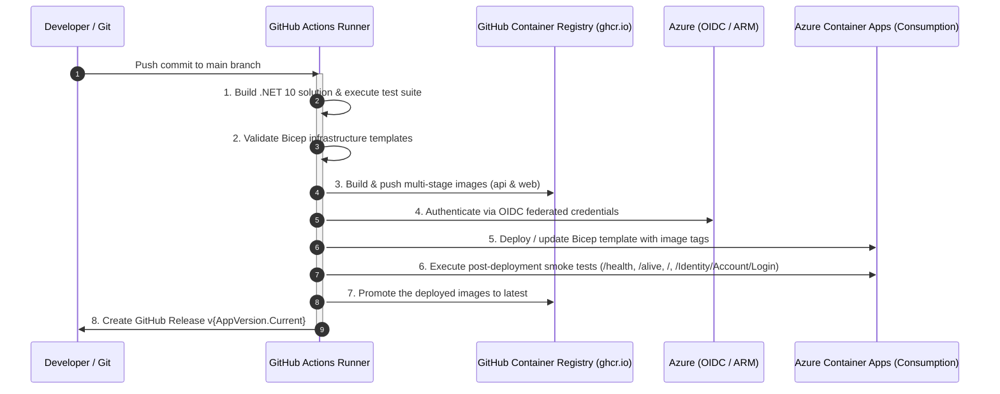

# Personal Finance App - Development Notes & Developer Guide

This document provides developer guidelines, architectural details, configuration instructions, secrets management workflows, and troubleshooting solutions for developing and maintaining the **Personal Finance App**.

---

## 1. Prerequisites & Environment Setup

### Required SDKs and Tools
- **.NET 10 SDK**: the version pinned in the repo-root [`global.json`](../global.json) (10.0.402, rolling forward to later patches in the 10.0.4xx band). CI installs the same SDK from that file.
- **Entity Framework Core CLI Tools (`dotnet-ef`)**:
  ```bash
  dotnet tool install --global dotnet-ef
  # Or update if already installed
  dotnet tool update --global dotnet-ef
  ```
- **IDE**: JetBrains Rider (recommended), Visual Studio 2022+ / 2026+, or VS Code with C# Dev Kit.
- **Git**

---

## 2. Solution Structure & Project Architecture

The solution uses a Clean Architecture pattern integrated with **.NET Aspire**:

```
PersonalFinanceApp/
├── PersonalFinance.sln                      # Solution configuration
├── CHANGELOG.md                             # Release changelog
├── README.md                                # General project documentation
├── docs/
│   ├── ARCHITECTURE.md                      # Projects, request flow, feature checklist
│   ├── DEVELOPMENT.md                       # Developer guidelines (this document)
│   ├── deployment.md                        # Deployment guide
│   └── IDENTITY_SCHEMA.md                   # Identity schema documentation
└── PersonalFinance/
    ├── Directory.Build.props                # Shared build settings and analyzers
    ├── Directory.Packages.props             # Central NuGet package versions
    ├── src/
    │   ├── PersonalFinance.AppHost/         # .NET Aspire orchestrator & dashboard
    │   ├── PersonalFinance.ServiceDefaults/ # Aspire telemetry, health checks & resilience
    │   ├── PersonalFinance.Web/             # ASP.NET Core MVC, Razor Pages, Identity UI
    │   ├── PersonalFinance.ApiService/      # REST API backend, Google Drive service & Scalar
    │   ├── PersonalFinance.Data/            # EF Core AppDbContext, entities & migrations
    │   └── PersonalFinance.Shared/          # Contracts, DTOs, helpers & cryptographic utilities
    └── tests/
        └── PersonalFinance.Tests/           # xUnit unit and integration tests
```

### Architectural Roles

| Project | Responsibility | Key Technologies |
|---|---|---|
| `PersonalFinance.AppHost` | Orchestrates multi-project startup, service discovery, and Aspire dashboard. | .NET Aspire 13.x |
| `PersonalFinance.ServiceDefaults` | Shared OpenTelemetry metrics, distributed tracing, health endpoints (`/health`, `/alive`), and HTTP resilience. | OpenTelemetry, Polly |
| `PersonalFinance.Web` | Frontend web UI, Identity, file explorer, budget reports, transactions viewer, net worth projections. | MVC, Razor Pages, Identity, Bootstrap 5, Chart.js, Refit |
| `PersonalFinance.ApiService` | Backend REST API: Google Drive integration, budget reports, transactions, net worth projections, OpenAPI & Scalar docs (`/scalar/v1`). | ASP.NET Core Controllers, Scalar |
| `PersonalFinance.Data` | EF Core persistence with Azure SQL migrations, Identity stores, Data Protection keys. InMemory provider for tests and CI e2e. | EF Core 10, SQL Server |
| `PersonalFinance.Shared` | Shared DTOs, API interfaces (`IGoogleDriveApi`, `INetWorthApi`), constants and shared helpers. | Refit, System.Security.Cryptography |
| `PersonalFinance.Tests` | Automated unit and integration test suite (500+ tests). | xUnit, EF Core InMemory |

---

## 3. Configuration & Secrets Management

### Security Principle
**Never commit plain-text API keys, passwords, or private tokens to Git repositories or `appsettings.json`.**

The project separates configuration into:
1. `appsettings.json` / `appsettings.Development.json`: Safe, non-sensitive defaults, URLs, and logging levels.
2. **.NET User Secrets** (`secrets.json`): Sensitive credentials on developer machines (Brevo API keys, Google API keys).
3. **Environment Variables**: Production secrets injected via container orchestrators or CI/CD pipelines.

---

### Configuration Precedence
Both apps use the standard ASP.NET Core order, lowest to highest: `appsettings.json`, `appsettings.{Environment}.json`,
user secrets (Development only), environment variables, command-line arguments. An environment variable such as
`ConnectionStrings__DefaultConnection=InMemory:Dev` therefore overrides the connection string in your user secrets.

### Local SQL Server (Docker)

The recommended development database is SQL Server 2022 Developer edition in Docker, defined in `compose.yaml` at the
repo root. It uses the same EF Core provider (`AzureSql` / `AzureSqlAppDbContext`) and the same migrations as
production Azure SQL; only the connection string differs.

#### Prerequisites

- **Docker Desktop** running.
- **Windows:** use the WSL2 backend (Settings → General → "Use the WSL 2 based engine").
- **macOS on Apple Silicon:** turn on Settings → General → "Use Rosetta for x86_64/amd64 emulation on Apple Silicon".
  The SQL Server image is amd64-only (`compose.yaml` pins `platform: linux/amd64`), so expect a slower first start
  than on x64.

#### 1. Create `.env`

Copy `.env.example` to `.env` in the repo root and set the `sa` password. `.env` is gitignored; never commit it.

```text
MSSQL_SA_PASSWORD=<your strong password>
SQL_HOST_PORT=1433
```

The `AZURE_TRANSLATOR_KEY`, `AZURE_TRANSLATOR_REGION` and `AZURE_TRANSLATOR_ENDPOINT` lines are optional: only
`npm run i18n:translate` reads them (see "Translations"). Leave them blank unless you draft translations locally.

SQL Server refuses to start with a weak password. It must be **at least 8 characters** and contain characters from
**at least three** of these four groups: uppercase letters, lowercase letters, digits, and symbols. Avoid `'`, `"` and
`;` in the password so it stays easy to quote in a connection string.

Change `SQL_HOST_PORT` if something else on your machine already listens on 1433 (for example a native SQL Server on
Windows).

SQL Server only reads `MSSQL_SA_PASSWORD` the first time it creates the data volume, and the password is then stored in
the volume. If you change it in `.env` later, the old password stays in effect: `db:up` reports the container as
unhealthy and the apps fail with `Login failed for user 'sa'`. Run `npm run db:reset` (this deletes the local data),
then `npm run db:up`.

#### 2. Start, stop and reset the container

```bash
npm run db:up      # start in the background and wait until SQL Server accepts connections
npm run db:down    # stop the container; data is kept in the named volume
npm run db:reset   # stop the container and delete the volume (the next db:up starts from an empty server)
```

The scripts only call `docker compose`, so they behave the same in PowerShell, cmd and zsh. If `MSSQL_SA_PASSWORD` is
missing, `db:up` stops with a message saying so.

The container has no restart policy, so it doesn't come back on its own after a reboot or after Docker Desktop restarts.
Run `npm run db:up` again before starting the app.

#### 3. Point both apps at the container

Put the same connection string in user secrets for the ApiService and the Web project. Other commands in this guide refer to it as `<local connection string>`. Replace `1433` with your
`SQL_HOST_PORT` and `<password>` with your `MSSQL_SA_PASSWORD`. The single quotes make these commands work unchanged in
both PowerShell and zsh.

```bash
dotnet user-secrets set 'ConnectionStrings:DefaultConnection' 'Server=localhost,1433;Database=PersonalFinance;User ID=sa;Password=<password>;TrustServerCertificate=True;Encrypt=True;MultipleActiveResultSets=False' --project PersonalFinance/src/PersonalFinance.ApiService
dotnet user-secrets set 'ConnectionStrings:DefaultConnection' 'Server=localhost,1433;Database=PersonalFinance;User ID=sa;Password=<password>;TrustServerCertificate=True;Encrypt=True;MultipleActiveResultSets=False' --project PersonalFinance/src/PersonalFinance.Web
```

**Switching from the dev Azure SQL database:** `dotnet user-secrets set` overwrites the existing value, so first copy
the Azure connection string to a key the apps don't read, such as `ConnectionStrings:AzureDevConnection`. Do this for
both projects:

```bash
dotnet user-secrets list --project PersonalFinance/src/PersonalFinance.ApiService
dotnet user-secrets set 'ConnectionStrings:AzureDevConnection' '<the current DefaultConnection value>' --project PersonalFinance/src/PersonalFinance.ApiService
```

To switch back later, set `ConnectionStrings:DefaultConnection` to the saved `AzureDevConnection` value. The local
database and the Azure database are separate: accounts and data don't carry over between them.

#### 4. Start the app

Start the app through the AppHost or run the ApiService and Web projects separately (section 4). On its first start
against the empty server, the ApiService creates the `PersonalFinance` database, applies every migration and seeds the
starter data; no `dotnet ef` command is needed. To run the e2e preflight against a non-default port, set
`E2E_DB_PORT` (see "Running the E2E tests locally").

#### Windows verification checklist

Run these in order on Windows (PowerShell) to confirm the whole setup works there. Each step must succeed before the
next one.

1. **Docker Desktop with WSL2:** Docker Desktop is running with "Use the WSL 2 based engine" turned on, and
   `docker version` shows both a client and a server.
2. **`.env`:** copy `.env.example` to `.env` and set `MSSQL_SA_PASSWORD`. If a native SQL Server already listens on
   1433, set `SQL_HOST_PORT` to a free port such as `14333`.
3. **`npm run db:up`:** finishes without an error and `docker compose ps` shows the `sqlserver` service as `healthy`.
4. **User secrets:** run the two `dotnet user-secrets set` commands from step 3 above with your port and password, then
   check them with `dotnet user-secrets list --project PersonalFinance/src/PersonalFinance.ApiService` (and the same for
   `PersonalFinance.Web`).
5. **Start the ApiService and Web projects** as in "Running the projects separately" under "Running the E2E tests
   locally" (set the variables with `$env:NAME = '...'`). The ApiService log shows the migrations applied and the seed
   data created, and `http://localhost:5200` opens the home page.
6. **`npm run e2e:preflight`:** passes, with `WEB_URL`, `API_URL` and (for a non-default port) `E2E_DB_PORT` set.
7. **E2E suites:** `npm run test:e2e` and `npm run test:api` both pass.
8. **`npm run db:reset`:** stops the container and deletes the volume; the next `npm run db:up` starts from an empty
   server.

### Alternative: dev Azure SQL database

Use this when you want to test against real Azure SQL. It needs an Azure subscription and the Azure CLI, and the
Serverless Free Tier database pauses when its monthly free allowance runs out.

`infra/deploy-local-sql.ps1` deploys `infra/local-dev.bicep` (an Azure SQL server and database in
`rg-personalfinance-dev`), opens the server firewall to your public IP and stores the connection string in user secrets
for both apps (`-SkipUserSecrets` only prints it):

```powershell
.\infra\deploy-local-sql.ps1
```

The connection string has this shape if you set it by hand:

```text
Server=tcp:<server>.database.windows.net,1433;Initial Catalog=PersonalFinance;Persist Security Info=False;User ID=<user>;Password=<password>;MultipleActiveResultSets=False;Encrypt=True;TrustServerCertificate=False;Connection Timeout=30;
```

### Alternative: native SQL Server or LocalDB (Windows)

A SQL Server instance or LocalDB installed on Windows works too; put its connection string in user secrets for both apps
instead of the container's. When no connection string is configured at all, the apps and `dotnet ef` fall back to
`Server=localhost,1433;Database=PersonalFinance;Trusted_Connection=True;...` (`DatabaseProviderHelper.DefaultSqlConnectionString`).
That fallback uses Windows authentication, so it only works on Windows with a native SQL Server listening on TCP port
1433. On macOS, and with the Docker container, always set the connection string.

### Setting Up User Secrets on a New Machine

When cloning this repository on a new machine, run the following commands to configure development user secrets. Replace each placeholder value with your actual credential.

#### PersonalFinance.Web Project

```bash
# Database connection string: set it as in "3. Point both apps at the container" under "Local SQL Server (Docker)"
# (for Azure SQL see the alternatives)

# Brevo transactional email API key
dotnet user-secrets set "Brevo:ApiKey" "<YOUR_BREVO_API_KEY>" --project PersonalFinance/src/PersonalFinance.Web

# Google OAuth 2.0 credentials
dotnet user-secrets set "Authentication:Google:ClientId" "<YOUR_GOOGLE_CLIENT_ID>.apps.googleusercontent.com" --project PersonalFinance/src/PersonalFinance.Web
dotnet user-secrets set "Authentication:Google:ClientSecret" "<YOUR_GOOGLE_CLIENT_SECRET>" --project PersonalFinance/src/PersonalFinance.Web
```

#### PersonalFinance.ApiService Project

```bash
# Database connection string: set it as in "3. Point both apps at the container" under "Local SQL Server (Docker)"
# (for Azure SQL see the alternatives)

# Google Drive API key (default; users can also enter their own key via /GoogleDrive)
dotnet user-secrets set "GoogleDrive:ApiKey" "<YOUR_GOOGLE_DRIVE_API_KEY>" --project PersonalFinance/src/PersonalFinance.ApiService

# OpenAI API key (for AI Assistant feature)
dotnet user-secrets set "OpenAI:ApiKey" "<YOUR_OPENAI_API_KEY>" --project PersonalFinance/src/PersonalFinance.ApiService
```

#### Verify Configured Secrets

```bash
# List Web project secrets
dotnet user-secrets list --project PersonalFinance/src/PersonalFinance.Web

# List ApiService project secrets
dotnet user-secrets list --project PersonalFinance/src/PersonalFinance.ApiService
```

#### Resetting User Secrets

If you need to clear all secrets and start fresh:

```bash
# Clear all secrets for Web project
dotnet user-secrets clear --project PersonalFinance/src/PersonalFinance.Web

# Clear all secrets for ApiService project
dotnet user-secrets clear --project PersonalFinance/src/PersonalFinance.ApiService
```

#### Remove a Single Secret

To remove an individual secret without clearing all others:

```bash
# Example: Remove the Brevo API key
dotnet user-secrets remove "Brevo:ApiKey" --project PersonalFinance/src/PersonalFinance.Web
```

---

### Viewing and Locating User Secrets

#### Viewing Configured Secrets

To see all currently configured secrets for a project, run:

```bash
# List Web project secrets
dotnet user-secrets list --project PersonalFinance/src/PersonalFinance.Web

# List ApiService project secrets
dotnet user-secrets list --project PersonalFinance/src/PersonalFinance.ApiService
```

#### Where Are User Secrets Stored?

User secrets are stored in a JSON file in your user profile's AppData folder:

```
%APPDATA%\Microsoft\UserSecrets\<SecretId>\secrets.json
```

The `SecretId` is unique to each project and can be found in the project's `.csproj` file. Look for the `<UserSecretsId>` element:

```xml
<PropertyGroup>
  <UserSecretsId>aspnet-PersonalFinance.Web-abc123</UserSecretsId>
</PropertyGroup>
```

You can open the `secrets.json` file directly in a text editor to view the raw key-value pairs, but using `dotnet user-secrets list` is the recommended approach.

**Important:** User secrets are for **development only**. They are loaded only when the environment is set to `Development` and should never be relied upon in production deployments.

---

### Brevo Transactional Email Configuration

Account registration requires email confirmation (`options.SignIn.RequireConfirmedAccount = true`). Verification emails are sent via the **Brevo REST API** (`https://api.brevo.com/v3/smtp/email`).

#### Setting Brevo API Key via User Secrets
Configure the API key in the `PersonalFinance.Web` project secret store:

```bash
# Set Brevo API Key
dotnet user-secrets set "Brevo:ApiKey" "<YOUR_BREVO_API_KEY>" --project PersonalFinance/src/PersonalFinance.Web

# Optional: Override sender email or name
dotnet user-secrets set "Brevo:SenderEmail" "your-email@domain.com" --project PersonalFinance/src/PersonalFinance.Web
dotnet user-secrets set "Brevo:SenderName" "PersonalFinance" --project PersonalFinance/src/PersonalFinance.Web
```

#### Inspecting Configured Secrets
```bash
dotnet user-secrets list --project PersonalFinance/src/PersonalFinance.Web
```

#### Configuration Schema (`appsettings.json`)
`PersonalFinance.Web/appsettings.json` defines placeholder properties:
```json
"Brevo": {
  "ApiKey": "",
  "SenderEmail": "tngo0508@gmail.com",
  "SenderName": "PersonalFinance"
}
```
During execution, the User Secrets store automatically overrides `Brevo:ApiKey` in `Development` mode.

---

### Admin Account (`Rbac:AdminEmail`)

On startup the database seeder creates the roles in `AppRoles` and grants **Admin** to the account whose email matches `Rbac:AdminEmail`, but only if that account exists and its email is confirmed. It never removes roles.

```powershell
dotnet user-secrets set "Rbac:AdminEmail" "you@example.com" --project PersonalFinance/src/PersonalFinance.Web
```

- In Azure, set the environment variable `Rbac__AdminEmail` (or a Key Vault reference). Never commit a real value to `appsettings.json`.
- If the account does not exist yet, register and confirm it, then restart the app.
- After the first grant, **sign out and back in**: the Web cookie keeps its role claims until the next security-stamp check (up to 30 minutes).
- **Production requires a shared secret.** Set the same random value as `Internal__ApiKey` on both the Web and ApiService apps. Web sends it as `X-Internal-Key`; ApiService only attaches roles (and, once configured, only authenticates) when it matches. Without it ApiService attaches no roles outside Development, so Admin pages will fail with 403 from the API. Store it as a secret, never in `appsettings.json`.

---

### Research Market Data (`Research:Sec:UserAgent` and the refresh)

The Research page never calls a data source while someone browses. It reads saved copies (snapshots) from the `ResearchSnapshots` table, and only the **Research refresh** writes them: a run of the ApiService that downloads the public data, builds each dataset, saves it and exits. Until a refresh has run against a database, every Research tab shows the Unavailable State and the API answers `GET api/Research/*` with 503. Why these sources and not FRED: ADR 0012.

| Dataset | Endpoint | Source | Used by |
|---|---|---|---|
| `sectors` | `api/Research/sectors` | SEC EDGAR Public Float frames | Sectors tab |
| `etfs` (funds) | `api/Research/funds` | SEC Form N-PORT holdings | Funds tab tree |
| `fund-overlap` | `api/Research/funds/overlap` | N-PORT, each fund's latest report | Funds tab overlap |
| `fund-exposure` | `api/Research/funds/exposure` | N-PORT, each fund's latest report: issuer country and currency of every holding | World tab basket map |
| `fund-industries` | `api/Research/funds/industries` | N-PORT, each fund's latest report, matched by issuer name to SEC's company list and submissions (`Research:IssuerCikOverrides`) | Sectors tab basket view, which fetches it from the Web app's `Research/FundIndustries` when first shown (about 600 KB, so the page does not carry it) |
| `fund-returns` | `api/Research/funds/returns` | N-PORT Item B.5, H.15 bill rate | Funds correlation, Performance, Risk vs return |
| `fund-facts` | `api/Research/funds/facts` | Funds snapshot net assets, N-CSR XBRL expense ratios | Risk vs return |
| `macro` | `api/Research/macro` | BLS CPI-U, Fed H.15 (Treasury fallback), `Research:Recessions` | Performance |
| `world` | `api/Research/world` | World Bank | World tab |

`etf-filings` and `fund-return-filings` are caches of filings already read, and `fund-industry-filers` of company submissions read for the fund industries; they are not served. The fund industries refresh reads at most `Research:FundIndustrySubmissionsPerRefresh` new submissions a run (1,000), so its first runs in a new database classify more each day.

**1. Set the SEC contact (once per machine).** SEC's fair-access rules require a real contact email on every request. The committed `appsettings.json` has a placeholder on `example.com`, which the refresh refuses to send; it then skips Sectors and funds and rebuilds only World.

```bash
dotnet user-secrets set "Research:Sec:UserAgent" "PersonalFinance research you@yourdomain.com" --project PersonalFinance/src/PersonalFinance.ApiService
```

**2. Run the refresh** from a checkout that has the Research code, against the database your app uses (check with `dotnet user-secrets list --project PersonalFinance/src/PersonalFinance.ApiService`; never production):

```bash
dotnet run --project PersonalFinance/src/PersonalFinance.ApiService -- --refresh-research
```

- It applies pending migrations, refreshes, logs `Research refresh finished: built ...; failed ...; skipped ...` and exits. Exit code 0 means every dataset was built.
- The **first run takes 15 to 20 minutes**: it reads several thousand SEC company pages at SEC's rate limit, then the Form N-PORT filings of the 20 Tracked Funds (about 30 per fund since late 2019, several GB in all: the bond and international funds each report thousands of holdings). Company details and the filings read are saved in the database, the filings after each fund, so a run stopped part-way carries on where it left off and later runs are much faster. The fund overlap is then built from each fund's latest report, read again because security identifiers are never stored (ADR 0010); later runs rebuild it only when some fund has filed a newer report. The fund exposure is built the same way as the overlap, from each fund's latest report, totalling every holding's issuer country and currency (securities-lending collateral left out). The fund facts read each fund's newest shareholder report (Form N-CSR or N-CSRS) once, for its expense ratio; SPY files none, so it shows "n/a". The fund returns read only the head of each filing (its monthly returns), once per filing, and their Sharpe ratios use the 3-month Treasury bill from the Fed Board's H.15 release (a 4 MB download each run); if the Fed's site cannot be reached, the returns are still built, without Sharpe ratios. The macro dataset (CPI-U from the Bureau of Labor Statistics, the effective federal funds rate and 3-month Treasury bill from H.15) is rebuilt each run with the same contact; when the Fed cannot be read, the Treasury bill comes from the Treasury's daily bill rates and the federal funds rate keeps its stored months.
- Each dataset refreshes on its own: one that fails keeps its previous snapshot.
- Recessions shaded on the Performance chart are configuration (`Research:Recessions` in the ApiService's `appsettings.json`, each a `Start` and `End` month and a `Label`). They are read when the page loads, so a new entry needs neither a code change nor a refresh.
- Nothing schedules it locally. Run it again whenever you want newer data.
- A branch without the Research code (before 5.0.0) ignores `--refresh-research` and starts the normal API instead.
- With an InMemory database the refresh cannot fill the running app. Use made-up data instead: start the ApiService with `ASPNETCORE_ENVIRONMENT=Development` and `E2E_SEED_RESEARCH=true` (see "Running the E2E tests locally").

**Production:** the `SEC_USER_AGENT` repository variable carries the contact (see "Repository Variables"), and a daily Container Apps Job runs the refresh at 10:00 UTC (see `docs/deployment.md`).

#### Refreshing production by hand

Deploying a release does not refresh the data. The job only picks up the new image at the deploy, and its next scheduled run may be hours away. After a release that adds a Research dataset or changes how one is built (5.4.0 added the fund overlap and fund returns), start the job yourself; until it has run, the new views show the Unavailable State and reloading the page does not help.

The commands need the Azure CLI signed in to the production subscription and its `containerapp` extension (`az extension add --name containerapp`; `job logs show` asks to install it otherwise and fails in a non-interactive shell).

**1. Find the job.** Its name ends in a generated suffix:

```bash
az containerapp job list -g rg-personalfinance-prod --query "[?contains(name,'research')].name" -o tsv
JOB=research-pf-prod-cdknljx37hrso   # the name printed above
```

**2. Check it runs the new image** (the tag is the merge commit's short SHA) and that no run is in progress:

```bash
az containerapp job show -n $JOB -g rg-personalfinance-prod --query "properties.template.containers[0].image" -o tsv
az containerapp job execution list -n $JOB -g rg-personalfinance-prod \
  --query "[0:5].{name:name, status:properties.status, start:properties.startTime, image:properties.template.containers[0].image}" -o table
```

Each run records the image it used, so the list also tells you whether the last scheduled run already had the new code.

**3. Start it.** This prints the run's name:

```bash
az containerapp job start -n $JOB -g rg-personalfinance-prod --query name -o tsv
RUN=research-pf-prod-cdknljx37hrso-xxxxxxx   # the name printed above
```

The Azure Portal's **Run now** on the job does the same.

**4. Follow it.** Most lines are SEC requests; this keeps the progress lines and the final summary:

```bash
az containerapp job logs show -n $JOB -g rg-personalfinance-prod --execution $RUN --container research-refresh \
  --follow --tail 300 --format text \
  | grep --line-buffered '\[[0-9:]* [A-Z]*\]' | grep --line-buffered -v -E 'HTTP request|HTTP response|Execution attempt'
```

Or check only the status (`Running`, then `Succeeded` or `Failed`):

```bash
az containerapp job execution show -n $JOB -g rg-personalfinance-prod --job-execution-name $RUN --query properties.status -o tsv
```

**5. Read the result.** The run ends with `Research refresh finished: built ...; failed ...; skipped ...`; reload the Research page once it has.

- The datasets run in order: Sectors, funds, fund overlap, fund returns, World. A run stopped by the job's 30-minute limit (`replicaTimeout`) never reaches the later ones; Azure retries a failed run once.
- The funds refresh saves the filings read after each fund, so a stopped run is not wasted. If the run still fails, start it again; after a release that adds funds it can take two or three runs before every dataset is built.
- `Failed` with `Research refresh skips the SEC datasets` in the log means `SEC_USER_AGENT` is not set: only World was rebuilt. Set the variable and redeploy (it takes effect at the deploy), then start the job.
- A dataset that failed keeps its previous snapshot, so the page still shows the older data.

---

### Google Drive API Configuration

To interact with Google Drive folders without entering a key in the web interface on each session:

```bash
# Set default Google Drive API Key for ApiService
dotnet user-secrets set "GoogleDrive:ApiKey" "<YOUR_GOOGLE_API_KEY>" --project PersonalFinance/src/PersonalFinance.ApiService
```

*Note: Individual users can also supply and save their own API key via `/GoogleDrive`, where it is AES-256 encrypted before being persisted to the database.*

---

### Google OAuth 2.0 & External Authentication Setup

The application supports seamless third-party external authentication via ASP.NET Core Identity and OAuth 2.0 / OpenID Connect.

#### How It Works Architecturally
1. **Conditional Registration (`PersonalFinance.Web/Program.cs`)**:
   Google authentication is conditionally registered during startup when `Authentication:Google:ClientId` and `Authentication:Google:ClientSecret` are populated in configuration. If credentials are empty, the application runs smoothly without external login buttons.
2. **Dynamic UI Discovery (`Login.cshtml.cs` & `Register.cshtml.cs`)**:
   Pages query `SignInManager.GetExternalAuthenticationSchemesAsync()`. Branded buttons are dynamically rendered only for active schemes.
3. **Automated User Provisioning & Secure Account Linking (`ExternalLogin.cshtml.cs`)**:
   - **New Users**: When a user logs in with Google for the first time, a new `IdentityUser` is created with `EmailConfirmed = true` (verified by Google) and linked to `AspNetUserLogins`.
   - **Existing Confirmed Accounts**: If a local user with the matching email already exists and is confirmed (`EmailConfirmed == true`), the external provider is linked via `UserManager.AddLoginAsync` and the user is signed in immediately.
   - **Unconfirmed Accounts**: If a local account exists but has not verified their email, linking is rejected until the email is confirmed to prevent unauthorized account takeover.
4. **Custom Claims Synchronization**:
   Google user metadata is extracted during sign-in and synchronized into user identity claims:
   - `urn:google:picture`: User profile avatar (rendered in `_LoginPartial.cshtml`).
   - `ClaimTypes.GivenName`: First name or display name.
   - `urn:google:locale`: Language and regional preference.
5. **API-Aware Cookie Redirection**:
   Unauthenticated requests to API endpoints (`/api/...`) or requests with `Accept: application/json` / `X-Requested-With: XMLHttpRequest` receive HTTP `401 Unauthorized` or `403 Forbidden` instead of HTML 302 redirects to `/Account/Login`.

---

#### Step 1: Create OAuth 2.0 Credentials in Google Cloud Console

1. **Access Google Cloud Console**:
   - Navigate to [Google Cloud Console](https://console.cloud.google.com/) and sign in with your Google account.
2. **Create / Select Project**:
   - In the top navigation bar, open the project dropdown and click **"New Project"**.
   - Set the Project Name (e.g., `PersonalFinance`) and click **"Create"**. Ensure the new project is selected.
3. **Configure the OAuth Consent Screen**:
   - In the left sidebar, navigate to **APIs & Services** &rarr; **OAuth consent screen** (or [Consent Screen](https://console.cloud.google.com/apis/credentials/consent)).
   - Select **External** user type and click **Create**.
   - Enter required application information:
     - **App name**: `Personal Finance`
     - **User support email**: Your email address
     - **Developer contact information**: Your email address
   - Click **Save and Continue**.
   - **Scopes**: Click **Add or Remove Scopes**, select `openid`, `.../auth/userinfo.email`, and `.../auth/userinfo.profile`, then click **Update** and **Save and Continue**.
   - **Test Users**: While in "Testing" mode, add your Gmail account (and any test accounts) under **Test users**, then click **Save and Continue**.
4. **Create OAuth Client ID**:
   - In the left sidebar, navigate to **APIs & Services** &rarr; **Credentials**.
   - Click **+ CREATE CREDENTIALS** &rarr; **OAuth client ID**.
   - Set **Application type** to **Web application**.
   - Set **Name** to `PersonalFinance Web App`.
5. **Configure Origins and Redirect URIs**:

   | Configuration Field in Google Console | Format Rules | Development Example |
   |---|---|---|
   | **Authorized JavaScript origins** | Base origin only (`scheme://host:port`). **No path, no trailing slash.** | `https://localhost:7200`<br/>`http://localhost:5200` |
   | **Authorized redirect URIs** | Full callback endpoint URL with `/signin-google` path. | `https://localhost:7200/signin-google`<br/>`http://localhost:5200/signin-google` |

   > ⚠️ **Common Mistake**: Entering `https://localhost:7200/signin-google` into *Authorized JavaScript origins* will result in `Invalid Origin: URIs must not contain a path or end with "/"`. Ensure `/signin-google` is placed only in *Authorized redirect URIs*.

6. Click **CREATE**. Copy the generated **Client ID** (e.g., `485689840313-...apps.googleusercontent.com`) and **Client Secret**.

---

#### Step 2: Configure Local Credentials via .NET User Secrets

Store your Google credentials in the `PersonalFinance.Web` secret store:

```bash
# Set Google OAuth Client ID
dotnet user-secrets set "Authentication:Google:ClientId" "<YOUR_GOOGLE_CLIENT_ID>.apps.googleusercontent.com" --project PersonalFinance/src/PersonalFinance.Web

# Set Google OAuth Client Secret
dotnet user-secrets set "Authentication:Google:ClientSecret" "<YOUR_GOOGLE_CLIENT_SECRET>" --project PersonalFinance/src/PersonalFinance.Web
```

Verify configured secrets:
```bash
dotnet user-secrets list --project PersonalFinance/src/PersonalFinance.Web
```

#### Production & Container Configuration
In production or staging environments, supply these values via environment variables:
- `Authentication__Google__ClientId`
- `Authentication__Google__ClientSecret`

#### Configuration Schema (`appsettings.json`)
`PersonalFinance.Web/appsettings.json` provides empty baseline placeholders:
```json
"Authentication": {
  "Google": {
    "ClientId": "",
    "ClientSecret": ""
  }
}
```

---

#### Step 3: Extending to Other OAuth Providers (GitHub, Microsoft, Facebook, etc.)

The authentication architecture is designed to support additional external providers with minimal effort:

1. **Add Package Reference**:
   Add the provider package (e.g., `AspNet.Security.OAuth.GitHub` or `Microsoft.AspNetCore.Authentication.MicrosoftAccount`) to `Directory.Packages.props` and `PersonalFinance.Web.csproj`.
2. **Register in `PersonalFinance.Web/Program.cs`**:
   ```csharp
   var githubClientId = builder.Configuration["Authentication:GitHub:ClientId"];
   var githubClientSecret = builder.Configuration["Authentication:GitHub:ClientSecret"];
   if (!string.IsNullOrEmpty(githubClientId) && !string.IsNullOrEmpty(githubClientSecret))
   {
       builder.Services.AddAuthentication()
           .AddGitHub(options =>
           {
               options.ClientId = githubClientId;
               options.ClientSecret = githubClientSecret;
               options.CallbackPath = "/signin-github";
           });
   }
   ```
3. **Automatic UI & Handler Integration**:
   Because `Login.cshtml`, `Register.cshtml`, and `ExternalLogin.cshtml.cs` leverage generic ASP.NET Core Identity scheme discovery (`SignInManager.GetExternalAuthenticationSchemesAsync()` and `SignInManager.GetExternalLoginInfoAsync()`), the newly registered provider button will automatically appear on the UI and route through the existing account provisioning and linking pipeline.

---

#### Step 4: Scaffolded Identity Pages & Custom ExternalLogin Architecture

ASP.NET Core Identity uses Razor Pages located under `Areas/Identity/Pages/Account/`. **Every** Account and Manage
page of the Identity UI library is scaffolded into the project (slice L1b of the localization spec), so none is served
precompiled from `Microsoft.AspNetCore.Identity.UI` and each can be translated and changed in place.

##### 1. Where the scaffolded pages came from
- The views are the library's own `Pages/V5` Razor files from `dotnet/aspnetcore` at the tag matching the
  `Microsoft.AspNetCore.Identity.UI` version in `Directory.Packages.props` (10.0.0). The code generator's templates are
  older than the library and render different markup, so they were not used for the views.
- The page models are the generator's templates (Identity UI 10's classes are generic and internal), rendered for
  `IdentityUser`, brought to the C# style rules, and aligned with the library: the same `[AllowAnonymous]` pages, email
  through `IEmailSender<IdentityUser>`, the confirm-account link only with `NoOpEmailSender`, and the library's log
  messages and `LoggerEventIds`. `Security/IdentityPagesScaffoldingTests` pins this.
- `dotnet aspnet-codegenerator identity` no longer runs against this project: it compiles in memory without source
  generators and fails on `[LoggerMessage]` and `[GeneratedRegex]` methods. When upgrading Identity UI, diff the
  library's `Pages/V5` sources between the two tags and apply the changes by hand.

##### 2. Custom Enhancements in `ExternalLogin.cshtml.cs`

Rather than relying on default boilerplate scaffolding, the `ExternalLogin` flow in this application has been customized with essential security and user experience enhancements:

- **Automated User Provisioning**:
  When a user signs in via an external OAuth provider for the first time, a new `IdentityUser` is provisioned with `EmailConfirmed = true` (since third-party providers like Google have already verified email ownership).
- **Pre-Account Takeover Defense**:
  When an existing local account matches the provider email address:
  - **Confirmed Accounts (`EmailConfirmed == true`)**: The external login is automatically linked using `_userManager.AddLoginAsync(existingUser, info)` and the user is signed in.
  - **Unconfirmed Accounts (`EmailConfirmed == false`)**: The external login association is rejected with an explicit error to prevent malicious pre-registration account takeover attacks.
- **Dynamic Claims Synchronization (`SynchronizeCustomClaimsAsync`)**:
  On every successful external authentication callback, user claims are refreshed:
  - `urn:google:picture`: Synchronizes user avatar URL for display in `_LoginPartial.cshtml`.
  - `ClaimTypes.GivenName`: Synchronizes user display name / given name.
  - `urn:google:locale`: Synchronizes user language and locale preferences.
- **Bootstrap 5 Card UI Layout**:
  `ExternalLogin.cshtml` provides clean, centralized card styling matching the application design system with clear feedback notifications.

##### 3. Key Files Reference
- `PersonalFinance/src/PersonalFinance.Web/Areas/Identity/Pages/Account/ExternalLogin.cshtml`: Razor Page view.
- `PersonalFinance/src/PersonalFinance.Web/Areas/Identity/Pages/Account/ExternalLogin.cshtml.cs`: Page model and authentication handlers.
- `PersonalFinance/src/PersonalFinance.Web/Program.cs`: External authentication provider configuration.
- `PersonalFinance/src/PersonalFinance.Web/Infrastructure/ApiAwareCookieRedirects.cs`: 401/403 instead of login redirects for API and fetch requests.
- `PersonalFinance/tests/PersonalFinance.Tests/ExternalAuthenticationTests.cs`: Unit test coverage for claims mapping and provisioning logic.

---

### Database Connection String & Secrets Management

To protect credentials and prevent sensitive database connection strings from being committed to source control or exposed in deployment logs, connection strings are managed securely across development, design-time tooling, and production.

#### 1. Local Development via .NET User Secrets
Never add passwords to `appsettings.json`. Store the connection string in the .NET User Secrets store for both the Web and ApiService projects, whether it points at the local SQL Server container (see "Local SQL Server (Docker)" in this section, with the exact commands), the dev Azure SQL database or a native SQL Server (see the alternatives after it). Never point it at the production database.

*Note: To try the UI without a database, use `InMemory:Dev` as the connection string for both projects (see "Database Providers" in section 5). Data is lost on restart.*

#### 2. Design-Time EF Core CLI Tooling (`AppDbContextFactory`)
Design-time tools (like `dotnet ef migrations add` and `dotnet ef database update`) resolve the database connection string using `DesignTimeDbContextFactoryHelper.ResolveConnectionString()`:
1. `--connection-string "<value>"` command-line argument passed to `dotnet ef database update`
2. `ConnectionStrings__DefaultConnection` or `DefaultConnection` environment variable
3. Fallback default (`DatabaseProviderHelper.DefaultSqlConnectionString`, Windows authentication on `localhost,1433`; it only works on Windows with a native SQL Server)

Example applying EF Core migrations to the local SQL Server container (see "EF Core CLI Commands" in section 5 for the full set):
```bash
dotnet ef database update --context AzureSqlAppDbContext --project PersonalFinance/src/PersonalFinance.Data -- --connection-string '<local connection string>'
```

#### 3. Production & CI/CD Pipeline Injection
In Azure Container Apps, credentials are never written to plain-text configuration files or container image layers:
- **Bicep `@secure()` Parameters**: `sqlAdministratorLoginPassword` and `customConnectionString` in `infra/main.bicep` are decorated with `@secure()`, ensuring values are masked in Azure Resource Manager deployment logs and ARM outputs.
- **Container Apps Secret Store**: In `infra/modules/web-service.bicep` and `infra/modules/api-service.bicep`, the connection string is registered in the Container App environment's native secret store (`db-connection-string`).
- **Container Environment Binding**: Bound securely via `secretRef: 'db-connection-string'` to environment variable `ConnectionStrings__DefaultConnection`.
- **Runtime Resolution**: At startup, ASP.NET Core reads `builder.Configuration.GetConnectionString("DefaultConnection")`, automatically injecting the secret into EF Core `AppDbContext`.

---

## 4. Running the Application

### Option A: Via .NET Aspire AppHost (Recommended)
Launches all services, wires up Aspire service discovery, and starts the Aspire telemetry dashboard:

```bash
dotnet run --project PersonalFinance/src/PersonalFinance.AppHost
```

- **Aspire Dashboard**: URL displayed in console output (e.g., `https://localhost:17227`)
- **Web App**: `https://localhost:7200`
- **API Service**: `https://localhost:7100`
- **Scalar API UI**: `https://localhost:7100/scalar/v1`

#### Aspire Dashboard Launch Settings
`PersonalFinance.AppHost/Properties/launchSettings.json` configures standard Aspire environment variables:
```json
"environmentVariables": {
  "ASPNETCORE_ENVIRONMENT": "Development",
  "DOTNET_ENVIRONMENT": "Development",
  "DOTNET_DASHBOARD_OTLP_ENDPOINT_URL": "https://localhost:21224",
  "DOTNET_RESOURCE_SERVICE_ENDPOINT_URL": "https://localhost:22257"
}
```

---

### Option B: Standalone Project Execution
You can run services individually when debugging a specific component:

```bash
# 1. Run ApiService
dotnet run --project PersonalFinance/src/PersonalFinance.ApiService

# 2. Run Web Frontend (in a separate terminal)
dotnet run --project PersonalFinance/src/PersonalFinance.Web
```

---

### Development vs Release JavaScript and CSS

The Web app's own scripts and stylesheets live under `wwwroot/js/` and `wwwroot/css/`. Views reference them there, as usual.

- **Development** (`ASPNETCORE_ENVIRONMENT=Development`) serves those readable originals. A Debug build needs no Node.
- **Release builds** (`dotnet build` or `dotnet publish` with `-c Release`, including the container build) run the `MinifyWebAssets` target in `PersonalFinance.Web.csproj`. It runs `npm ci` in `PersonalFinance/src/PersonalFinance.Web/` when `node_modules` is missing or older than that folder's `package.json` or `package-lock.json`, then `npm run minify`, which writes a minified copy of each file to `wwwroot/dist/` with the same relative path (`js/core/utils.js` becomes `dist/js/core/utils.js`). `MapStaticAssets` then serves them with Brotli/gzip. The build fails if minification fails, so **Release builds need Node 22** (the version the Dockerfile and CI use) on the PATH.
- **Outside Development**, `AssetUrlTagHelper` rewrites `/js/...` and `/css/...` references to `/dist/...?v=<hash>`, but only when that `dist` file exists in the web root, so a Debug build run as Production (no `dist`) keeps `/js/...`. In Development it rewrites only when the original is missing too, as in a published Release build. It never touches `/lib/` or external URLs.
- **Release builds leave out the originals.** `wwwroot/js/`, `wwwroot/css/` and the web root's `package*.json` and ESLint files are removed from the static web assets, so a Release publish neither contains nor serves them. A published Release build run in Development therefore uses `dist`; a local `dotnet run -c Release` in Development still finds the originals on disk but does not serve them, so use a Debug build there. CI publishes the Web project and runs `node PersonalFinance/src/PersonalFinance.Web/tools/check-publish.js <publish-dir>`, which fails if `dist` or its `.br`/`.gz` siblings are missing, a `.map` file is published outside the vendored `lib` folders, or unminified source or tooling remains. Its tests run with `node --test PersonalFinance/src/PersonalFinance.Web/tools/check-publish.test.js`.
- **Vendored files are out of scope.** `wwwroot/lib/` and `wwwroot/Identity/lib/` hold third-party files, published as shipped with their `.map` files; `check-publish.js` exempts them on purpose (an agreed deviation from spec #286).

The minify tooling has its own `package.json` next to the Web project file (esbuild only; separate from the repo-root one). To run it by hand:

```bash
cd PersonalFinance/src/PersonalFinance.Web
npm ci
npm run minify   # wipes and rewrites wwwroot/dist (git-ignored)
```

To check minified pages locally, run a Release build in a non-Development environment, for example `dotnet run -c Release --project PersonalFinance/src/PersonalFinance.Web --no-launch-profile -- --environment Production` (with the same connection and API settings as usual).

---

## 5. Database & Entity Framework Core Workflows

### ASP.NET Core Identity Schema Documentation
For a complete breakdown of all 7 ASP.NET Core Identity database tables (`AspNetUsers`, `AspNetRoles`, `AspNetUserRoles`, `AspNetUserClaims`, `AspNetRoleClaims`, `AspNetUserLogins`, `AspNetUserTokens`), foreign key relationships, and how application tables link to `AspNetUsers`, see [IDENTITY_SCHEMA.md](IDENTITY_SCHEMA.md). The application tables themselves are drawn in [DIAGRAMS.md](DIAGRAMS.md#4-data-model).

### Database Providers
`DatabaseProviderHelper` (in `PersonalFinance.Data`) supports two providers:

| Provider | When it is used | Migrations |
|---|---|---|
| Azure SQL (`AzureSqlAppDbContext`) | Default for every environment: production Azure SQL and local SQL Server (the Docker container, a native instance or LocalDB). | `PersonalFinance.Data/Migrations/AzureSql` |
| EF Core InMemory | The connection string starts with `InMemory:` (or is `:memory:`), or `Database:Provider` / the `DATABASE_PROVIDER` environment variable is `InMemory`. Used by the CI e2e job and for trying the UI without a database. | None (schema is created from the model) |

There is no SQLite provider any more. Identity string keys/FKs are explicitly bounded in `AppDbContext.OnModelCreating` (`Id`/`UserId`/`RoleId` = 450, login/token providers = 128) so SQL Server scaffolding emits `nvarchar(450)` / `nvarchar(128)`.

### Data Protection Keyring Persistence
To ensure authentication cookies and antiforgery tokens remain valid across container restarts and scale-to-zero cycles in Azure Container Apps, Data Protection keys are stored directly in `AppDbContext` via `Microsoft.AspNetCore.DataProtection.EntityFrameworkCore` (`DataProtectionKeys` table).

### Automated Migrations & Cold-Start Resilience
- Pending migrations and starter sample data are automatically applied on startup via `app.MigrateAndSeedDatabaseAsync()` using the active provider's migration set.
- Built-in retry logic (5 retries with exponential backoff) handles Azure SQL Serverless auto-pause wake-up latencies (~10-30s cold starts) without crashing container startup.
- Dedicated migration execution: Run `dotnet run --project PersonalFinance/src/PersonalFinance.ApiService -- --migrate-only` or set `MIGRATE_ONLY=true` for ACA Jobs or initialization containers. It exits 0 on success and non-zero if startup or migration fails.

### EF Core CLI Commands
Run all EF Core commands from the repository root. The design-time factory (`AppDbContextFactory.cs`) reads the connection string from `--connection-string`, then the `ConnectionStrings__DefaultConnection` environment variable, then falls back to the Windows-only default described in "Alternative: native SQL Server or LocalDB (Windows)". It does not read user secrets, so point it at the local SQL Server container (`npm run db:up`) with an environment variable or `--connection-string`. One migration set serves both the container and production Azure SQL.

```bash
# Point the EF tools at the local container (zsh; in PowerShell: $env:ConnectionStrings__DefaultConnection = '...')
export ConnectionStrings__DefaultConnection='<local connection string>'

# Add a migration (inspect the generated file before committing)
dotnet ef migrations add <MigrationName> --context AzureSqlAppDbContext --output-dir Migrations/AzureSql --project PersonalFinance/src/PersonalFinance.Data

# Apply migrations to a database you are authorized to change (never production without explicit approval)
dotnet ef database update --context AzureSqlAppDbContext --project PersonalFinance/src/PersonalFinance.Data
# ...or pass the connection string explicitly instead of the environment variable
dotnet ef database update --context AzureSqlAppDbContext --project PersonalFinance/src/PersonalFinance.Data -- --connection-string '<connection string>'

# Generate an idempotent SQL script for review
dotnet ef migrations script --idempotent --context AzureSqlAppDbContext --project PersonalFinance/src/PersonalFinance.Data -o azuresql.sql

# List migrations
dotnet ef migrations list --context AzureSqlAppDbContext --project PersonalFinance/src/PersonalFinance.Data
```

---

## 6. Testing & Quality Assurance

The solution contains a comprehensive test suite in `PersonalFinance.Tests` validating domain models, helpers, parsers, services, and controllers.

```bash
# Run all tests
dotnet test PersonalFinance.sln

# Run tests with detailed output
dotnet test PersonalFinance.sln --logger "console;verbosity=normal"
```

### Key Test Suites
- `IdentityConfigurationTests`: Validates `RequireConfirmedAccount` sign-in policies and registration flows.
- `ExternalAuthenticationTests`: Tests Google OAuth scheme registration, option configuration, custom claim extraction (`urn:google:picture`, `urn:google:locale`), API-aware 401/403 status code redirects, user auto-provisioning with confirmed emails, and secure account linking.
- `BrevoEmailSenderTests`: Tests Brevo REST API dispatch, payload serialization, error responses, and HTML email assembly.
- `EmailTemplateHelperTests`: Tests custom HTML email templates, parameter escaping, CTA button styling, and fallback URL rendering.
- `GoogleDriveSpreadsheetTests`: Tests URL parsing, multi-sheet OpenXML budget parsing, balance extraction, category categorization, transaction parsing (`ParseXlsxTransactions`, `ParseCsvTransactions`), side-by-side table detection, Excel serial date conversion, and total row filtering.
- `GoogleDrivePersistenceTests`: Tests connection storage, file caching, incremental sync, and AES encryption.
- `GoogleDriveWebControllerTests`: Tests controller actions for budget reports, transactions, error handling, and spreadsheet source resolution.
- `DatabasePersistenceAndMigrationTests`: Provider switching, provider-specific migration sets, migrate/seed pipeline, SQL Server migration script inspection (`nvarchar(450)` keys), and Data Protection key persistence.
- `ServiceDefaultsTests`: Validates OpenTelemetry providers, health check registration, and Aspire defaults.
- `GitHubActionsDeploymentWorkflowTests`: Validates CI/CD workflow configuration including job timeouts, concurrency settings, `paths-ignore`, per-image cache scopes, deploy gating, and `promote-latest` behavior.
- `ReleaseAutomationTests`: `AppVersion.Current` matches its components and has a `CHANGELOG.md` section, and the `create-release` job and `release-check` workflow keep their gates.
- `ModelValidationConventionTests`: Fails when `[Required]` is placed on a `bool` property (it is always satisfied, so it never rejects an unchecked box).
- `Web/Localization/*`: the JSON localizer's fallback chain and log events, named placeholders and plurals, the `<js-strings>` island, model-binding and Identity messages (identical to the framework's in English), request localization over HTTP, the language switcher, the committed `Resources/i18n` files, and the app shell and Send feedback page rendered through the compiled Razor views in English and Vietnamese (`AppShellRenderingTests`). `tools/i18n-client.test.js` (in `npm run test:i18n`) covers `core/i18n.js` merging several islands.
- `tools/raw-colours.test.js` (in `npm run test:i18n`): the raw-colour guard. A hex, `rgb()`/`rgba()` or `hsl()`/`hsla()` literal in a Web stylesheet fails it, except in the first `:root` and `:root[data-theme="dark"]` token blocks of `ledger.css` and `site.css`. The scan skips the vendored `wwwroot/lib/` and `wwwroot/Identity/lib/`, the minified `wwwroot/dist/`, `bin/`, `obj/` and `node_modules/`. Use a `--lp-*` or `--app-*` token instead. `tools/raw-colours.allowlist.json` records each file that is not clean yet with its exact literal count. When you clean a file, run `npm run css:raw-colours` and lower its count, or remove the file from the list once it reaches zero. The test fails until the list matches.
- `tools/theme-tokens.test.js` (in `npm run test:i18n`): the semantic theme tokens. It checks that each one (surface levels, link and fill greens, control borders, the positive, negative and warning states, overlays, shadows and the `--app-chart-*` set) is defined in both themes, and that each text/surface pair meets WCAG AA (4.5:1 for text, 3:1 for UI parts). Prefer these tokens over the raw palette: `--app-brand-text` for green text and links, `--app-brand-fill` behind white labels, `--app-surface-raised` for modals and popovers. The contrast maths is in `tools/contrast.js`, which the E2E theme smoke also uses (axe-core is MPL-2.0, so it is not used).

### Translations

User-facing text lives in `PersonalFinance/src/PersonalFinance.Web/Resources/i18n/en.json`; `vi.json` is machine-drafted
([ADR 0015](adr/0015-json-localization-with-custom-string-localizer.md)). Add or change English keys only and push:
the `i18n Translate` workflow (`.github/workflows/i18n-translate.yml`) runs on every PR from a branch of this
repository, sends the missing or stale keys to Azure AI Translator and pushes `vi.json` and `i18n.lock.json` to the
PR branch as its own commit, `i18n: translate N keys (vi)`. Pull before you push again. It needs the repository
secret `AZURE_TRANSLATOR_KEY` and the variable `AZURE_TRANSLATOR_REGION` (optionally `AZURE_TRANSLATOR_ENDPOINT`), and
pushes with `AGENT_GH_TOKEN` so the other PR workflows re-run on the translated commit. A PR from a fork gets no
secrets and is skipped. Never hand-type `vi.json` entries or lock hashes; a hand correction to an existing `vi.json`
entry stays until its English changes.

To draft locally instead (the result is the same commit):

```bash
npm run i18n:translate
```

It reads `AZURE_TRANSLATOR_KEY`, `AZURE_TRANSLATOR_REGION` and `AZURE_TRANSLATOR_ENDPOINT` from the environment or the
repository's `.env`. `npm run i18n:translate -- --dry-run` lists what would be sent. `npm run i18n:report` prints
what CI's `i18n-report` step writes to the job summary, and `npm run test:i18n` runs the Node tests of both scripts.

### Running the E2E tests locally

The Playwright suites in `e2e-tests/` need a running Web app, a running ApiService, and a reachable database. CI runs them automatically; locally, follow these steps in order.

**No database? One command.** `bash .github/scripts/e2e-inmemory.sh` (Git Bash on Windows) builds the solution as CI does (Release, warnings as errors), starts both apps on the InMemory provider on free ports with the settings listed under "Running the projects separately" below, runs `npm run test:e2e` and `npm run test:api`, and stops them. `--no-build` skips the build; `ui` or `api` runs one suite. The scheduled ticket agent runs it the same way (`docs/agents/issue-tracker.md`). The steps below are for a run against a real database, or apps you started yourself.

1. **Make the database reachable.** The apps use the `ConnectionStrings:DefaultConnection` user secret (see section 3). Check what it points at with `dotnet user-secrets list --project PersonalFinance/src/PersonalFinance.Web`. If it targets the local Docker container, run `npm run db:up` (see "Local SQL Server (Docker)" in section 3); otherwise start whatever provides SQL Server there (for example the local SQL Server service with TCP enabled on 1433). The ApiService applies pending EF Core migrations on startup, so a database that is down shows up as a SQL error 258 (timeout) crash in `DatabaseMigrationExtensions`.
2. **Start the apps.** Run `PersonalFinance.ApiService` (profile ports `7100`/`5100`) and `PersonalFinance.Web` (profile ports `7200`/`5200`), or start both through `PersonalFinance.AppHost`.
3. **Check everything is up.** `npm run e2e:preflight` fails fast, with a hint, if the database port, Web app or API is unreachable.
4. **Run the suites.**

```powershell
$env:WEB_URL = 'http://localhost:5200'
$env:API_URL = 'https://localhost:7100'
npm run e2e:preflight
npm run test:e2e   # UI tests (default WEB_URL is http://localhost:5000)
npm run test:api   # API tests (default API_URL is https://localhost:7100)
```

If the database is not on `localhost:1433` (for example a container started with a different `SQL_HOST_PORT`), set `E2E_DB_HOST` and `E2E_DB_PORT` for the preflight check.

**Running the projects separately (as CI does).** The full UI suite passes when both apps run over plain HTTP with the
same settings the CI e2e job uses:

- `E2E_DISABLE_EMAIL_CONFIRMATION=true` on the Web app, so the account registered by Test 9 can sign in without email confirmation.
- `E2E_SEED_RESEARCH=true` on the ApiService, so the Research walkthrough (Test 9c) has data and the Reporting Currency smoke (Test 9f) sees a converted total. In Development only, the ApiService then stores small made-up Sectors, funds and World snapshots and one USD to VND exchange rate at startup (`Features/Research/ResearchFixtureSeeder.cs`), leaving any dataset already stored alone (on a SQL Server database the fixture rows stay until a Research refresh replaces them); it needs no network to SEC or the World Bank. The setting is ignored in every other environment, so it never seeds Production.
- `DATABASE_PROVIDER=InMemory` and `ConnectionStrings__DefaultConnection=InMemory:<name>` on both apps if no SQL Server is reachable, as CI does; set `DATABASE_PROVIDER=InMemory` for `npm run e2e:preflight` too, so it skips the SQL Server check.
- `ApiSettings__BaseUrl=http://localhost:5100` on the Web app. Without the AppHost, nothing resolves the default `https+http://apiservice` address.
- `--urls http://localhost:<port>` on both apps. Otherwise the ApiService redirects HTTP to HTTPS, and Web-to-API calls fail if the ASP.NET Core dev certificate is not trusted.
- `ASPNETCORE_ENVIRONMENT=Development` set as an environment variable, not only `--environment`, so the Identity UI static files (jQuery validation) are served.
- `OpenAI__ApiKey=` (empty) on the ApiService if your user secrets hold `OpenAI:ApiKey`. The environment variable overrides the secret, so no OpenAI client is registered and the run spends none of your quota; CI configures no key either. On Windows an empty value removes the variable instead of overriding the secret (in PowerShell and in Git Bash alike), so set a single space there: `$env:OpenAI__ApiKey = ' '`; a blank key counts as no key. With a key, the Money Priorities walkthrough accepts a written Purpose Note as well as the "not available right now" message.

```bash
# zsh; in PowerShell set each variable with $env:NAME = '...' first
# OpenAI__ApiKey= keeps a user-secret OpenAI key out of the run (on Windows: $env:OpenAI__ApiKey = ' ')
export ASPNETCORE_ENVIRONMENT=Development E2E_SEED_RESEARCH=true OpenAI__ApiKey=
dotnet run --project PersonalFinance/src/PersonalFinance.ApiService --no-launch-profile --urls http://localhost:5100
# second terminal
export ASPNETCORE_ENVIRONMENT=Development E2E_DISABLE_EMAIL_CONFIRMATION=true ApiSettings__BaseUrl=http://localhost:5100
dotnet run --project PersonalFinance/src/PersonalFinance.Web --no-launch-profile --urls http://localhost:5200
# third terminal (E2E_DB_PORT only if SQL_HOST_PORT is not 1433)
export WEB_URL=http://localhost:5200 API_URL=http://localhost:5100 E2E_DB_PORT=1433
npm run e2e:preflight && npm run test:e2e && npm run test:api
```

> **Side effects:** the registration test (Test 9) creates a real user (`e2etest_<timestamp>@example.com`) in whichever database the app uses, and startup applies any pending migrations. Do not run the suites against production.

---

## 7. Common Troubleshooting & FAQs

### 1. Aspire Dashboard Startup Error: Missing OTLP Endpoints
**Symptom:**
```
System.AggregateException: Failed to configure dashboard resource because DOTNET_DASHBOARD_OTLP_ENDPOINT_URL and DOTNET_DASHBOARD_OTLP_HTTP_ENDPOINT_URL environment variables are not set.
```
**Cause:**
`launchSettings.json` in `PersonalFinance.AppHost` used legacy or incorrect variable names (e.g. `ASPIRE_DASHBOARD_OTLP_ENDPOINT_URL`).
**Resolution:**
Ensure `PersonalFinance.AppHost/Properties/launchSettings.json` specifies `DOTNET_DASHBOARD_OTLP_ENDPOINT_URL` and `DOTNET_RESOURCE_SERVICE_ENDPOINT_URL`.

---

### 2. ASP.NET Core Identity: `Unable to load user with ID '...'`
**Symptom:**
Navigating to account pages or confirming email results in an error message: `Unable to load user with ID 'ac88844f-...'`.
**Cause:**
The browser contains an existing authentication cookie (`.AspNetCore.Identity.Application`) referencing a user ID from a previous or recreated database (for example, an `InMemory:` store after a restart).
**Resolution:**
1. Clear browser cookies for `localhost:7200` (or open an Incognito / Private window).
2. Register a new user account at `/Identity/Account/Register`.
3. If an unconfirmed user needs a new email verification link, navigate to `/Identity/Account/ResendEmailConfirmation`.

---

### 3. Brevo Email Delivery: Emails Not Received / 401 Unauthorized
**Symptom:**
Registration succeeds but no confirmation email arrives, or logs show `Brevo API returned error status Unauthorized`.
**Cause:**
Missing or invalid Brevo API key in the User Secrets store.
**Resolution:**
1. Verify the secret is set:
   ```bash
   dotnet user-secrets list --project PersonalFinance/src/PersonalFinance.Web
   ```
2. If missing or expired, update the secret:
   ```bash
   dotnet user-secrets set "Brevo:ApiKey" "<VALID_KEY>" --project PersonalFinance/src/PersonalFinance.Web
   ```
3. Ensure the sender email configured in `appsettings.json` (`Brevo:SenderEmail`) is a verified sender in your Brevo account dashboard.

---

### 4. Google Drive Explorer: 404 Not Found or 403 Forbidden
**Symptom:**
Google Drive folder returns 404 or 403 error in the explorer UI.
**Cause:**
- **404 Not Found**: Google masks non-public folders as 404. The folder is set to "Restricted".
- **403 Forbidden**: Google Drive API is not enabled on your Google Cloud Console project, or the API key has referrer/IP restrictions.
**Resolution:**
1. In Google Drive, right-click the folder &rarr; **Share** &rarr; change General access to **"Anyone with the link"** (Viewer).
2. Ensure the Google Drive API v3 is enabled in Google Cloud Console under *APIs & Services > Library*.

---

### 5. Google OAuth: `Error 400: redirect_uri_mismatch`
**Symptom:**
Clicking "Continue with Google" opens a Google error page displaying:
```
Access blocked: This app's request is invalid
Error 400: redirect_uri_mismatch
```
**Cause:**
The redirect URI sent by the application (e.g., `https://localhost:7200/signin-google`) does not exactly match any of the entries in **Authorized redirect URIs** in Google Cloud Console.
**Resolution:**
1. Click **error details** on the Google error page to view the exact `redirect_uri` requested by your browser.
2. Open [Google Cloud Console Credentials](https://console.cloud.google.com/apis/credentials) &rarr; edit your OAuth 2.0 Web Client.
3. Under **Authorized redirect URIs**, add the exact URI:
   - `https://localhost:7200/signin-google`
   - `http://localhost:5200/signin-google`
4. Click **Save** and retry after a few seconds.

---

### 6. Google Cloud Console: `Invalid Origin: URIs must not contain a path or end with "/"`
**Symptom:**
Google Cloud Console rejects entering a URL into the **Authorized JavaScript origins** field.
**Cause:**
A full callback path (e.g., `/signin-google`) or a trailing slash was entered into *Authorized JavaScript origins*.
**Resolution:**
- **Authorized JavaScript origins** requires the origin scheme, domain, and port **only** (e.g., `https://localhost:7200` or `http://localhost:5200`).
- Place callback URLs with `/signin-google` strictly inside **Authorized redirect URIs**.

---

### 7. External Login Button Not Appearing on Login / Register Pages
**Symptom:**
The "or continue with" divider and Google sign-in buttons are missing from `/Identity/Account/Login` and `/Identity/Account/Register`.
**Cause:**
The application conditionally hides external login options when `Authentication:Google:ClientId` or `Authentication:Google:ClientSecret` are empty or missing.
**Resolution:**
1. Check configured secrets:
   ```bash
   dotnet user-secrets list --project PersonalFinance/src/PersonalFinance.Web
   ```
2. If missing, configure credentials:
   ```bash
   dotnet user-secrets set "Authentication:Google:ClientId" "<YOUR_CLIENT_ID>" --project PersonalFinance/src/PersonalFinance.Web
   dotnet user-secrets set "Authentication:Google:ClientSecret" "<YOUR_CLIENT_SECRET>" --project PersonalFinance/src/PersonalFinance.Web
   ```
3. Restart `PersonalFinance.Web` or `PersonalFinance.AppHost`.

---

### 8. Google Sign-In Error: `Account with this email already exists but has not been confirmed`
**Symptom:**
Signing in with Google fails with the validation error: *"An account with this email address already exists but has not been confirmed. Please confirm your email address first."*
**Cause:**
A local account was previously registered with the same email address via password, but the email confirmation link was not verified. For security, external logins are not linked to unconfirmed accounts to protect against pre-account-takeover attacks.
**Resolution:**
1. Navigate to `/Identity/Account/ResendEmailConfirmation` and confirm the local account via the confirmation email.
2. Once the local email is confirmed, signing in with Google will automatically link the provider to the account.

### 9. Dev Azure SQL Database Paused: `reached the monthly free amount allowance`
**Symptom:**
The ApiService fails at startup (or every request fails) with *"This database has reached the monthly free amount allowance for the month of ... and is paused for the remainder of the month."*
**Cause:**
`ConnectionStrings:DefaultConnection` in user secrets still points at the dev Azure SQL database (Serverless Free Tier), which Azure pauses once its monthly free allowance runs out. It resumes at 12:00 AM UTC on the first of the next month.
**Resolution:**
1. Check where the apps point: `dotnet user-secrets list --project PersonalFinance/src/PersonalFinance.ApiService`. A `*.database.windows.net` server is the Azure database.
2. Switch to the local container: follow "Local SQL Server (Docker)" in section 3, including the note on saving the Azure connection string first.
3. Alternatively, choose "Continue using database with additional charges" on the database's Compute and Storage tab in the Azure Portal. This resumes the database immediately and bills you for the extra usage.

### 10. Research Page: `Your data is safe. The service is temporarily unavailable.`
**Symptom:**
A Research tab shows the Unavailable State, and the ApiService logs `HTTP "GET" "/api/Research/sectors" responded 503` (or `funds`, `world`).
**Cause:**
No Research refresh has stored that dataset in this database yet. On a new machine or a fresh database the table is empty. If only Sectors and funds are missing, the refresh ran without a real SEC contact.
**Resolution:**
1. Set `Research:Sec:UserAgent` and run the refresh, as in "Research Market Data" in section 3.
2. Reload the Research page once the refresh logs `Research refresh finished`.
3. In production, check that the `SEC_USER_AGENT` repository variable is set and that the Research job has run on the deployed image, and start it if not (see "Refreshing production by hand" in section 3).

---

## 7. Containerization & Docker Builds

The application provides multi-stage, production-ready `Dockerfile` configurations for both `PersonalFinance.ApiService` and `PersonalFinance.Web` targeting **.NET 10** with Ubuntu Noble chiseled runtime images (`mcr.microsoft.com/dotnet/aspnet:10.0-noble-chiseled-extra`) and non-root security (`USER $APP_UID`).

### Building Container Images Locally

Run Docker build commands from the repository root:

```bash
# Build ApiService container image
docker build -t personalfinance-apiservice:latest -f PersonalFinance/src/PersonalFinance.ApiService/Dockerfile .

# Build Web container image
docker build -t personalfinance-web:latest -f PersonalFinance/src/PersonalFinance.Web/Dockerfile .
```

### Running Containers Locally

```bash
# Run ApiService
docker run -d --name personalfinance-api -p 8081:8080 personalfinance-apiservice:latest

# Run Web Frontend
docker run -d --name personalfinance-web -p 8080:8080 personalfinance-web:latest
```

Health check endpoints `/health` and `/alive` are available on port 8080 for both container instances.

---

## 8. Azure Deployment & Infrastructure as Code (Bicep)

The application provides Azure Infrastructure as Code (IaC) using modular Bicep templates targeting **Azure Container Apps (ACA) Consumption Profiles** with 0 to 1 replica autoscaling (production keeps 1 replica warm 08:00–22:00 Pacific and scales to zero overnight; ADR 0011), Log Analytics 5 GB/mo free grant, and Azure SQL Database Basic tier (~$5/month).

### Infrastructure Structure

```
infra/
├── main.bicep                  # Orchestrates ACA Environment, Log Analytics, Database, and Container Apps
├── main.parameters.json        # Parameter mapping for environment
├── local-dev.bicep             # Standalone template for local dev Azure SQL provisioning
├── deploy-local-sql.ps1        # Script to provision local dev Azure SQL and store connection string
├── modules/
│   ├── log-analytics.bicep     # Free 5GB/mo workspace (PerGB2018 SKU, 30 days retention)
│   ├── container-env.bicep     # Container Apps Managed Environment (Consumption profile)
│   ├── sql-database.bicep      # Azure SQL Database Basic tier (~$5/month, 2 GB, 5 DTUs)
│   ├── api-service.bicep       # ApiService Container App (Internal ingress, scale-to-zero)
│   └── web-service.bicep       # Web App Container App (External HTTPS ingress, scale-to-zero)
└── deploy.ps1                  # Single-command local deployment and validation script
```

### Validating & Deploying Infrastructure Locally

#### 1. Dry-Run Template Validation
Validate Bicep syntax and ARM schema against Azure Resource Manager without deploying resources:
```powershell
.\infra\deploy.ps1 -ResourceGroupName "rg-personalfinance-prod" -Location "eastus" -ValidateOnly
```

#### 2. What-If Deployment Preview
Generate a What-If diff of planned cloud resource changes:
```powershell
.\infra\deploy.ps1 -ResourceGroupName "rg-personalfinance-prod" -Location "eastus" -WhatIf
```

#### 3. Provisioning & Deployment
Deploy the full stack to Azure Container Apps:
```powershell
.\infra\deploy.ps1 `
  -ResourceGroupName "rg-personalfinance-prod" `
  -Location "eastus" `
  -GoogleClientId "<YOUR_CLIENT_ID>" `
  -GoogleClientSecret "<YOUR_CLIENT_SECRET>" `
  -BrevoApiKey "<YOUR_BREVO_KEY>" `
  -GoogleDriveApiKey "<YOUR_DRIVE_KEY>"
```

### Production Secrets & Environment Variables

| Variable / Secret | Target ACA Secret / Env | Purpose |
|---|---|---|
| `Authentication:Google:ClientId` | `google-client-id` / `Authentication__Google__ClientId` | Google OAuth 2.0 Web Client ID |
| `Authentication:Google:ClientSecret` | `google-client-secret` / `Authentication__Google__ClientSecret` | Google OAuth 2.0 Client Secret |
| `Brevo:ApiKey` | `brevo-api-key` / `Brevo__ApiKey` | Brevo REST API Key for email confirmation |
| `Brevo:SenderEmail` | `Brevo__SenderEmail` | Brevo verified sender email |
| `GoogleDrive:ApiKey` | `google-drive-api-key` / `GoogleDrive__ApiKey` | Google Drive API v3 public folder access |
| `ConnectionStrings:DefaultConnection` | `db-connection-string` / `ConnectionStrings__DefaultConnection` | Azure SQL connection string |
| `Research:Sec:UserAgent` | `Research__Sec__UserAgent` (Research refresh job only) | SEC contact, from the `SEC_USER_AGENT` repository variable |
| `ASPNETCORE_FORWARDEDHEADERS_ENABLED` | `ASPNETCORE_FORWARDEDHEADERS_ENABLED=true` | Forwarded headers for SSL termination behind ACA ingress |

---

## 9. CI/CD Pipeline (GitHub Actions, GHCR & Azure OIDC)

The repository includes a zero-cost continuous integration and deployment pipeline defined in [`.github/workflows/deploy-azure.yml`](.github/workflows/deploy-azure.yml).

### Zero-Cost CI/CD Architecture
- **GitHub Container Registry (`ghcr.io`)**: Stores multi-stage container images for `PersonalFinance.ApiService` and `PersonalFinance.Web` at **$0.00** cost (eliminating the ~$5/month Azure Container Registry fee).
- **Azure OIDC Passwordless Authentication**: Authenticates GitHub Actions runners using OpenID Connect federated credentials, eliminating long-lived Azure service principal passwords and secrets.
- **Automated Validation & Testing**: Runs compilation, unit tests, Bicep syntax validation, container image builds, Bicep provisioning, and live HTTP smoke tests on every push to `main`.



### GitHub Releases

Every merged PR that bumps `AppVersion` becomes a GitHub Release of its own
([ADR 0006](adr/0006-one-release-per-merged-pr.md)):

- **`release-check.yml`** runs on every PR to `main`. It fails unless `AppVersion.Current` is higher than on `main`,
  equals `Major.Minor.Patch[-Suffix]`, and has a `## [x.y.z] - YYYY-MM-DD` section in `CHANGELOG.md`. Docs-only PRs pass,
  and so do PRs labelled `no-release` (a revert or CI-only tweak, for example); merging those creates no Release.
- **`create-release`** in `deploy-azure.yml` runs on `main` after the smoke tests pass. It creates the tag `vx.y.z` on the
  merged commit and a Release whose notes are that CHANGELOG section followed by GitHub's generated list of merged PRs.
  A version with a suffix (e.g. `4.3.0-rc.1`) is a pre-release. If the tag already exists (no bump, or a re-run), the job
  skips with a notice and the deployment stays green.
- Both use [`.github/scripts/release-version.sh`](../.github/scripts/release-version.sh). Run it locally to preview a
  Release's notes: `bash .github/scripts/release-version.sh notes "$(bash .github/scripts/release-version.sh current)"`.

### GitHub Repository Secrets & Variables

Configure the following secrets in GitHub Repository Settings &rarr; **Secrets and variables** &rarr; **Actions**:

#### Repository Secrets (`secrets.*`)
| Secret Name | Description | Example / Source |
|---|---|---|
| `AZURE_CLIENT_ID` | Application (client) ID of Azure App Registration / Managed Identity | `00000000-0000-0000-0000-000000000000` |
| `AZURE_TENANT_ID` | Azure Active Directory Tenant ID | `00000000-0000-0000-0000-000000000000` |
| `AZURE_SUBSCRIPTION_ID` | Azure Subscription ID | `00000000-0000-0000-0000-000000000000` |
| `GOOGLE_CLIENT_ID` | Google OAuth 2.0 Client ID | `<id>.apps.googleusercontent.com` |
| `GOOGLE_CLIENT_SECRET` | Google OAuth 2.0 Client Secret | `GOCSPX-...` |
| `BREVO_API_KEY` | Brevo REST API Key for email verification | `xkeysib-...` |
| `GOOGLE_DRIVE_API_KEY` | Google Drive API v3 Key | `AIzaSy...` |
| `CUSTOM_CONNECTION_STRING` | *(Optional)* Connection string for an external database | `Data Source=tcp:sqlserver...` |
| `SQL_ADMIN_PASSWORD` | *(Optional)* Password for Azure SQL Basic tier | `P@ssw0rd12345!` |

#### Repository Variables (`vars.*`)
| Variable Name | Description | Default Value |
|---|---|---|
| `BREVO_SENDER_EMAIL` | Verified Brevo sender email address | `tngo0508@gmail.com` |
| `BREVO_SENDER_NAME` | Sender display name | `PersonalFinance` |
| `CUSTOM_DOMAIN_NAME` | *(Optional)* Custom hostname for the Web App, e.g. `www.personalfinancex.com` | *(empty)* |
| `CUSTOM_DOMAIN_CERTIFICATE_ID` | *(Optional)* Managed certificate resource ID for `CUSTOM_DOMAIN_NAME`; without it the domain is bound with HTTPS off. See `docs/CUSTOM_DOMAIN.md` | *(empty)* |
| `SEC_USER_AGENT` | Contact the daily Research refresh job sends to SEC (an app name and a real email). Without it production gets World data only. Set it with `gh variable set SEC_USER_AGENT --repo tngo0508/PersonalFinance --body "PersonalFinance research <email>"`; a change takes effect at the next deploy | `PersonalFinance research tngo0508@gmail.com` |

---

### Step-by-Step: Setting Up Azure OIDC Federated Credentials

Run the following Azure CLI commands to configure passwordless GitHub Actions authentication:

```bash
# 1. Define variables
APP_NAME="personalfinance-github-deployer"
GITHUB_ORG_OR_USER="<YOUR_GITHUB_USERNAME_OR_ORG>"
GITHUB_REPO="PersonalFinanceApp"
SUBSCRIPTION_ID=$(az account show --query id -o tsv)
RESOURCE_GROUP="rg-personalfinance-prod"

# 2. Create Azure AD Application / App Registration
APP_ID=$(az ad app create --display-name $APP_NAME --query appId -o tsv)

# 3. Create Service Principal for the application
az ad sp create --id $APP_ID

# 4. Assign Contributor role to the Resource Group
az role assignment create \
  --role "Contributor" \
  --assignee $APP_ID \
  --scope "/subscriptions/$SUBSCRIPTION_ID/resourceGroups/$RESOURCE_GROUP"

# 5. Add Federated Identity Credential for main branch
az ad app federated-credential create \
  --id $APP_ID \
  --parameters "{
    \"name\": \"github-actions-main\",
    \"issuer\": \"https://token.actions.githubusercontent.com\",
    \"subject\": \"repo:${GITHUB_ORG_OR_USER}/${GITHUB_REPO}:ref:refs/heads/main\",
    \"description\": \"GitHub Actions deployment for main branch\",
    \"audiences\": [\"api://AzureADTokenExchange\"]
  }"

# 6. Add Federated Identity Credential for Pull Requests (optional)
az ad app federated-credential create \
  --id $APP_ID \
  --parameters "{
    \"name\": \"github-actions-pr\",
    \"issuer\": \"https://token.actions.githubusercontent.com\",
    \"subject\": \"repo:${GITHUB_ORG_OR_USER}/${GITHUB_REPO}:pull_request\",
    \"description\": \"GitHub Actions PR validation\",
    \"audiences\": [\"api://AzureADTokenExchange\"]
  }"
```

---

### Post-Deployment Smoke Testing

The deployment pipeline runs automated smoke tests against the public web endpoint. You can also run the smoke test suite locally against any deployed instance:

```powershell
.\infra\smoke-test.ps1 -WebUrl "https://web.yellowmeadow-12345.eastus.azurecontainerapps.io"
```

Endpoints validated:
- `/health`: Readiness probe ensuring database and dependencies are responsive.
- `/alive`: Liveness probe ensuring ASP.NET Core process is running.
- `/`: Home landing page verifying Razor / MVC routing and asset serving.
- `/Identity/Account/Login`: Identity login UI verifying cookie and Data Protection setup.

> **Microservice Network Isolation & `/scalar/v1`:**
> `PersonalFinance.ApiService` is provisioned with internal-only ingress (`external: false`) in Azure Container Apps to prevent unauthorized public exposure of backend endpoints. Consequently, internal endpoints such as `/scalar/v1` and `/openapi/v1.json` are not exposed to public internet smoke tests; they are verified during development and CI pipeline test executions.

---

## Appendix: Content Archived from README

> The following sections were previously in `README.md` and have been moved here for reference. They contain detailed, step-by-step instructions that are more appropriate for a developer guide than a project landing page.

---

### Data Flow & System Interactions

#### 1. Google Drive Folder Exploration & Caching Flow
1. **User Connection**: Authenticated user submits a Google Drive folder link or ID and API key on `/GoogleDrive`.
2. **Security & Persistence**: The connection configuration is encrypted via `CredentialProtector` (AES-256) and saved in the database (`GoogleDriveConnection`).
3. **Fetching & Caching**: `PersonalFinance.ApiService` queries Google Drive API v3, normalizes metadata (size, MIME category, timestamps), and persists records to `GoogleDriveCachedFile`.
4. **Subsequent Access**: On repeat visits, metadata is served immediately from the database cache without triggering external API calls, providing near-instant page loads.
5. **Incremental Sync**: The manual "Sync / Refresh" button detects new, updated, or removed files, updating only changed records.

#### 2. Monthly Budget Report & Analytics Flow
1. **Spreadsheet Discovery**: User clicks "View Budget Report" on any Google Sheet or spreadsheet CSV in their Drive.
2. **Fetch & Conversion**: `GoogleDriveFileSource` (ApiService) downloads the spreadsheet: a Google Sheet as an XLSX export, then a CSV export; any other file as stored. `SpreadsheetReaderService` parses each download in turn and keeps the first one that contains budget data.
3. **Parsing Engine**: `BudgetSpreadsheetParser` automatically detects single-month and full-year multi-month budget formats, parses planned vs. actual income/expenses, extracts category allocations, and computes starting/ending balances.
4. **Analytics Delivery**: A structured `MonthlyBudgetReportDto` is returned through the typed Refit client to the frontend. When the sheet cannot be downloaded or has no budget table, the report has no months, `IsLiveSpreadsheetData = false` and an `ErrorMessage`, which the page shows. Figures are never estimated or invented: months missing from the sheet stay empty, and a month with totals but no category rows has no category breakdown. A sync never saves such a report as snapshots.
5. **Interactive Visualization**: The web client renders KPI summary cards (Total Income, Total Expenses, Net Surplus/Deficit, Savings Rate), Chart.js comparison charts, and category variance progress bars with print support.

#### 3. Spreadsheet Transactions Viewer Flow
1. **Transaction Discovery**: User clicks "Transactions" on any Google Sheet or spreadsheet in their Drive.
2. **Fetch & Export**: `ApiService` exports the spreadsheet as XLSX (all sheets available) via Google Drive API, with CSV fallback.
3. **Parsing Engine**: `BudgetSpreadsheetParser.ParseXlsxTransactions` scans sheets for tables with `Date` and `Amount` headers. It supports side-by-side tables (e.g., Google's Monthly budget template with Expenses and Income), section labels that set transaction type, `Type` columns, signed amounts, Excel serial date conversion, and skips "Total…" rows. Sheets named "Transactions" are prioritized.
4. **Analytics Delivery**: A structured `SpreadsheetTransactionsDto` is returned through the `IGoogleDriveApi.GetSpreadsheetTransactionsAsync` Refit method to the frontend.
5. **Interactive Visualization**: The web client renders a searchable, sortable table with category chips, income marked with green "+", spending-over-time charts (daily or monthly), top category rankings, live filtered totals, and CSV export.

#### 4. Net Worth Projection & Financial Independence Flow
1. **User Input**: User enters current net worth, annual income, savings rate, investment return rate, inflation rate, and FI target on the Net Worth page (`/Networth`). Preset scenarios (Conservative, Moderate, Aggressive) can auto-fill parameters.
2. **Server-Side Calculation**: The `NetWorthProjectionRequestDto` is sent via the `INetWorthApi` Refit client to `PersonalFinance.ApiService/NetWorthController`. The `NetWorthProjectionService` computes year-by-year projections including net worth growth, annual contributions, investment returns, inflation-adjusted values, and cumulative ROI.
3. **Randomization**: Optionally, the randomization feature generates Monte Carlo–style parameter variations to explore different outcomes.
4. **Projection Delivery**: A structured `NetWorthProjectionDto` is returned to the frontend.
5. **Interactive Visualization**: The web client renders a year-by-year projection table (highlighting rows where cumulative ROI surpasses annual income — the FI milestone), interactive Chart.js visualizations with a dark futuristic theme, and slider controls for live parameter adjustments. A 4% rule calculator helps users set realistic FI targets.

---

### Detailed Feature Descriptions

#### Google Drive Folder Explorer & Persistent Caching
Allows users to connect, manage, and cache Google Drive folders with persistent database storage so they only need to connect a folder once and avoid repeated API requests (`/GoogleDrive`).
- **Persistent Storage**: Google Drive folder connections (`GoogleDriveConnection`) and file metadata (`GoogleDriveCachedFile`) are saved in the database.
- **Subsequent Login Auto-Loading**: Saved configurations load automatically upon login, skipping setup flows and serving cached data with zero external API calls.
- **Multiple Drives Support**: Users can connect multiple Google Drive folders simultaneously, switch between them seamlessly, and add new drives without overwriting existing ones.
- **Incremental Synchronization & Manual Refresh**: Smart synchronization updates modified files, inserts new items, and removes deleted files without re-downloading unchanged metadata. Users can trigger manual sync via the "Sync / Refresh" button.
- **Credential Security & Re-authentication**: API credentials and tokens are AES-encrypted in the database, masked in UI outputs (`AIza...8xY2`), never logged in plaintext, and isolated by authenticated user. Expired credentials prompt an in-place re-authentication modal.
- **Universal URL Parsing**: Supports standard folder URLs, shortened/view URLs, and raw folder IDs via `GoogleDriveMetadata.ExtractFolderId`.
- **Interactive DataTables & Grid Views**: Real-time category filtering (Sheets, Docs, PDFs, Images, Slides, Folders), sorting by name, size (raw byte sorting), creation/modification dates, and pagination.
- **Direct Access**: Clickable links to open files/folders directly in Google Drive, plus quick clipboard copy actions.

#### Google Drive Monthly Budget Report & Financial Analytics
Transforms raw budget spreadsheets stored in Google Drive into structured, actionable financial insights directly from the web interface.
- **Automatic Layout Detection**: Seamlessly identifies and parses both single-month budget sheets and 12-month full-year overview spreadsheets.
- **Income & Expense Analytics**: Computes planned vs. actual totals, net surplus/deficit, net savings rate (%), and budget variance across all categories.
- **Starting & Ending Balances**: Tracks beginning and ending cash balances across months for cash flow visibility.
- **Visual Analytics**: Interactive Chart.js visualizations including income vs. expense bar/line charts and category spending doughnut charts.
- **Category Progress & Variance**: Visual progress bars highlighting under-budget and over-budget category allocations.
- **Export & Print**: Dedicated clean printable report view for physical archiving and financial reviews.
- **Enhanced Features** (v1.1.0+): Summary card with period, status badge, and plain-language takeaway; plan meters on Income and Spending tiles; savings rate measured against a 20% goal; "Where your income went" bar; category sorting (largest, most over budget, A–Z); "Only over budget" filter; CSV export.

#### Spreadsheet Transactions Viewer
View, search, and filter transaction data extracted from Google Sheets spreadsheets (`/GoogleDrive` → Transactions action).
- **Smart Table Detection**: `BudgetSpreadsheetParser.ParseXlsxTransactions` automatically finds tables with `Date` and `Amount` headers across all sheets. Sheets named "Transactions" are read first.
- **Side-by-Side Tables**: Supports Google's Monthly budget template format where Expenses and Income tables appear side by side.
- **Type Resolution**: Uses section labels above tables, `Type` columns, or signed amounts to determine income vs. expense.
- **Excel Date Conversion**: Handles Excel serial dates (e.g., 45292 → 2024-01-15).
- **Total Row Filtering**: Automatically skips "Total…" summary rows.
- **Interactive UI**: Searchable, sortable table with category chips, income marked with green "+", spending-over-time charts (daily or monthly for ranges over two months), top category rankings with "Other" folding, live filtered totals, and CSV export.
- **Transactions Insights**: Highlights largest expense, top category share, and most frequent category.

#### Net Worth Projection & Financial Independence Planning
Interactive tool for planning Financial Independence (FI) goals (`/Networth`).
- **Input Parameters**: Current net worth, annual income, savings rate, investment return rate, inflation rate, and FI target amount.
- **Preset Scenarios**: Conservative, Moderate, and Aggressive presets for quick setup.
- **Year-by-Year Projections**: Table showing net worth growth, annual contributions, investment returns, inflation-adjusted values, and cumulative ROI.
- **FI Milestone Highlighting**: Rows where cumulative ROI surpasses annual income are highlighted, marking a key FI milestone.
- **Monte Carlo Randomization**: Explore parameter variations to understand range of possible outcomes.
- **4% Rule Calculator**: Tooltips and explanations help users set realistic FI targets based on the 4% withdrawal rule.
- **Interactive Controls**: Slider controls for all parameters with live preview updates, input validation, and reset functionality.
- **Server-Side Validation**: Projections computed by `NetWorthProjectionService` in `ApiService` with shared DTOs (`NetWorthProjectionDto`, `NetWorthProjectionRequestDto`).
- **Dark Futuristic Chart Theme**: Enhanced Chart.js visualizations for net worth growth over time.

---

### How to Get a Free Google Cloud API Key (Step-by-Step for Non-Technical Users)

To query live Google Drive folders, you can obtain a free API key from Google in about 2 minutes:

1. **Open Google Cloud Console**:
   - Go to [console.cloud.google.com](https://console.cloud.google.com/) and sign in with any standard Google/Gmail account.
2. **Create a Project**:
   - Click the **Project dropdown** at the top of the page (next to the Google Cloud logo) and click **"New Project"**.
   - Enter a name (e.g., `PersonalFinance-DriveExplorer`) and click **"Create"**.
3. **Enable the Google Drive API**:
   - In the left sidebar navigation, click **APIs & Services** &rarr; **Library** (or search for *"Google Drive API"* in the top search bar).
   - Select **Google Drive API** and click the blue **"Enable"** button.
4. **Generate Your API Key**:
   - In the left sidebar, click **APIs & Services** &rarr; **Credentials**.
   - Click **"+ CREATE CREDENTIALS"** at the top of the page and choose **"API key"**.
5. **Copy and Use Your Key**:
   - A dialog will show your generated API key (starts with `AIzaSy...`).
   - Copy the key and paste it into the **Google API Key** field on the `/GoogleDrive` web page, or configure it securely in local User Secrets:
     ```bash
     dotnet user-secrets set "GoogleDrive:ApiKey" "YOUR_API_KEY_HERE" --project PersonalFinance/src/PersonalFinance.ApiService
     ```

> **Note**:
> - **Cost**: The Google Drive API is **free** for personal use (Google provides thousands of free queries per day).
> - **Folder Sharing Requirement**: The Google Drive folder's General access must be set to **"Anyone with the link"** (Role: Viewer). API keys operate without user login credentials and can only query public/link-shared folders. If left as *"Restricted"*, Google Drive returns an HTTP 404 (Not Found) or HTTP 403 (Forbidden) access error.

#### Troubleshooting File Listing Issues
1. **HTTP 404 / Cannot See Files**: Google masks private folders with HTTP 404. In Google Drive, right-click the folder &rarr; click **Share** &rarr; **Share** &rarr; change General access to **"Anyone with the link"** (Viewer).
2. **HTTP 403 Forbidden**: Ensure the **Google Drive API** is enabled in your Google Cloud Console under *APIs & Services > Library*, and that your API key has no restricting IP/HTTP referrers preventing requests.
3. **0 Files Returned**: If files exist in the folder but are not listed, confirm both the folder and nested items are accessible to "Anyone with the link".

---

### Configuration & User Secrets Management (Brevo)

To prevent accidental credential leaks into public Git repositories, private keys are managed via [.NET User Secrets](https://learn.microsoft.com/en-us/aspnet/core/security/app-secrets) during local development.

#### Brevo Transactional Email Sender
ASP.NET Core Identity is configured with `RequireConfirmedAccount = true`, requiring user verification upon registration. Transactional emails are dispatched via the **Brevo REST API** (`https://api.brevo.com/v3/smtp/email`) with responsive HTML templates.

Configure the Brevo API key in your local secret store:

```bash
# Set Brevo API Key for Web Frontend
dotnet user-secrets set "Brevo:ApiKey" "<YOUR_BREVO_API_KEY>" --project PersonalFinance/src/PersonalFinance.Web
```

Verify secrets stored for `PersonalFinance.Web`:
```bash
dotnet user-secrets list --project PersonalFinance/src/PersonalFinance.Web
```

---

### Running the Application (Detailed)

#### Run via .NET Aspire AppHost (Recommended)
Launch the entire solution with the Aspire dashboard, service discovery, metrics, and trace observability:
```bash
dotnet run --project PersonalFinance/src/PersonalFinance.AppHost
```
- **Aspire Dashboard**: Accessible at the URL output in terminal (e.g., `https://localhost:17227`)
- **Web Frontend**: Automatically launched and configured to discover `ApiService`
- **API Service**: Automatically launched with health and OpenAPI/Scalar endpoints

#### Run Standalone Projects

**ApiService**
```bash
dotnet run --project PersonalFinance/src/PersonalFinance.ApiService
```
- **Scalar API UI**: `https://localhost:7100/scalar/v1`
- **OpenAPI Document**: `https://localhost:7100/openapi/v1.json`
- **Health Check**: `https://localhost:7100/health`

**Web Frontend**
```bash
dotnet run --project PersonalFinance/src/PersonalFinance.Web
```
- **Web App**: `https://localhost:7200`
- **Health Check**: `https://localhost:7200/health`

---

### Security, Resilience & Observability (Detailed)

- **Secrets Management**: Sensitive credentials (such as Brevo email API keys and Google Drive API keys) are kept out of source control using `.NET User Secrets` during development.
- **Credential Encryption**: User-submitted Google API keys are encrypted using AES-256 (`CredentialProtector`) prior to persistence and masked (`AIza...8xY2`) in UI outputs.
- **Identity & Email Verification**: User authentication is enforced via ASP.NET Core Identity with mandatory email verification (`RequireConfirmedAccount = true`) delivered via Brevo REST API and responsive HTML templates.
- **Resilience Pipelines**: Outgoing HTTP calls to `ApiService` and external Google APIs leverage `Microsoft.Extensions.Http.Resilience` for automatic exponential backoff, retry handling, and circuit breakers.
- **Logging**: Structured, high-contrast logging configured across all services via Serilog and `AnsiConsoleTheme.Code`.
- **Health Checks & Telemetry**: Built-in `/health` and `/alive` uptime endpoints with full OpenTelemetry tracing and metrics integrated into the .NET Aspire dashboard.
- **API Documentation**: Interactive OpenAPI documentation served via Scalar at `/scalar/v1`.
- **Zero-Cost Azure Deployment & CI/CD**: Fully automated GitHub Actions workflow (`deploy-azure.yml`) using GitHub Container Registry (`ghcr.io`), Azure OIDC federated passwordless credentials, Bicep IaC, and Azure Container Apps Consumption (warm 08:00–22:00 Pacific, scale-to-zero overnight) for about $10–20/month.
