# Diagrams

A visual map of the Personal Finance App for engineers getting to know the codebase, and a reference for reviews.
Every diagram is [Mermaid](https://mermaid.js.org/) and renders on GitHub, in Rider and in VS Code. Each one says
which files it was drawn from, so it doubles as a reading list. Terms (Feature, Service, Entity, Account, Purge, ...)
are defined in [`GLOSSARY.md`](../GLOSSARY.md); the reasons behind the shapes are in [`adr/`](adr/).

**Last verified against `AppVersion` 5.13.0 (2026-10-24).** The diagrams are hand-maintained. When you add an
Entity, a Feature, an Infrastructure abstraction or a scheduled job, update the diagram that shows it and its row in
the [Feature map](#3-feature-map) (step 10 of the add-a-feature checklist in [`ARCHITECTURE.md`](ARCHITECTURE.md)).

## Index

| # | Diagram | Kind | Answers |
|---|---|---|---|
| [1](#1-runtime-context) | Runtime context | flowchart | What runs, what it talks to, which jobs exist |
| [2](#2-anatomy-of-a-feature) | Anatomy of a Feature (Feedback) | class | What a canonical Feature is made of, from browser to table |
| [3](#3-feature-map) | Feature map | table | For every Feature: controllers, Services, Entities, Refit Contract, Web controller, JS, how it deviates |
| [4](#4-data-model) | Data model | 4 ER diagrams | Every Entity, its columns, keys and relationships |
| [5](#5-request-flow-end-to-end) | Request flow, end to end | sequence | Headers, authentication, validation and both error paths |
| [6](#6-identity-and-rbac) | Identity and RBAC | flowchart | How an Account becomes a principal in each app, and where roles are checked |
| [7](#7-account-lifecycle) | Account lifecycle | state + sequence | Deletion Request, Grace Period, cancel, Purge |
| [8](#8-budget-data-source) | Budget data source | class + flowchart | The two budget sources behind one reader, and who consumes it |
| [9](#9-notifications) | Notifications | flowchart | Who raises them, where they are stored, how the bell reads them |
| [10](#10-research-pipeline) | Research pipeline | flowchart + sequence | Daily refresh from official sources, and the dashboard read path |
| [11](#11-unavailable-state-and-keeping-the-apiservice-awake) | Unavailable State | flowchart | What the Web shows when the ApiService fails, and the warm window |
| [12](#12-ai-assistant) | AI Assistant | sequence | Scope filter, quota, tools, OpenAI call, usage record |
| [13](#13-google-drive-and-spreadsheet-analysis) | Google Drive and Spreadsheet Analysis | class + sequence | The one cross-Feature dependency, and connect-then-import |
| [14](#14-startup-and-pipelines) | Startup and pipelines | 2 flowcharts | ApiService run modes, Web middleware order |
| [15](#15-scheduled-and-background-work) | Scheduled and background work | table | Everything that runs without a request |
| [16](#16-localization) | Localization | 3 flowcharts | How a request gets its language, where the Account's Language is stored, where strings come from, how translations are made |

Diagrams that live elsewhere and are not repeated here:

- Project dependencies and the short request flow: [`ARCHITECTURE.md`](ARCHITECTURE.md).
- Production system context, CI/CD, Bicep modules, rollback and the request path through Azure:
  [`deployment.md`](deployment.md) section 1.
- Release flow from merge to GitHub Release: [`DEVELOPMENT.md`](DEVELOPMENT.md).
- Custom domain and certificate flow: [`CUSTOM_DOMAIN.md`](CUSTOM_DOMAIN.md).
- The ASP.NET Core Identity tables: [`IDENTITY_SCHEMA.md`](IDENTITY_SCHEMA.md).

## 1. Runtime context

The logical shape at run time. Production resource names, ingress and the deploy pipeline are in
[`deployment.md`](deployment.md) 1.1. Locally, `PersonalFinance.AppHost` starts `web` and `apiservice` with Aspire
service discovery (`AppHost.cs`), and SQL Server runs in Docker (`compose.yaml`).

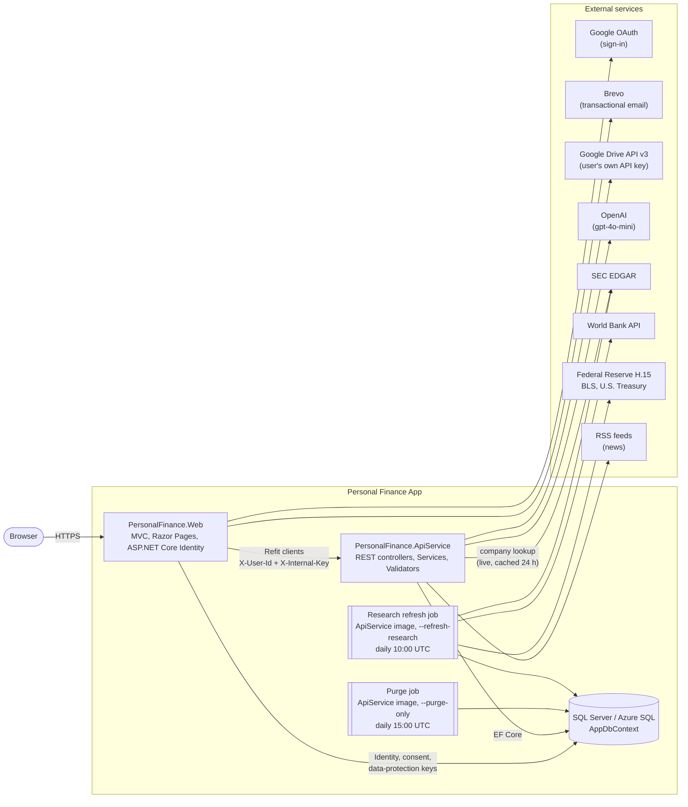

Drawn from `Web/Infrastructure/InternalApiClientExtensions.cs`, `ApiService/Program.cs`, `infra/main.bicep` and the
Feature `Adapters/` folders.

## 2. Anatomy of a Feature

**Feedback** is the Feature to mirror ([`ARCHITECTURE.md`](ARCHITECTURE.md), "Adding a feature"). Its chain is the
canonical one from [ADR 0007](adr/0007-feature-folders-with-interface-only-dependencies.md): ApiService controller,
Validator, Service interface, `internal sealed` Service, `AppDbContext`, Entity; and on the Web side a thin MVC
controller that only knows the Refit Contract. Only the interface, the controller and the DTOs are `public`.

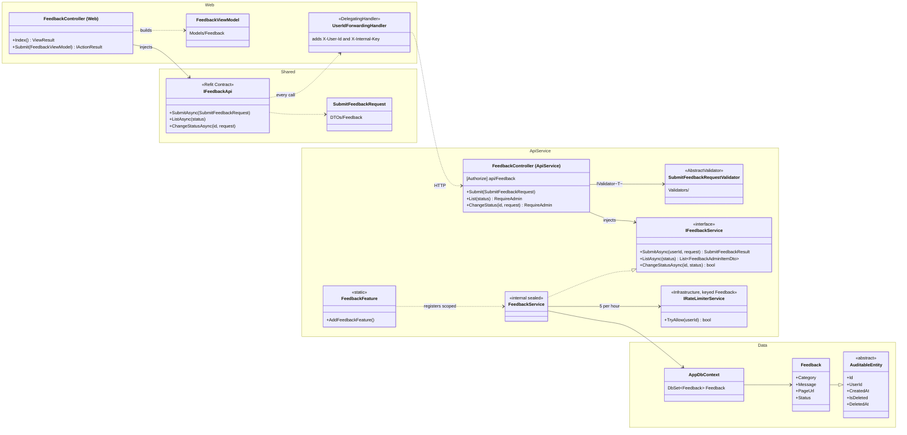

Drawn from `ApiService/Features/Feedback/`, `Web/Controllers/FeedbackController.cs`, `Shared/Contracts/IFeedbackApi.cs`
and `Data/Entities/Feedback.cs`. Two things make Feedback slightly more than minimal: the keyed rate limiter from
Infrastructure and a join on the Identity `Users` table for the admin inbox.

## 3. Feature map

One row per ApiService Feature, plus the Infrastructure-owned Notifications. ApiService routes are relative to the
ApiService root; a Web controller marked "JSON only" has no view and is called by the page's JavaScript at `/api/...`.
JavaScript paths are under `Web/wwwroot/js/`.

| Feature | ApiService controllers (route) | Service interfaces | Entities it owns (reads) | Refit Contract | Web controller | JavaScript | How it differs from section 2 |
|---|---|---|---|---|---|---|---|
| AccountLifecycle | `AccountDeletionController` (`api/account-deletion`), `DataExportController` (`api/data-export`) | `IAccountDeletionService`, `IAccountPurgeService`, `IDataExportService` | `DeletionRequest` (every user-owned Entity on purge and export) | `IAccountDeletionApi`, `IDataExportApi` | none: Identity Razor Pages under `Areas/Identity/Pages/Account/` | none | `AccountPurgeJob` runs the image with `--purge-only`; see [7](#7-account-lifecycle) |
| Admin | `AdminController` (`api/Admin`, RequireAdmin) | `IAdminService` | none (Identity tables) | `IAdminApi` | `Admin` (also injects `IFeedbackApi`) | none | `UserManager`/`RoleManager`, `AdminRoleLock`; no Validators |
| AiAssistant | `AiAssistantController` (`api/AiAssistant`) | `IAiAssistantService`, `IAiQuotaService`, `IAiScopeFilter` | `AiUsageRecord` (reads `NetWorthParameters`, `SavingsGoal`, `UserBudgetAllocation`, `UserPreference`) | `IAiAssistantApi` | `AiAssistant` (JSON only) | `core/ai-chat-widget.js`, `news/news-summary.js` | OpenAI through `IChatClient`; see [12](#12-ai-assistant) |
| Analysis | `SpreadsheetAnalysisController` (`api/SpreadsheetAnalysis`) | `ISpreadsheetAnalysisService`, `IGoogleSheetRemovalService` | `SpreadsheetBudgetSnapshot`, `SpreadsheetTransactionRecord` | `ISpreadsheetAnalysisApi` | `Analysis` (also injects `IBudgetTrackerApi`) | `analysis/` | Depends on GoogleDrive's `ISpreadsheetReader`; see [13](#13-google-drive-and-spreadsheet-analysis) |
| BudgetPlanner | `BudgetController` (`api/Budget`) | `IBudgetService` | `UserBudgetAllocation` | `IBudgetPlannerApi` | `Budget` | `budget/` | Raises Notifications; reads `IBudgetDataProvider` |
| BudgetTracker | `BudgetTrackerController` (`api/budget-tracker`) | `IMonthlyBudgetService`, `IBudgetTrackerRemovalService` | `BudgetCategory`, `BudgetTransaction`, `MonthlyBudgetPlan`, `MonthlyBudgetLine` | `IBudgetTrackerApi` | `BudgetTracker` | `budget-tracker/`, `core/data-source-toggle.js` | Six Validators; the controller also injects `IBudgetDataSourceService` |
| Community | `CommunityController` (`api/Community`) | `ICommunityService` | `CommunityStory`, `CommunityStoryLike`, `CommunityComment`, `CommunityCommentLike`, `CommunityPoll`, `CommunityPollOption`, `CommunityPollVote` | `ICommunityApi` | `Community` | `community.js` | No Validators: the Service throws `ArgumentException`, the controller returns 400 |
| Dashboard | `DashboardController` (`api/Dashboard`) | `IDashboardService` | none (reads `NetWorthParameters`, `SavingsGoal`, `UserBudgetAllocation`, `GoogleDriveConnection`) | `IDashboardApi` | `Dashboard` | `dashboard/` | Read-only aggregator over four Features plus `IBudgetDataProvider` |
| Feedback | `FeedbackController` (`api/Feedback`) | `IFeedbackService` | `Feedback` | `IFeedbackApi` | `Feedback`; inbox in `Admin` | none | The canonical example ([2](#2-anatomy-of-a-feature)) |
| GoogleDrive | `GoogleDriveController` (`api/GoogleDrive`) | `IDriveConnectionService`, `ISpreadsheetReader`, `IGoogleDriveFileSource` (internal) | `GoogleDriveConnection`, `GoogleDriveCachedFile` | `IGoogleDriveApi` | `GoogleDrive` | `google-drive/` | Typed `HttpClient`s to Google Drive; a 1,450-line static parser; see [13](#13-google-drive-and-spreadsheet-analysis) |
| NetWorth | `NetWorthController` (`api/NetWorth`) | `INetWorthParametersService` | `NetWorthParameters` | `INetWorthApi` | `Networth` | `networth/` | `calculate` is pure: a static Validator and the static `NetWorthProjectionService`, no Service, no database |
| Research | `ResearchController` (`api/Research`), `CompaniesController` (`api/Research/companies`) | `IResearchService`, `ICompanyProfileService`, nine `IResearchDatasetRefresher`, `ResearchSnapshotStore` | `ResearchSnapshot` (not user-owned) | `IResearchApi` | `Research` | `research/` (12 files) | The largest Feature: five external adapters, `Domain/` with 56 pure types, a refresh job; see [10](#10-research-pipeline) |
| SavingsGoals | `SavingsGoalsController` (`api/SavingsGoals`, Contributions under `{goalId}/contributions`) | `ISavingsGoalService` | `SavingsGoal`, `Contribution` | `ISavingsGoalsApi` | `SavingsGoals` | `savingsgoals/` | Validators for a new goal, a Contribution and a balance correction; the saved amount is the Contribution total, cached on the goal in the same save; raises each milestone Notification once |
| Search | `SearchController` (`api/Search`) | `ISearchService` | none (reads `BudgetTransaction`, `BudgetCategory`, `SpreadsheetTransactionRecord`, `SavingsGoal`) | `ISearchApi` | `Search` (JSON only) | `core/search.js` | Read-only; picks the source through `IBudgetDataSourceService` |
| Watchlist | `WatchlistController` (`api/Watchlist`), `NewsController` (`api/News`) | `IWatchlistService`, `INewsService`, `INewsFeedClient` (internal) | `SavedArticle` | `IWatchlistApi`, `INewsApi` | `Watchlist` (JSON only), `News` | `news/` | RSS adapter with `IMemoryCache` (5 minutes); `NewsService` has no database |
| Notifications (Infrastructure) | `NotificationController` (`api/Notification`) | `INotificationService` | `Notification` | `INotificationApi` | `Notification` (JSON only) | `core/notifications.js` | Shared by three Features; see [9](#9-notifications) |

Web controllers with no ApiService Feature: `Home` (landing page, `landing/skyline.js`), `InvestmentCalculator`
(client-side only, `investment-calculator/`) and `Legal`. Every Feature registers itself in
`ApiService/Features/<Feature>/<Feature>Feature.cs`, called in order from `ApiService/Program.cs`; every Refit Contract
is registered in `Web/Infrastructure/InternalApiClientExtensions.cs`.

## 4. Data model

Drawn from `Data/Entities/` and `AppDbContext.OnModelCreating` (all configuration is fluent, no attributes, no
`IEntityTypeConfiguration` classes, tables keep their `DbSet` names). The Identity tables are in
[`IDENTITY_SCHEMA.md`](IDENTITY_SCHEMA.md).

Reading key:

- **`AuditableEntity`** (abstract) gives every user-owned Entity `int Id`, `string UserId` (max 450), `CreatedAt`,
  `UpdatedAt?`, `IsDeleted`, `DeletedAt?` and `SoftDelete()`. The diagrams list only the Entity's own columns.
- **`UserId` is a logical link, not a foreign key.** No Entity has a database FK to `AspNetUsers`. After a Purge, kept
  rows carry `UserId = "deleted-account"` (`Shared/Constants/DeletedAccount.cs`).
- **Soft delete.** A global query filter `!IsDeleted` hides deleted rows of every `AuditableEntity` except
  `AiUsageRecord`, which is never soft-deleted. `CommunityPoll`, `CommunityPollOption`, `GoogleDriveCachedFile`,
  `ResearchSnapshot` and `DeletionRequest` are not auditable and are hard-deleted (or kept) as noted.
- Relationship labels give the FK column and the configured delete behaviour. Money columns are `decimal`; the
  precision is in the comment.

### 4.1 Budget Tracker, planner and net worth

```mermaid
erDiagram
    BudgetCategory {
        int Id PK
        string UserId "unique with Kind and Name, live rows only"
        string Name
        int Kind "BudgetCategoryKind: Expense=1, Income=2"
        int SortOrder
    }
    BudgetTransaction {
        int Id PK
        string UserId "indexed with Date"
        int CategoryId FK
        DateOnly Date
        decimal Amount "18,2"
        string Description
    }
    MonthlyBudgetPlan {
        int Id PK
        string UserId "unique with Year and Month, live rows only"
        int Year
        int Month
    }
    MonthlyBudgetLine {
        int Id PK
        string UserId
        int PlanId FK "unique with CategoryId, live rows only"
        int CategoryId FK
        decimal PlannedAmount "18,2"
        decimal ActualOverride "18,2, nullable"
    }
    UserBudgetSourcePreference {
        int Id PK
        string UserId UK "live rows only"
        int Source "BudgetDataSource: GoogleSheet=1, BudgetTracker=2"
    }
    UserBudgetAllocation {
        int Id PK
        string UserId "unique with Period"
        string Period "yyyy-MM"
        decimal MonthlyIncome "18,2"
        decimal HousingAmount "18,2, plus 9 more category amounts"
        DateTime UpdatedAtUtc
    }
    SavingsGoal {
        int Id PK
        string UserId
        string Name
        decimal TargetAmount "18,2"
        decimal CurrentAmount "18,2, cached total of its Contributions"
        string Description "nullable"
        DateTime TargetDate "nullable"
        bool IsCompleted "derived: CurrentAmount at or over TargetAmount"
        int HighestMilestoneNotified "0, 50, 75 or 100, never falls"
    }
    Contribution {
        int Id PK
        string UserId "indexed with SavingsGoalId and Date"
        int SavingsGoalId FK
        decimal Amount "18,2, signed, never zero"
        DateOnly Date
        string Note "nullable, max 200"
        int Kind "ContributionKind: Regular=0, Opening=1, Adjustment=2"
    }
    NetWorthParameters {
        int Id PK
        string UserId UK
        decimal StartingBalance "18,4"
        decimal AnnualSavings "18,4"
        decimal AnnualIncome "18,4"
        decimal AnnualSpending "18,4"
        int CurrentAge
        int RetirementAge
        decimal BaseRoi "18,4, plus ConservativeRoi, AggressiveRoi, AggressiveSavings"
        DateTime UpdatedAtUtc
    }

    BudgetCategory ||--o{ BudgetTransaction : "CategoryId, Restrict"
    BudgetCategory ||--o{ MonthlyBudgetLine : "CategoryId, Restrict"
    MonthlyBudgetPlan ||--o{ MonthlyBudgetLine : "PlanId, Cascade"
    SavingsGoal ||--o{ Contribution : "SavingsGoalId, Restrict"
```

`UserBudgetAllocation` and `NetWorthParameters` have no relationships; they are drawn here, with `SavingsGoal`, because
the Dashboard and the AI Assistant read them together with the budget data. Deleting a goal soft-deletes its
Contributions with it.

### 4.2 Google Drive and spreadsheet data

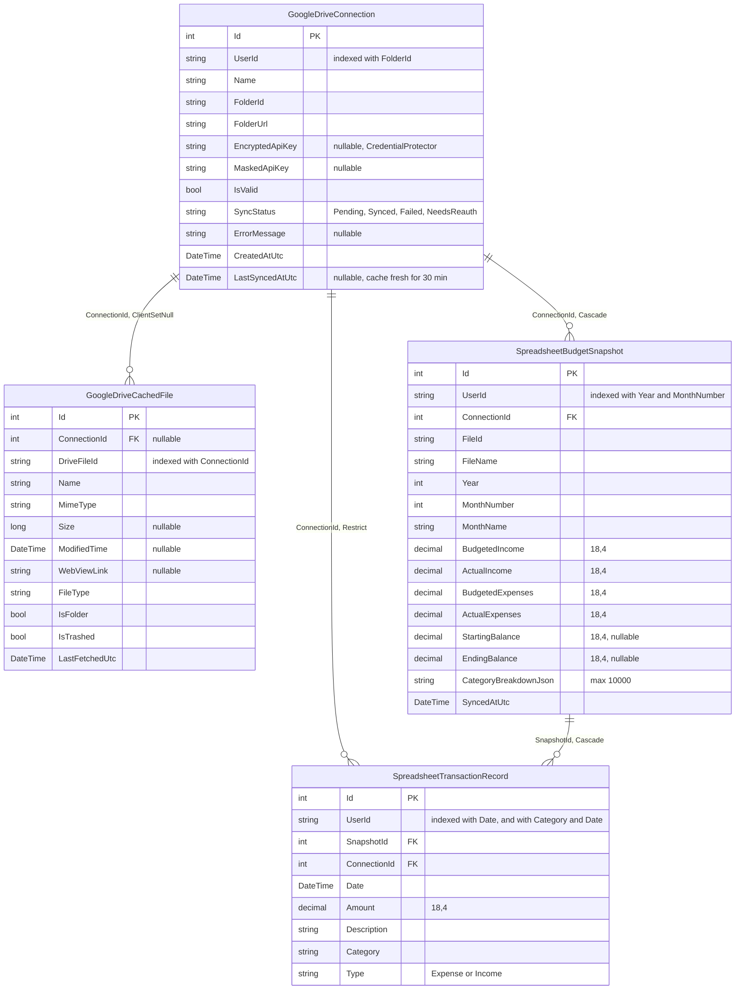

Known quirk: `GoogleDriveConnection.BudgetSnapshots` and `.TransactionRecords` are navigation collections that
`OnModelCreating` never ties to the `ConnectionId` relationships above, so EF Core also created a second, optional
shadow FK column `GoogleDriveConnectionId` on both spreadsheet tables (visible in
`AzureSqlAppDbContextModelSnapshot.cs`). The code never sets it.

### 4.3 Community

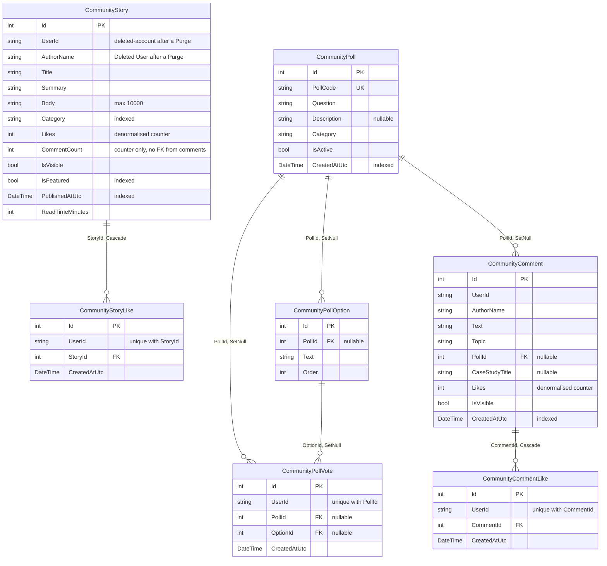

`CommunityPoll` and `CommunityPollOption` are seeded reference data (`SeedCommunityDataAsync`): no `UserId`, no soft
delete, untouched by the Purge. Stories and comments survive the Purge anonymised ([ADR
0005](adr/0005-account-purge-hard-deletes-after-grace-period.md)).

### 4.4 Account, consent and cross-cutting records

```mermaid
erDiagram
    AspNetUsers {
        string Id PK "IdentityUser, see IDENTITY_SCHEMA.md"
        string Email
        DateTimeOffset LockoutEnd "MaxValue while a Deletion Request is Pending"
        string SecurityStamp "rotated on request and cancel"
    }
    DeletionRequest {
        int Id PK
        string UserId "indexed; deleted-account after the Purge"
        DateTime RequestedAt
        DateTime PurgeAfter "RequestedAt + 30 days, indexed with Status"
        int Status "Pending=1, Cancelled=2, Purged=3; concurrency token"
        string CancelTokenHash UK "SHA-256; the raw token is never stored"
        DateTime CancelledAt "nullable"
        DateTime PurgedAt "nullable"
    }
    UserPreference {
        int Id PK
        string UserId UK "among non-deleted rows"
        string Language "en or vi; the culture cookie mirrors it"
    }
    UserConsent {
        int Id PK
        string UserId "indexed"
        string PolicyVersion "AppVersion at registration"
        bool AcceptedTerms
        bool AcceptedPrivacy
        string IpAddress "nullable"
    }
    Feedback {
        int Id PK
        string UserId "indexed"
        int Category "Bug=1, Idea=2, Other=3"
        string Message
        string PageUrl "nullable"
        int Status "New=1, Reviewed=2, Archived=3; indexed with CreatedAt"
    }
    Notification {
        int Id PK
        string UserId "indexed, and with IsRead"
        int Type "BudgetAlert=0, SavingsMilestone=1, SyncStatus=2"
        string Title "English snapshot"
        string Message "English snapshot"
        string TitleKey "nullable; rendered in the reader's language"
        string MessageKey "nullable"
        string Arguments "nullable JSON of named arguments"
        bool IsRead
        DateTime ReadAt "nullable"
        string SourceFeature "nullable: Budget, SavingsGoals, GoogleDrive"
    }
    AiUsageRecord {
        int Id PK
        string UserId "indexed; CreatedAt indexed; never soft-deleted"
        string Endpoint "chat or summarize"
        int PromptTokens
        int CompletionTokens
        int CachedPromptTokens
        decimal EstimatedCostUsd "18,6"
    }
    SavedArticle {
        int Id PK
        string UserId "unique with Url"
        string Title
        string Url
        string Source
        string Category
        string Notes "nullable"
        string ImageUrl "nullable"
        DateTime SavedAtUtc
    }
    ResearchSnapshot {
        int Id PK
        string Dataset UK "sectors, etfs, fund-overlap, macro, world, ..."
        string FirstPeriod
        string LastPeriod
        string Payload "JSON of the Shared snapshot DTO"
        DateOnly SourceAsOf
        DateTime BuiltAt
    }

    AspNetUsers ||..o| DeletionRequest : "UserId, logical"
    AspNetUsers ||..o| UserPreference : "UserId, logical"
    AspNetUsers ||..o{ UserConsent : "UserId, logical"
    AspNetUsers ||..o{ Feedback : "UserId, logical"
    AspNetUsers ||..o{ Notification : "UserId, logical"
    AspNetUsers ||..o{ AiUsageRecord : "UserId, logical"
    AspNetUsers ||..o{ SavedArticle : "UserId, logical"
```

`ResearchSnapshot` belongs to no Account: one row per dataset, replaced wholesale by the refresh job
([10](#10-research-pipeline)). `DeletionRequest` is the only row that outlives its Account.

## 5. Request flow, end to end

The short version is in [`ARCHITECTURE.md`](ARCHITECTURE.md). This one adds the two handlers that carry identity and
the two ways a failure reaches the browser.

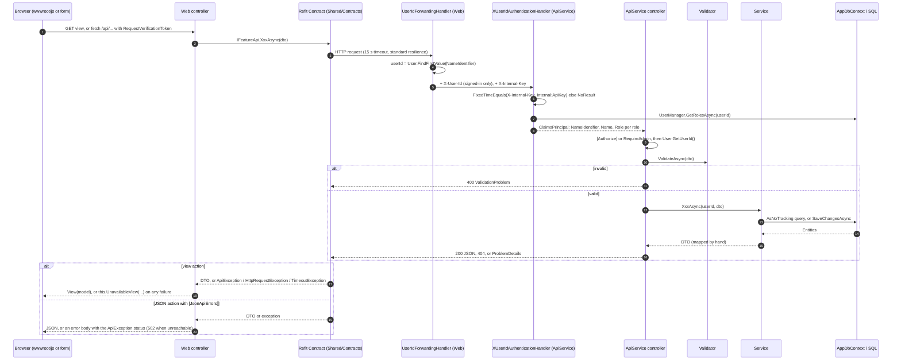

Drawn from `Web/Infrastructure/UserIdForwardingHandler.cs`, `ApiService/Infrastructure/XUserIdAuthenticationHandler.cs`,
`Web/Infrastructure/JsonApiErrorsAttribute.cs` and `Web/Infrastructure/UnavailableStateExtensions.cs`. The failure
branches are detailed in [11](#11-unavailable-state-and-keeping-the-apiservice-awake).

## 6. Identity and RBAC

Both apps share the Identity tables in `AppDbContext`, but build their principal differently: the Web from the cookie,
the ApiService from the forwarded header on every request ([ADR
0004](adr/0004-rbac-roles-from-database-and-policy-checks.md)). There is one Policy, `RequireAdmin`, and two Roles,
`Admin` and `User` (`Shared/Constants/AppPolicies.cs`, `AppRoles.cs`).

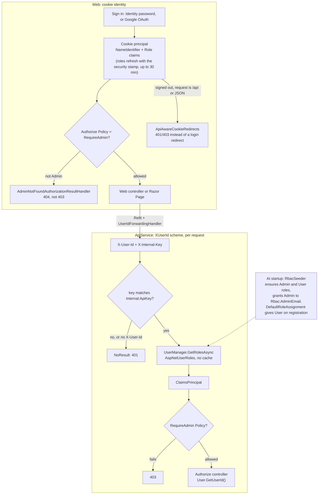

Drawn from `Web/Program.cs`, `Web/Infrastructure/AdminNotFoundAuthorizationResultHandler.cs`,
`Web/Infrastructure/ApiAwareCookieRedirects.cs`, `ApiService/Infrastructure/XUserIdAuthenticationHandler.cs`,
`Data/RbacSeeder.cs` and `Data/DefaultRoleAssignment.cs`. Rules for new code are in `ARCHITECTURE.md`, "Identity".

## 7. Account lifecycle

[ADR 0005](adr/0005-account-purge-hard-deletes-after-grace-period.md). Owned by `ApiService/Features/AccountLifecycle/`
and the Identity Razor Pages `Manage/DeletePersonalData`, `DeletionRequested`, `CancelDeletion` and `Lockout`.

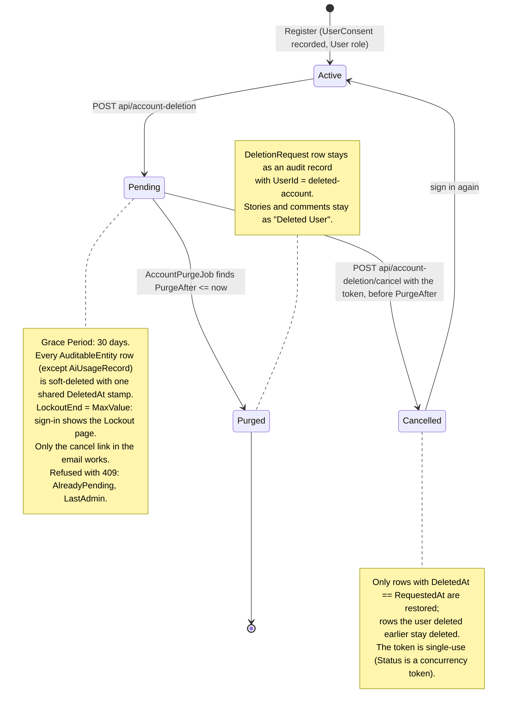

What happens on each side of the Grace Period:

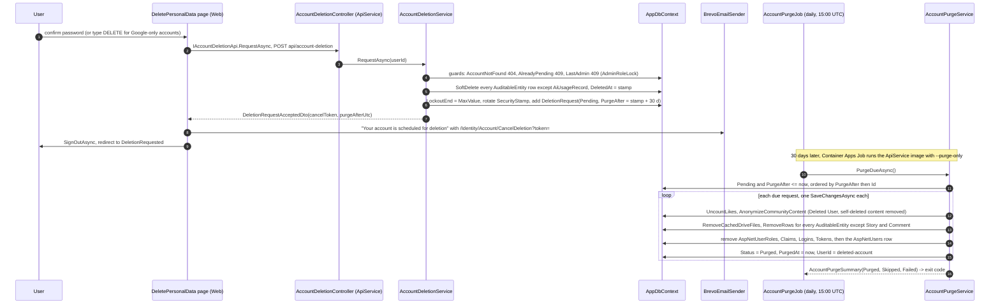

Drawn from `AccountDeletionService.cs`, `AccountPurgeService.cs`, `AccountPurgeJob.cs`,
`Web/Areas/Identity/Pages/Account/Manage/DeletePersonalData.cshtml.cs` and `infra/modules/purge-job.bicep`. No email is
sent on cancel or on purge. `DataExportController` (`GET api/data-export`) is the third member of the lifecycle and
returns the Account's live rows as one JSON file.

## 8. Budget data source

[ADR 0002](adr/0002-budget-tracker-separate-from-spreadsheet-data.md): budget figures come from either an imported
Google Sheet or the built-in Budget Tracker, and every reader goes through one Infrastructure seam so it never knows
which. All classes are in `ApiService/Infrastructure/`.

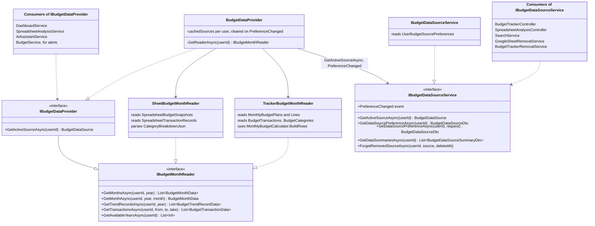

How the active source is chosen on each read:

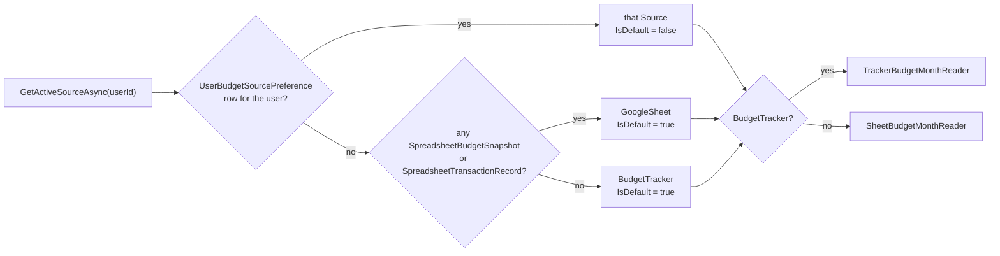

Drawn from `IBudgetMonthReader.cs`, `BudgetDataProvider.cs`, `BudgetDataSourceService.cs` and
`InfrastructureServiceExtensions.cs`. The provider never falls back to the other source. Removing a source
(`GoogleSheetRemovalService`, `BudgetTrackerRemovalService`) soft-deletes its rows and calls `ForgetRemovedSourceAsync`.

## 9. Notifications

Notifications are Infrastructure because three Features raise them. The browser never polls: the bell loads the unread
count once per page and the list on click.

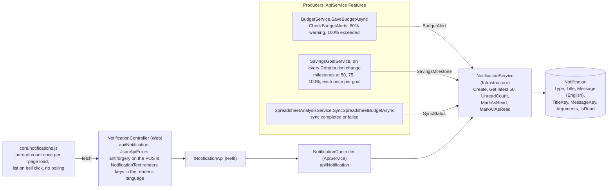

Drawn from `ApiService/Infrastructure/INotificationService.cs`, `NotificationController.cs` (both apps) and
`Web/wwwroot/js/core/notifications.js`. The Web exposes no create endpoint; producers write through the Service, each
with a `TitleKey`, `MessageKey` and named `Arguments` beside the English text ([16](#16-localization)).

## 10. Research pipeline

The Research dashboard never calls a data source from a request. A daily job rebuilds one `ResearchSnapshot` row per
dataset from official public sources ([ADR 0012](adr/0012-research-data-from-official-public-sources.md)); the pages
read those rows. Security identifiers are used in memory during a refresh and never stored ([ADR
0010](adr/0010-research-never-stores-security-identifiers.md)).

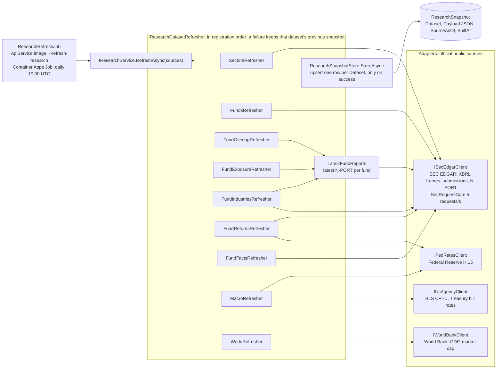

The read path. Each tab fails on its own, and `IResearchApi` is the one Refit client registered without retries on 503,
because a 503 here means "never loaded", not "try again".

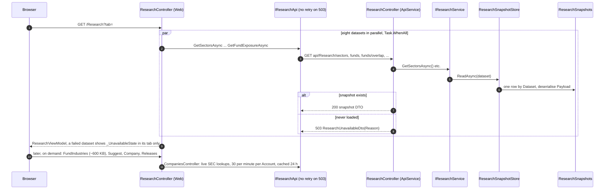

Drawn from `ApiService/Features/Research/ResearchFeature.cs`, `ResearchService.cs`, `ResearchSnapshotStore.cs`,
`ResearchRefreshJob.cs`, `Adapters/`, `Web/Controllers/ResearchController.cs` and
`infra/modules/research-refresh-job.bicep`. The Companies tab is the exception that calls SEC EDGAR at request time,
through `CompanyProfileService` with in-memory caches (`CompanyTickerIndexCache`, `KeptWhileUnreachableCache`).

## 11. Unavailable State and keeping the ApiService awake

The Unavailable State is a view pattern, not middleware: a controller catches any failure from its Refit call and
renders `Views/Shared/Unavailable.cshtml` (or the `_UnavailableState` partial inside a page) with a plain Retry link.
JSON actions get the same treatment from an exception filter. [ADR
0011](adr/0011-warm-window-instead-of-always-on-replicas.md) explains why the ApiService is sometimes asleep.

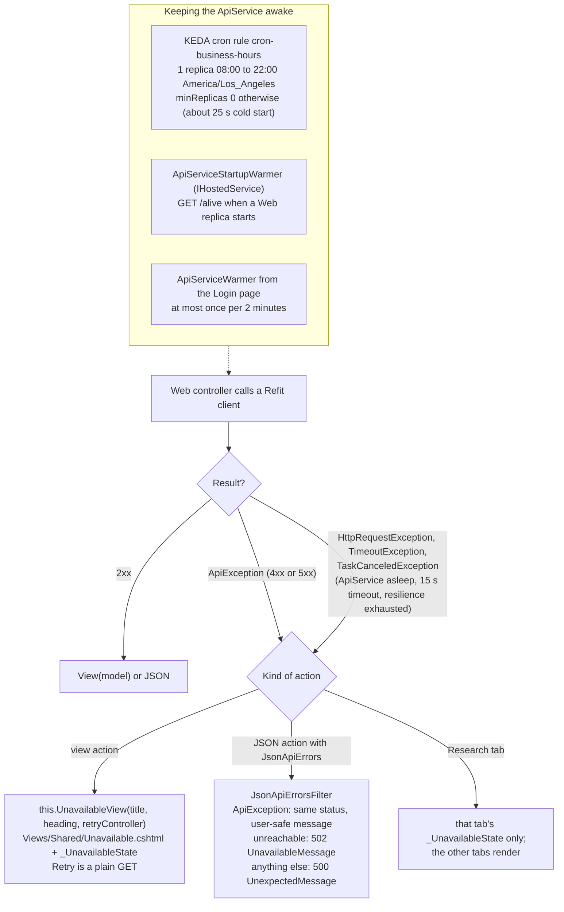

Drawn from `Web/Infrastructure/UnavailableStateExtensions.cs`, `JsonApiErrorsAttribute.cs`, `ApiErrorMessages.cs`,
`ApiServiceWarmer.cs`, `ApiServiceStartupWarmer.cs` and `infra/modules/api-service.bicep`. Controllers that use the
pattern: Budget, Community, Networth, SavingsGoals, Admin (inbox), Dashboard (its own `Unavailable` view) and Research.

## 12. AI Assistant

The chat widget on every page. The ApiService guards the OpenAI call three times before it is made: scope, quota and
message size. Without an `OpenAI:ApiKey` no `IChatClient` is registered and the Service returns a fixed "unavailable"
reply. Setup is in [`AI_ASSISTANT_SETUP.md`](AI_ASSISTANT_SETUP.md).

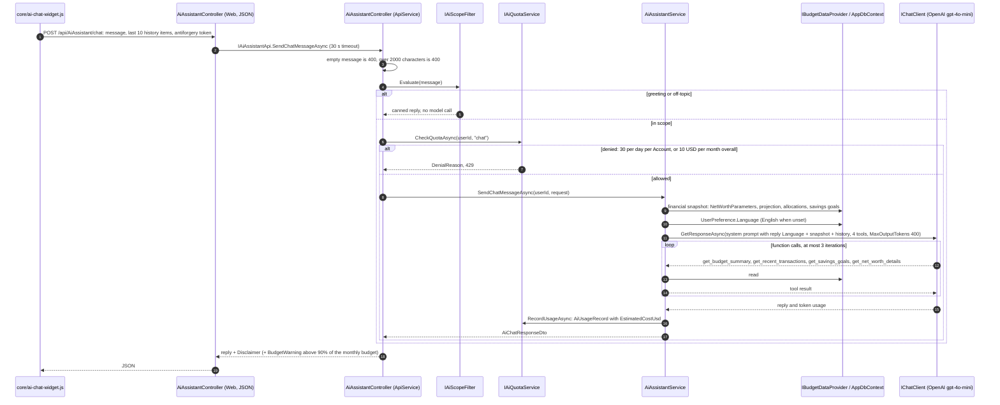

Drawn from `ApiService/Features/AiAssistant/` and `Adapters/OpenAiChatClientRegistration.cs` (official OpenAI .NET
SDK wrapped by `Microsoft.Extensions.AI`). The `summarize` endpoint (news page) follows the same path with one more
guard: the unkeyed `IRateLimiterService`, 10 calls per minute per Account.

## 13. Google Drive and Spreadsheet Analysis

The one place where a Feature depends on another: Analysis imports spreadsheets through GoogleDrive's public
`ISpreadsheetReader`, interface only, as [ADR 0007](adr/0007-feature-folders-with-interface-only-dependencies.md)
requires. There is no OAuth: a connection stores the user's own Google API key, encrypted by
`Data/Helpers/CredentialProtector.cs`.

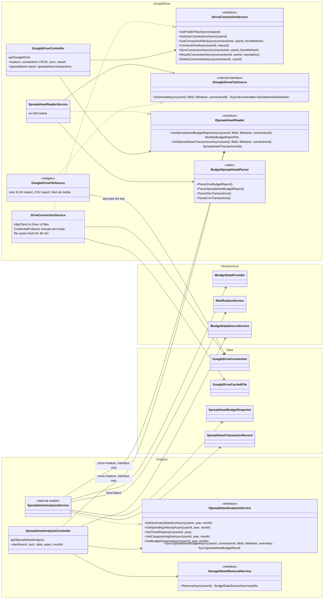

Connecting a folder, then importing a sheet into budget snapshots. Imports are always user-triggered; nothing syncs on a
schedule.

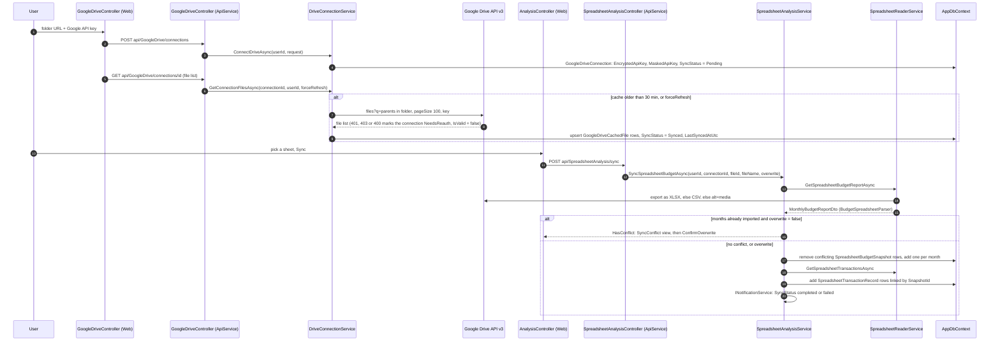

Drawn from `ApiService/Features/GoogleDrive/DriveConnectionService.cs`, `Adapters/GoogleDriveFileSource.cs`,
`SpreadsheetReaderService.cs`, `ApiService/Features/Analysis/SpreadsheetAnalysisService.cs` and the two Web controllers.
Removing the imported data (`IGoogleSheetRemovalService`) soft-deletes the snapshots and records but keeps the
connection.

## 14. Startup and pipelines

`Program.cs` in each app is a short list; the detail is in extension methods. The ApiService image is also the Purge
and Research jobs, chosen by a command-line flag.

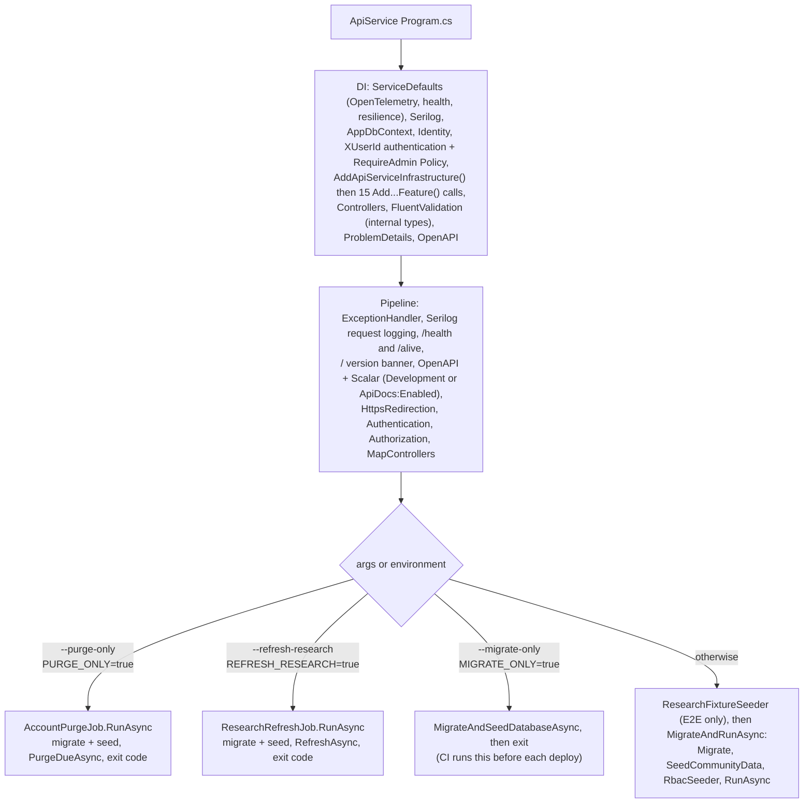

```mermaid
flowchart LR
    a["Serilog request logging"] --> b["/health, /alive"] --> c["ExceptionHandler + HSTS<br/>(outside Development)"] --> d["ForwardedHeaders"] --> e["HttpsRedirection"] --> f["RequestLocalization<br/>cookie, Accept-Language, en<br/>(formatting en-US or vi-VN)"] --> g["Routing"] --> h["Authentication<br/>Identity cookie, Google"] --> i["Authorization<br/>AdminNotFound handler"] --> j["Static assets"] --> k["MVC default route<br/>+ Razor Pages"] --> l["MigrateAndRunAsync"]
```

Drawn from `ApiService/Program.cs`, `Web/Program.cs`, `Data/DatabaseMigrationExtensions.cs` and
`ServiceDefaults/Extensions.cs`. Web DI, in order: ServiceDefaults and Serilog, `AppDbContext` and data protection,
Identity (cookie 14 days sliding, `ApiAwareCookieRedirects`, optional Google), the `RequireAdmin` Policy and the
404 handler, `AddInternalApiClients`, Brevo email, `IUserConsentService`, `TimeProvider`, forwarded headers,
`AddAppLocalization` ([16](#16-localization)), Razor Pages and MVC with a global antiforgery filter, view and
DataAnnotations localization.

## 15. Scheduled and background work

There are no `BackgroundService`s, timers or job libraries in either app. Everything that runs without a request is
listed here.

| What | Where | When | Purpose |
|---|---|---|---|
| Account Purge | Container Apps Job `infra/modules/purge-job.bicep`, ApiService image with `--purge-only` (`AccountPurgeJob`) | daily, cron `0 15 * * *` UTC, 900 s timeout | Hard-delete Accounts whose Grace Period ended ([7](#7-account-lifecycle)) |
| Research refresh | Container Apps Job `infra/modules/research-refresh-job.bicep`, ApiService image with `--refresh-research` (`ResearchRefreshJob`) | daily, cron `0 10 * * *` UTC, 1800 s timeout | Rebuild every `ResearchSnapshot` from official sources ([10](#10-research-pipeline)) |
| Migrations | ApiService image with `--migrate-only` (`Data/DatabaseMigrationExtensions.cs`) | each deploy, from `.github/workflows/deploy-azure.yml` | Apply EF Core migrations and seed, then exit |
| Warm window | KEDA cron rule `cron-business-hours` in `api-service.bicep` and `web-service.bicep` | 08:00 to 22:00 America/Los_Angeles, production only | Keep one replica of each app warm ([ADR 0011](adr/0011-warm-window-instead-of-always-on-replicas.md)) |
| `ApiServiceStartupWarmer` | `Web/Infrastructure/ApiServiceStartupWarmer.cs`, the only `IHostedService` | once per Web replica start | `GET /alive` on the ApiService so both wake together |
| `ApiServiceWarmer` | `Web/Infrastructure/ApiServiceWarmer.cs`, called from the Login page | at most once per 2 minutes | Same ping, before the first authenticated request |
| News auto-refresh | `Web/wwwroot/js/news/news.js` | every 5 minutes while the News page is open | Re-fetch `/News/Refresh`; the ApiService caches feeds for 5 minutes in `IMemoryCache` |
| SEC request gate | `ApiService/Features/Research/Adapters/SecRequestGate.cs` | during a refresh or company lookup | Throttle SEC EDGAR calls to 5 per second |

## 16. Localization

The Web app speaks English and Vietnamese ([ADR 0015](adr/0015-json-localization-with-custom-string-localizer.md),
[spec](specs/localization-and-multi-currency.md)). One flat JSON file per language holds every string; one in-house
localizer serves Razor, DataAnnotations, model binding, Identity errors and the JS island. The formatting culture
follows the Language (`en` → `en-US`, `vi` → `vi-VN`) for separators, dates and typed amounts; the currency symbol
always comes from the amount's currency (ADR 0016). ApiService is not localized and formats in `en-US`.

```mermaid
flowchart TB
    req["Request"] --> rl{"RequestLocalization<br/>(no query-string provider)"}
    rl -- "1. .AspNetCore.Culture cookie" --> ui["LanguageCultureProvider<br/>CurrentUICulture en or vi<br/>CurrentCulture en-US or vi-VN"]
    rl -- "2. Accept-Language" --> ui
    rl -- "3. otherwise" --> ui
    ui --> loc["IStringLocalizer (JsonStringLocalizer)<br/>uiCulture, parent, then en<br/>3401 LocalizationFallback, 3402 LocalizationNotFound"]
    cat["JsonLocalizationCatalog (singleton)<br/>Resources/i18n/en.json, vi.json<br/>loaded once at startup"] --> loc
    loc --> razor["Razor: @L[key], L.Named, L.NamedHtml, L.Plural<br/>(_ViewImports injects L)"]
    loc --> da["DataAnnotations ErrorMessage and Display(Name) keys<br/>ModelBindingMessagesSetup (11 messages)"]
    loc --> idn["LocalizedIdentityErrorDescriber<br/>Identity.Error.Code"]
    loc --> js["js-strings tag helper<br/>script data-i18n-strings JSON islands:<br/>the layout's Shell.Js. and the page's own"] --> pfi["core/i18n.js<br/>merges the islands; PFI18n.t, PFI18n.plural, html lang"]
    sw["_LanguageSwitcher<br/>top bar (anonymous) and account menu"] -- "POST /Language/Set + antiforgery" --> lc["LanguageController<br/>stores the choice when signed in,<br/>LanguageCookie.Write, LocalRedirect"]
    lc -. "cookie c=vi-VN, uic=vi" .-> rl
```

Money, numbers and typed amounts, on the server and in the browser:

```mermaid
flowchart LR
    cur["SupportedCurrencies<br/>(Shared/Constants)<br/>code, minor units, symbol"] --> mf["MoneyFormatter<br/>(Shared/Helpers)<br/>Format, FormatWhole, FormatAmount"]
    cul["CurrentCulture<br/>separators, symbol position"] --> mf
    mf --> views["Razor views, Web services,<br/>ApiService text"]
    ban["CurrencyFormatBanTests<br/>no 'C' format elsewhere"] -.-> views
    cul --> html["html data-culture"] --> pfi2["core/i18n.js<br/>PFI18n.formatMoney, formatNumber,<br/>formatDate, parseNumber"]
    pfi2 --> charts["page modules,<br/>Chart.js and D3 axes and tooltips"]
    pfi2 --> input["input data-money-input<br/>as-you-type grouping"]
    input -- "form post 1.234,56" --> bind["CultureDecimalModelBinder<br/>CultureDecimalParser (strict grouping)"]
    bind -- "1234.56, or a ModelState error" --> ctrl["Web controller"]
```

The Account's Language is stored, and the cookie only mirrors it:

```mermaid
flowchart LR
    reg["Register, ExternalLogin<br/>(new Account)"] -- "seed: request's Language" --> ups["IUserPreferenceService<br/>(Web/Services, AppDbContext)"]
    lc["LanguageController<br/>(signed in)"] -- "set" --> ups
    page["Account settings › Language<br/>Manage/Language"] -- "set + cookie" --> ups
    ups --> row[("UserPreference<br/>Language")]
    signin["OnSignedIn<br/>LanguageSignInEvents:<br/>password, Google, 2FA, refresh"] -- "read" --> ups
    signin -- "LanguageCookie.Write" --> cookie[".AspNetCore.Culture"]
    mail["AccountEmailService<br/>confirm, email change,<br/>reset password, deletion"] -- "read recipient's Language" --> ups
    mail -- "LanguageScope + EmailTemplateHelper" --> brevo["IEmailSender (Brevo)"]
    ies["IdentityEmailSender<br/>(IEmailSender&lt;IdentityUser&gt;)"] --> mail
```

```mermaid
flowchart LR
    en["en.json<br/>(written by hand)"] --> tr["npm run i18n:translate<br/>missing or stale keys only<br/>notranslate placeholders, glossary.vi.json"]
    lock["i18n.lock.json<br/>hash of the English per key"] <--> tr
    tr -- "textType=html, 429 back-off" --> az["Azure AI Translator F0"]
    az --> tr
    tr -- "placeholders verified" --> vi["vi.json<br/>commit: i18n: translate N keys (vi)"]
    vi --> ci["CI lint-js job: i18n-report<br/>missing, stale, unreferenced (reported)<br/>bad JSON, placeholder mismatch (fails)"]
    en --> ci
```

ApiService is still language-free, but its rejections now carry a localization key and typed arguments
([ADR 0017](adr/0017-api-errors-carry-localization-keys.md), [spec](specs/localized-api-errors.md)): a validator rule
sets `.WithErrorCode(ApiErrorKeys…)` and a service throws `ApiErrorException`, both rendered as one `ApiErrorDto`.
Web resolves each entry through the localizer and formats the arguments in the request culture; the English
`message` is only a fallback for a key missing from `en.json`. Web's own fallbacks are `Errors.*` keys.

```mermaid
flowchart LR
    src["Validator or service<br/>(ApiService Feature)"] --> raise["ApiErrorException<br/>or ValidationResult.ToApiError()<br/>key, English, field, ErrorArgs"]
    raise --> filt["ApiErrorExceptionFilter<br/>(ApiService/Infrastructure)<br/>the fitting 4xx"]
    filt -- "HTTP body" --> dto["ApiErrorDto<br/>errors: {key, message, field, args}"]
    dto --> aem["Web ApiErrorMessages<br/>FromApiException, ForUser, Fields"]
    aem --> loc["IStringLocalizer en.json, vi.json<br/>+ ApiErrorArgFormat<br/>Text, Number, Money (MoneyFormatter)"]
    loc --> out["page field errors<br/>or JSON {error}"]
```

Drawn from `Web/Infrastructure/Localization/`, `Shared/Helpers/MoneyFormatter.cs`, `Shared/Constants/SupportedCurrencies.cs`,
`Web/Services/UserPreferenceService.cs`, `AccountEmailService.cs`,
`Web/TagHelpers/JsStringsTagHelper.cs`, `Web/Controllers/LanguageController.cs`, `Web/Views/Shared/_LanguageSwitcher.cshtml`, `Web/wwwroot/js/core/i18n.js`,
`Web/tools/i18n-translate.js`, `Web/tools/i18n-report.js`, `ApiService/Infrastructure/ApiErrorException*.cs`,
`ErrorArgs.cs`, `ValidationResultExtensions.cs`, `Web/Infrastructure/ApiErrorMessages.cs`, `ApiErrorArgFormat.cs` and the `lint-js` job of `.github/workflows/deploy-azure.yml`.
A string that is not shaped like a key (English still on attributes of pages not yet translated) is shown as written,
without the 3402 warning.

## Keeping this page current

- Hand-edit the Mermaid; there is no generator. Render a changed block before committing: GitHub's preview, Rider's
  Markdown preview, or `npx @mermaid-js/mermaid-cli -i block.mmd -o block.svg` from a scratch folder (do not add it to
  `package.json`).
- A new Entity goes into the matching ER diagram in [4](#4-data-model) and, if user-owned, into the Purge list in
  `AccountPurgeService` automatically (it enumerates `AuditableEntity` types), so only the diagram needs you.
- A new Feature gets a row in [3](#3-feature-map). It needs its own diagram only when it deviates from
  [2](#2-anatomy-of-a-feature): external adapters, background jobs, cross-Feature dependencies.
- A new Infrastructure abstraction or scheduled job gets a diagram or a row in [15](#15-scheduled-and-background-work).
- Update the "Last verified against" version at the top when you have checked the whole page, not when you change one
  diagram.
