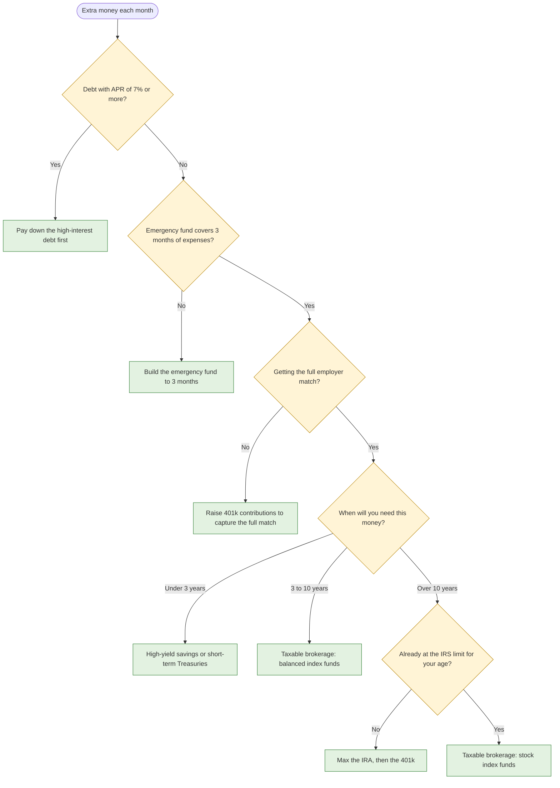

# Priority Tree, first authored draft

Prototype for [Draft the Priority Tree in Mermaid](https://github.com/tngo0508/PersonalFinance/issues/300), part of
[Map: Money Priorities decision tree](https://github.com/tngo0508/PersonalFinance/issues/297). Throwaway branch, never
merged. The production tree is a model the Mermaid text is generated from; this file is the draft it is transcribed from.

## The tree

## Inputs the walk collects

| Input | Asked when | Used by |
|---|---|---|
| Extra amount per month | always | every leaf |
| Purpose (short free text) | always | AI note only |
| Highest debt APR | always | Q1 |
| Debt balance | APR is 7% or more | L1 |
| Emergency-fund months covered | Q1 is No | Q2, L2 |
| Monthly expenses | Q2 is No | L2 |
| Getting the full match | Q2 is Yes | Q3 |
| Employer match percent | Q3 is No | L3 |
| Horizon | Q3 is Yes | Q4, L4 to L7 |
| Age range: under 50, 50 to 59 or 64+, 60 to 63 | horizon over 10 years | Q5, L6 |
| At the limit | horizon over 10 years | Q5 |

Monthly expenses at L2 is implied by "months covered" needing a target amount. The Walk entity ticket decides whether it
is asked or derived.

## Thresholds, stated on the page as assumptions

- High-interest debt: APR of 7% or more.
- Emergency fund covered: 3 months of expenses. One threshold, no split leaf for 3 to 6 months.
- Horizon splits: under 3 years, 3 to 10 years, over 10 years.
- Limits for Q5 come from the per-tax-year constants in
  [the IRS limits research](https://github.com/tngo0508/PersonalFinance/blob/research/irs-contribution-limits/docs/research/irs-contribution-limits.md).
  For 2026: 401(k) $24,500, catch-up $8,000 at 50+ or $11,250 at 60 to 63; IRA $7,500, catch-up $1,100 at 50+.

## Why horizon comes before the limit

Retirement accounts lock money until age 59½, so the contribution limit only matters when the money is not needed for
over 10 years.

## Numbers at each leaf

| Leaf | Numbers shown |
|---|---|
| L1 debt | Months to payoff and interest avoided at the APR and balance, beside the same money invested at the Base rate |
| L2 fund | Months until the fund reaches 3 months of expenses; no growth comparison |
| L3 match | Match captured per year at the employer's percent, beside the same money invested unmatched |
| L4 cash | Balance at horizon at a stated savings yield, beside the Conservative scenario |
| L5, L6, L7 invest | Balance at horizon under Base, Conservative and Aggressive |

The formulas, rounding and disclaimer wording belong to
[How are the dollar outcomes at each leaf computed?](https://github.com/tngo0508/PersonalFinance/issues/303).
